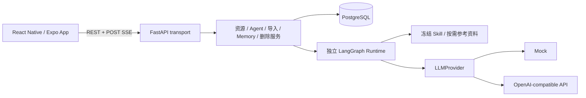

# 狗头军师 App

把关系沟通与情绪支持 Skill 转化为可独立运行的 AI Agent，并通过 React Native 手机 App 提供服务。用户可以围绕明确的对象与关系进行对话、导入聊天记录、管理自己授权的长期记忆，并查看或删除自己的数据。

架构为 **React Native / Expo / TypeScript + FastAPI / PostgreSQL + 独立 LangGraph Runtime**。Agent 可通过 Python API 与命令行运行，不依赖 Codex、Claude Code 等 Agent 宿主；模型调用、知识、Prompt、Memory 与密钥全部在服务端。

## 当前完成情况

截至 **2026-11-17**，正式工程标记为 **Phase 9 / 9H**。Phase 0–9 保留已完成的历史工程验收；后续 Phase 11 和导入聊天分析已有实现与定向测试，但**真实模型质量未通过，当前版本未完成统一全量回归，也未获公网生产准入**。

| 方向 | 当前状态 |
| --- | --- |
| 独立 Agent | 多节点 LangGraph、安全优先、事实/推测/未知分离、按需知识路由、行动建议、受控 Memory 已实现 |
| 后端与 API | FastAPI、PostgreSQL、签名 JWT、资源隔离、REST + POST SSE、操作幂等已实现 |
| 手机客户端 | 六页面、开发身份接入、真实 Agent 对话、文件导入、两类历史、Memory 与删除控制已实现 |
| 导入聊天分析 ICA | 范围授权、来源追溯、分片覆盖、Mock 报告执行及 quote-v2 证据协议已实现；产品执行默认关闭且仅允许 Mock |
| 真实模型质量 | Phase 11 与 ICA-BQ-v2 仍 FAIL / PARTIAL；工程测试不等于建议质量验收 |
| 可选 RAG | Phase 10 明确暂缓；当前确定性知识路由可独立工作 |
| 发布 | ICA 手机端报告体验、长周期容量、统一终验、CI/CD、EAS 与正式发布尚未完成 |

详细介绍：

- [项目全景介绍：定位、功能、架构、技术选择与最终目标](docs/PROJECT_OVERVIEW.md)
- [2026-11-17 完成情况核对：阶段、质量、本次验证与剩余工作](docs/PROJECT_STATUS_2026-11-17.md)
- [Master Plan：正式阶段与历史授权](docs/MASTER_PLAN.md)

本次通过后端 **309** 项定向离线测试、Mobile **413** 项测试、TypeScript 检查、**52** 个 OpenAPI 操作合同和生成客户端 **3** 项测试；独立 Mock Runtime Demo 成功。根命令 `make.cmd verify` 在历史 9H 源码指纹检查处退出 1，尚未进入后续完整回归。详见核对报告；历史 Android 验收不等于本次重新执行。

## 能做什么

- 针对回复、邀约、关系判断、投入失衡、沟通冲突、分手与长期关系等场景，执行结构化分析与建议流程。高风险优先进入安全分支；场景覆盖不代表所有场景质量均已验收。
- 创建与选择对象、关系和会话，通过服务端执行 Agent 对话，读取历史与运行进度。SSE 展示进度和完整校验后的回答，尚无逐 Token 输出或 WebSocket。
- 导入支持版本的微信 Markdown / ChatLab JSONL，明确说话人和关系绑定后入库，分页查看导入历史。导入不会自动调用模型或写入长期记忆。
- 明确授权后使用限量长期记忆，查看、暂停、恢复、撤回同意、撤销和删除；支持会话、Dataset、Person 与 Relationship 范围的受保护删除及回执。
- 用 Mock LLM 无模型密钥测试 Runtime 和后端。真实模型兼容层已实现并有 DeepSeek 合成评测记录，但当前质量不满足正式验收。

身份入口目前是开发 JWT，不能视作正式注册登录。App 尚不能让用户完成真实模型的导入聊天报告；月度、季度和年度洞察属于后续目标。

## 架构与目录



| 路径 | 职责 |
| --- | --- |
| `apps/mobile` | Expo 客户端、平台适配、开发会话、生成 API 客户端与测试 |
| `apps/server` | FastAPI transport、独立 Agent、应用服务、数据库及迁移 |
| `knowledge/goutoujunshi` | 未修改的上游 Skill 与参考资料 |
| `knowledge/upstream-manifest.json` | 上游来源、commit、许可与文件哈希 |
| `tools/api-codegen` | 从唯一 OpenAPI 合同生成 TypeScript 客户端 |
| `evals` | 合成案例、Mock/真实模型评测与人工评审材料 |
| `docs` | 合同、架构、ADR、阶段验收与证据 |
| `scripts` / `tests` | 阶段门禁、仓库核对与回归工具 |

## 本地运行

需要 Python 3.12–3.14、uv、符合锁定 Expo 要求的 Node.js、pnpm **11.25.0**。按[数据库说明](docs/DATABASE.md)准备开发库与独立测试库；`compose.yaml` 仅提供本地 PostgreSQL。

```powershell
# 仅首次创建配置；已有 .env 不要覆盖
if (-not (Test-Path .env)) { Copy-Item .env.example .env }
uv --cache-dir .cache/uv --no-managed-python sync --locked
pnpm install --frozen-lockfile
docker compose up -d postgres
uv --cache-dir .cache/uv --no-managed-python run --locked --env-file .env alembic upgrade head
.\make.cmd dev
```

另开终端启动客户端：

```powershell
pnpm --filter @goutou/mobile web
# 或在具备 Android / Expo 环境时：
pnpm --filter @goutou/mobile android
```

按[开发身份说明](docs/MOBILE_DEV_AUTH.md)生成短效开发 JWT，在 Settings 主动录入与验证。Mock 无需模型密钥；真实模型参数只配置在服务端 `.env`，不放进 `EXPO_PUBLIC_*`。

独立 Runtime 无密钥演示：

```powershell
$env:PYTHONPATH = '.;apps/server'
$env:PYTHONUTF8 = '1'
uv --cache-dir .cache/uv --no-managed-python run --locked --offline python apps/server/agent_demo.py
```

完整门禁入口是 `make verify` 或 Windows 的 `.\make.cmd verify`；当前失败与环境处理见[核对报告](docs/PROJECT_STATUS_2026-11-17.md)。真实 Provider 评测需要独立、明确且绑定具体计划的预算授权。

## 文档与许可

[系统架构](docs/ARCHITECTURE.md) · [行为合同](docs/SKILL_CONTRACT.md) · [Mobile 架构](docs/MOBILE_ARCHITECTURE.md) · [API 合同](docs/contracts/openapi.json) · [Phase 9 工程验收](docs/PHASE_9_FINAL_ACCEPTANCE.md) · [Phase 11 质量](docs/PHASE_11_QUALITY_CLOSEOUT.md) · [ICA-v2 评测](docs/ICA_BQ_V2_ACCEPTANCE.md) · [长周期规划](docs/ICA_LONGITUDINAL_ROADMAP_V4.md)

上游为 [shengjidaguai-china/goutoujunshi](https://github.com/shengjidaguai-china/goutoujunshi)，冻结 commit `6db7354a4002dc7c448a9c87ffdad8132570c9d3`。保留原 [MIT LICENSE](knowledge/goutoujunshi/LICENSE) 与 Copyright (c) 2026 powerycy。本次未修改上游快照。
