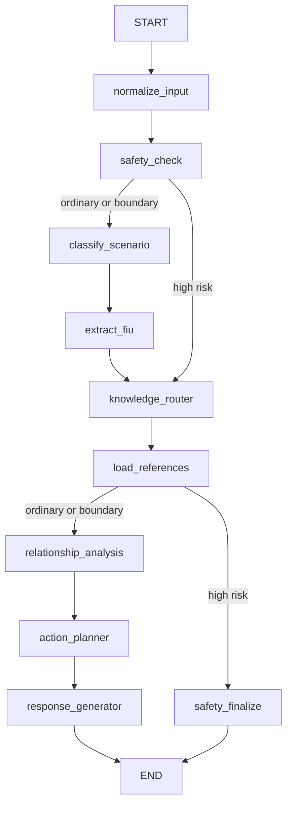

# Agent contracts and standalone runtime (Phases 3A–3F)

The source behavior is
`SKILL_CONTRACT.md` and the 81 synthetic cases in `evals/golden_cases.jsonl`.
The frozen upstream Skill remains unchanged. Phase 3C replaced the Phase 3B
fixtures with structured safety, scenario and FIU nodes. Phase 3D adds
deterministic reference selection and bounded loading. Phase 3E adds typed,
source-linked relationship analysis. Phase 3F adds independently validated
action planning and user-facing response generation.

## Input and state

`app.agent.contracts.AgentInput` requires a UUID `user_id`, UUID
`conversation_id`, and nonblank current `message`. `recent_messages` is a
separate list of user/assistant/tool messages, not an implicit part of the
current turn. Optional `relationship_id`, locale, timezone and string metadata
are supplied by the caller. `memory_enabled` defaults to false. The transport
must authenticate and check ownership before creating this input; the Agent
does not trust a user ID simply because it is present in a request body.

`initial_state(input)` creates the 29-field total `AgentState` TypedDict with explicit
defaults. Runtime-owned `run_id` is a new UUID and `run_status` starts pending.
Identity and current/context messages come from input. Scenario,
safety, route, profiles, analysis, action and final answer start as `None`.
Facts, inferences, unknowns, selected references, retrieved context, warnings
and memory candidates start as independent empty lists. Memory intent starts
at `no_write`. The state contains no dependency, database session, HTTP
object, secret, raw vendor response or hidden model reasoning. Its contents
are private business state, not a public API response. State must not be
persisted wholesale as long-term memory.

`UserProfile` and `RelationshipProfile` are small read models, not a new
psychological profile schema. The latter carries relationship/person IDs for
isolation. `retrieved_context` contains typed, budgeted `LoadedReference`
values after the loader runs; it is never part of the public `AgentResult`.

## Results and vocabulary

`AgentResult` is the public **completed** result, with schema version `1`,
run ID, status, scenario, safety, route, FIU evidence, optional knowledge,
analysis and action, memory intent/candidates, final answer and warnings.
It intentionally omits the full message history, profiles and retrieved
reference text. `AgentFailure` is a separate safe failed-run value with a
stable error code and message. Pending/running statuses are lifecycle states,
not fabricated completed outputs. All public values round-trip through JSON.

`Scenario` matches the 19 labels used by the current Golden dataset (the 18
relationship/safety scenarios plus `memory`). `RiskLevel` is `normal`/`high`
and `Route` is `ordinary`/`boundary`/`safety`, as in that dataset. High risk
requires the safety route. `AgentRunStatus` has exactly `pending`, `running`,
`completed`, `failed`, matching the current PostgreSQL check constraint; no
migration is needed. `MemoryDecision` follows the dataset's nine decisions.
Risk category labels, evidence source strings and memory candidate type strings
remain open because the source contract does not freeze a comprehensive
vocabulary for them. `ScenarioResult.reason_summary` is a short displayable
routing explanation, never hidden chain-of-thought.

FIU uses three separate model types: `Fact`, `Inference` and `Unknown`. An
inference requires an alternative explanation; a fact requires provenance.
`FactExtractionResult` has three typed lists, and `AgentState` keeps the lists
separate. A model-generated interpretation must not be copied to `facts`.
`KnowledgeRouteResult` accepts one to three distinct reference aliases, an
optional first-alias primary marker and a short routing summary. It contains
no filesystem paths or document text. `AnalysisResult` holds a core issue,
typed observations/dynamics/risks/constraints/uncertainties and compact FIU or
reference IDs for provenance. Ordinary and boundary runs now populate
`ActionPlan` with a contact policy, recommendation, supporting analysis point
IDs, optional message/observation window and stop conditions. High-risk runs
leave it empty. `ResponseResult` validates the provider's final answer before
only its text is copied into `AgentResult`.

`MemoryCandidate` records a subject ID, bounded content, type, source,
evidence, confidence and `requires_consent=true`. `MemoryIntent` separately
records a proposed decision, target and any confirmation need. Neither type
means a database write happened. In particular the Golden `memory_writes=1`
cases map to an **allowed candidate expectation** at this phase, not a claim
that one item was saved. The memory service and confirmed persistence receipt
belong to Phase 5.

## Runtime dependency and errors

`RuntimeDependencies` receives an existing `LLMProvider` (the Phase 2C
`chat`, `stream`, `structured_output` protocol), an optional narrow
`ProfileReader`, and optional reference registry/context budget overrides.
`ProfileReader` returns typed, owner-scoped profiles; future
implementations receive scoped services from the composition root. No Agent
module imports FastAPI, SQLAlchemy, HTTPX or a vendor client, reads settings
secrets or creates a database engine. More service interfaces should be added
when their actual nodes are implemented.

Agent errors are `invalid_input`, `dependency_failure`,
`structured_output_failure`, `knowledge_failure` and `runtime_failure`. The runtime must
translate Pydantic, LLM and storage exceptions at its boundary into these
project-owned categories. It must not expose vendor exception details in
`AgentFailure.message`. Reference registry, read, hash and budget failures
become `knowledge_failure`. Future storage/transport adapters extend the mapping.

## Node read/write matrix

Implemented rows are enforced by LangGraph wrappers. Other rows remain design
limits. Safety runs before ordinary relationship analysis.

| Node | Reads | Writes |
| --- | --- | --- |
| `normalize_input` | `current_message` | `current_message` |
| `safety_check` | `current_message`, `messages` | `safety`, `route` |
| `load_profile` | `user_id`, `relationship_id`, `memory_enabled` | `user_profile`, `relationship_profile` |
| `classify_scenario` | `current_message`, `messages`, `safety` | `scenario` |
| `extract_fiu` | `current_message`, `messages`, `scenario`, `safety` | `facts`, `inferences`, `unknowns` |
| `knowledge_router` | `current_message`, `scenario`, `safety`, `route` | `knowledge_route`, `selected_references` |
| `load_references` | `selected_references` | `retrieved_context` |
| `relationship_analysis` | `current_message`, `scenario`, `safety`, `route`, `facts`, `inferences`, `unknowns`, `user_profile`, `relationship_profile`, `retrieved_context` | `analysis_result` |
| `action_planner` | `current_message`, `scenario`, `route`, `facts`, `inferences`, `unknowns`, `selected_references`, `analysis_result`, `user_profile`, `relationship_profile` | `action_plan` |
| `response_generator` | `current_message`, `scenario`, `route`, `facts`, `inferences`, `unknowns`, `analysis_result`, `action_plan` | `final_answer` |
| `memory_candidate_extractor` | `memory_enabled`, `current_message`, `facts`, `relationship_profile`, `safety` | `memory_intent`, `memory_candidates` |

Phase 3C implements the first three semantic rows; Phase 3D implements the two
knowledge rows; Phase 3E implements relationship analysis; Phase 3F implements
action and response. `safety_finalize` reads `safety`, `route` and writes
`scenario=safety` plus a fixed safety answer. The runtime,
not graph nodes, owns `run_status`.

No node may write the identity fields, promote inferences to facts, save
memory, or access a provider through state. Future graph code should enforce
these boundaries and the safety-first order.

## Golden compatibility and limits

The offline test parameterizes all 81 cases, including `pair_a1` through
`pair_f2`. It validates scenario/safety/route vocabulary, FIU annotations,
reference alias constraints, memory decisions and candidate boundaries, and
round-trips a contract-shaped result. Behavior IDs are checked against the
existing required/forbidden catalog. The six pairs represent refusal vs
timing, quoted vs inferred meaning, speaker swap, explicit vs absent memory
consent, ordinary repair vs safety, and MBTI vs observable online behavior.

Required and forbidden behavior assertions are **semantic evaluation rules**:
their actual satisfaction cannot be proven by schema validation. The future
running Agent's response/action, safety route, FIU and memory side effects must
be evaluated against those IDs. `final_answer` and `action` provide observable
surfaces, while `memory_intent`/candidates expose planned memory behavior.
Actual write counts, deletion completion, speaker attribution in imported data
and unsafe wording need future runtime or persistence evaluation. These are
deliberate Phase 3A compatibility limits, not passing behavioral evals.

## Phase 3B architecture baseline and current graph

The root `uv.lock` pins LangGraph 1.2.12. `AgentRuntime` compiles one
`StateGraph(AgentState)` per runtime instance and reuses it across runs. It has
no checkpointer, global mutable Agent state, database access or API transport.
Phase 3B proved conditional routing with synthetic fixtures. Phase 3C removed
the metadata safety flag, constant scenario and synthetic analysis. The
current graph has these paths:



`safety_check` calls the injected provider for `SafetyResult` based on the
current message and up to eight recent messages. High risk bypasses scenario
and FIU. Explicit refusal or consent withdrawal with normal risk takes the
boundary route; a scheduling conflict remains ordinary. Normal/boundary input
then requests `ScenarioResult` and `FactExtractionResult` from separate nodes.
All three prompts live under `app/agent/prompts`, cite `SKILL_CONTRACT.md`,
place the rules in system messages, and encode user context with explicit
role/speaker labels as untrusted JSON. There is no memory write. FIU also
rejects facts whose
source is outside the Phase 1B provenance vocabulary; it cannot independently
prove that a valid-looking model claim is true.

Each node receives only the fields listed in `NODE_READS`, and its returned
keys must exactly match `NODE_WRITES`; the graph rejects violations. This is
an executable boundary in addition to the node-specific TypedDict updates.
The runtime owns `run_id` and `run_status`: `initial_state` gives pending,
`run()` sets running before `ainvoke`, then completed or failed. Public output
is `AgentResult` or `AgentFailure` with the same run ID, never the full state.
The runtime revalidates input, maps normalized provider errors and unexpected
node errors to stable codes, and returns fixed failure text without underlying
exception content. Invalid input gets a new failed-run ID before graph entry.

Standalone demo from the repository root:

```powershell
uv --cache-dir .cache/uv --no-managed-python run --locked python apps/server/agent_demo.py
```

It uses `MockLLMProvider` and prints `AgentResult` JSON without an API key,
server, network or PostgreSQL. `test_agent_runtime.py` retains graph execution,
structure, field access, failure and isolation gates; `test_agent_semantic.py`
adds the semantic node and Golden subset gates.

`evals/phase3c_subset.json` selects 24 Golden cases, including all six minimal
pairs. `evals/phase3c_semantic.py` compares scenario, safety, route, FIU claims,
provenance and forbidden fact promotion. Its replay provider is explicitly
derived from Golden expectations. Passing it proves execution and evaluator
consistency, **not independent semantic model accuracy**. No live model test
has been run; safety and FIU accuracy in unseen language remains unverified.

Knowledge loading is described in [Knowledge routing and loading](KNOWLEDGE_ROUTING.md).
The Phase 3E node and limitations are described in
[Relationship analysis](RELATIONSHIP_ANALYSIS.md). Phase 3F action and response
rules are described in [Action and response](ACTION_RESPONSE.md). Memory writes,
durable checkpointing, streaming transport and mobile remain outside this
subphase. The compiled graph has no durable resume behavior or business API.
