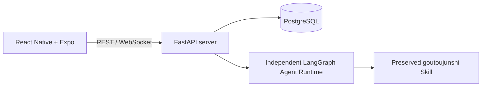

# Architecture direction

Phase 0 fixes only the system boundaries. Detailed database design, LangGraph
nodes, RAG and memory implementation belong to later phases.

- `apps/mobile` is the React Native and Expo client. It never calls an LLM API
  directly and does not contain model keys, prompts or the Skill corpus.
- `apps/server` will expose FastAPI endpoints and own server-side data access.
- The Agent Runtime will use LangGraph and remain callable without FastAPI or
  any external Agent Harness such as Codex or Claude Code.
- `knowledge/goutoujunshi` preserves the upstream Skill. Its content is not
  modified as part of app development.
- Mobile and server are separate deployments. They communicate through REST
  and WebSocket; PostgreSQL belongs to the server side.

Further behavior requirements are recorded in `docs/SKILL_CONTRACT.md` and
future phase decisions in `docs/adr/`.
