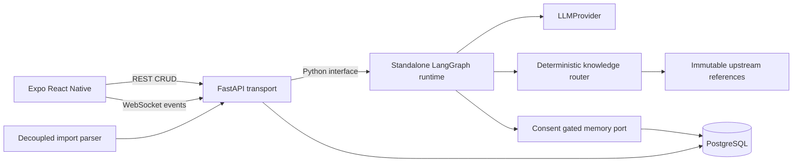
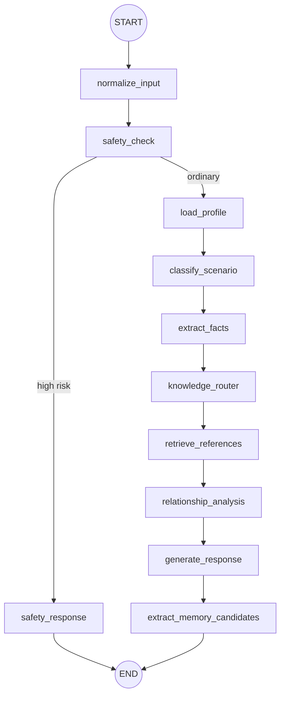

# Architecture

## System boundaries

The mobile app contains no prompts, knowledge corpus, long-term memory or LLM
keys. The API owns identity, authorization, storage and transport. The Agent
owns state transitions and can be run from a CLI or Python caller without the
API. A node receives structured state and typed service ports, never FastAPI
objects. The provider port exposes `chat`, `stream`, `structured_output`; Mock
and OpenAI-compatible implementations are required before live model use.

## Agent flow

Safety runs before profile and relationship analysis. Memory candidates are
data only; a separate consent checked persistence service decides whether to
write. A future interrupt may request confirmation before a write.

## State and evidence

`AgentState` will contain `user_id`, `conversation_id`, `messages`, `scenario`,
`safety_level`, `user_profile`, `relationship_profile`, `facts`, `inferences`,
`unknowns`, `selected_references`, `retrieved_context`, `analysis`, `action`,
`memory_candidates`, and `final_answer`. It may add provenance, current
`person_id`, run ID, and node trace. Any field removal or semantic change needs
an ADR. Hidden model reasoning is never persisted.

Short-term state belongs to one conversation. Long-term memory consists only
of bounded, sourced fields and events, segregated by user and person. A
conversation or upload is never copied wholesale into long-term memory.

## Knowledge and import

The frozen upstream snapshot is the source of truth. Phase 4 maps a scenario
to 1–3 reference paths, then reads only those files. `FEATURE_RAG=false` is
the required baseline. Phase 10 may add metadata, BM25, pgvector and reranking
behind the same router only after evaluation against that baseline.

The import package parses TXT, Markdown and JSON into `NormalizedMessage`
(`speaker`, `timestamp`, `content`) and keeps sender identity explicit. The
parser and deterministic statistics do not import Agent classes. A model may
interpret events and patterns only after the speaker map is locked.

## API and event plan

REST under `/api/v1/` will expose conversations, messages, persons,
relationships, memories, uploads, chat-imports and agent runs; `/health` is
outside the prefix. `POST /api/v1/agent/runs` accepts a client idempotency ID,
returns a `run_id`; `/api/v1/agent/runs/{run_id}/stream` streams stable typed
events (`status`, `token`, `analysis`, `interrupt`, `error`, `done`). The mobile
client will be generated from FastAPI OpenAPI rather than duplicating DTOs.

## Security and operations

Server-only secrets, owner-scoped queries, redacted logs, size/type-limited
uploads, path safety, user data deletion, and safe high-risk routing are
required gates. Observability reports metadata (run ID, scenario, nodes,
latency, references, provider/model, usage/cost, outcome) without full private
chat or hidden reasoning. LangSmith is optional and must fail open.
