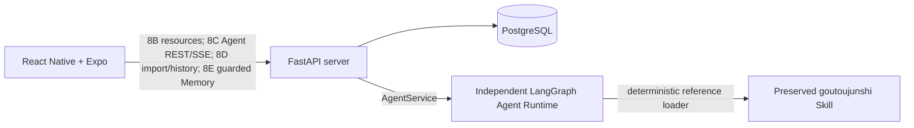

# Architecture direction

Phase 0 fixes the system boundaries. Phase 2A implements the FastAPI HTTP
foundation; Phase 2B adds PostgreSQL persistence; Phase 2C adds the internal
LLM Provider boundary; Phase 2D verifies their composition. Phase 3A defines
Agent state, input/output and dependency contracts. Phase 3B adds a standalone
minimal LangGraph execution path. Phase 3C replaces its fixtures with safety,
scenario and FIU semantic nodes. Phase 3D adds deterministic knowledge routing
and bounded loading of the frozen references. Phase 3E adds structured
relationship analysis that consumes typed FIU and loaded excerpts. Phase 3F
adds action planning and response generation. Phase 3G adds scoped, consented
long-term memory. RAG remains deferred.
Phase 3H closes the memory undo contract and exposes typed, transport-independent
runtime progress events. The overall Phase 3 Agent Runtime is complete after
its standalone E2E and regression gates; network transport was deferred at
that point. Phase 4 now supplies signed REST, POST SSE and persistent operation
idempotency around the standalone runtime.

- `apps/mobile` is the React Native and Expo client. It never calls an LLM API
  directly and does not contain model keys, prompts or the Skill corpus.
- `apps/server` exposes `/health`, `/ready`, `/api/v1/status` and signed
  synchronous and POST SSE Agent run endpoints through FastAPI.
  Its Pydantic Settings and error/logging foundation run without a database
  or LLM key. PostgreSQL is contacted only for readiness or data operations.
- The minimal Agent Runtime uses LangGraph and is callable without FastAPI or
  any external Agent Harness such as Codex or Claude Code.
- `knowledge/goutoujunshi` preserves the upstream Skill. Its content is not
  modified as part of app development.
- Phase8E MemoryController uses the same generated transport/session, public DTO
  adapters and server Memory services. Consent/retention/confirmation/receipts
  stay server authoritative; session-only immutable key/target attempts enable
  safe recovery without a client MemoryStore or journal. See
  [Mobile Memory](MOBILE_MEMORY_INTEGRATION.md). Production Agent behavior and
  frozen knowledge are unchanged; native and whole Phase8 acceptance remain8F.
- Mobile and server are separate deployments. Phase 8 will integrate REST and
  the actual Phase 4 POST SSE transport; the original WebSocket direction is
  not implemented. PostgreSQL belongs to the server side. Phase 7A–7D are local only.

Phase8B connects the generated typed client through one credential-injecting
transport and async owned-resource controller, translating DTOs into existing
ViewModels. Native SecureStore and volatile Web credentials require a real server
probe; epoch/cancellation/storage ordering isolate identities. Demo remains local.
Only explicit loopback development/test CORS is added; resource/Agent contracts,
runtime, knowledge and Memory/Import behavior are unchanged. See
[ADR0032](adr/0032-generated-mobile-client-and-development-session.md).

Further behavior requirements are recorded in `docs/SKILL_CONTRACT.md` and
future phase decisions in `docs/adr/`.

Phase8C adds owned Conversation Chat/History through that same generated client,
session and transport; native streaming uses installed expo/fetch. A bounded
independent V1 parser and page/session generations isolate consumption. Immutable
operation keys and explicit unknown outcomes follow existing server replay/disconnect
semantics; Message IDs reconcile confirmed answers with formal History. Runtime,
knowledge, provider contract, Import and Memory behavior remain unchanged. See
[ADR0033](adr/0033-mobile-agent-chat-stream-and-recovery.md).
The 2026-10-10 revalidation adds actual native incremental SSE and Chinese
answer/replay/owner-isolation evidence. Only the disposable native Mock demo
adds port/scenario options; transport/runtime/provider boundaries are unchanged.
Native lifecycle/fault coverage remains partial; no QA route or probe is shipped.

Phase8D adds real binary file selection/upload and formal ImportJob/Relationship
History through that same generated client/session/transport. Deterministic server
parser/binding/merge/permissions are unchanged. Existing ImportStep/speaker/source
and History ViewModels/shared controls/FlatList remain; feature adapters/controllers
own public DTO validation, explicit revision/unknown outcomes and bounded opaque
pagination. Native cache File/Web File remain private; no durable second store,
new account system, Memory mutation or imported analysis. See
[ADR0034](adr/0034-mobile-import-and-relationship-history.md).

## Implemented Phase 2A boundary

`app/main.py` builds an HTTP-only application. `app/api/v1/router.py` owns the
version prefix; `/health` stays outside it for process liveness. Settings
read environment variables or an ignored root `.env`, and secret fields are
masked. The only public status field from settings is `APP_ENV`. Request
validation, HTTP and unexpected errors share a minimal JSON shape. Logging
does not include request data or exception text. The root uv project and
lockfile own server dependencies; backend pytest and Ruff are active while
Agent and Mobile gates remain deferred. See
[ADR 0005](adr/0005-fastapi-foundation.md).

## Implemented Phase 2B boundary

The persistence path is API dependency → service/repository → SQLAlchemy Session
→ PostgreSQL. `app/db/session.py` creates an engine only when needed;
`app/api/dependencies.py` handles HTTP transaction commit, rollback and close.
`app/services` contains a narrow conversation persistence service. `/ready`
probes the database, while `/health` only proves the process is alive. The six
tables, ownership keys, delete rules, UTC timestamp policy and disposable
database test strategy are documented in
[ADR 0006](adr/0006-postgresql-foundation.md) and
[DATABASE.md](DATABASE.md). No CRUD transport API or Agent execution exists.

## Implemented Phase 2C boundary

Future application code uses `app.llm.LLMProvider` through one factory. The
protocol defines `chat`, `stream` and `structured_output`, with normalized
typed values and project-owned errors. `MockLLMProvider` is deterministic and
keyless. `OpenAICompatibleProvider` uses the same Chat Completions format with
configurable URL/key/model and an injectable HTTPX client. It discards hidden
reasoning fields; caller-supplied Pydantic schemas validate structured output.
No model is called at app startup, and `/health` and database `/ready` retain
their existing meanings. There is no LLM or Agent HTTP endpoint. See
[LLM_PROVIDER.md](LLM_PROVIDER.md) and [ADR 0007](adr/0007-llm-provider-boundary.md).

## Verified Phase 2 composition

FastAPI owns HTTP transport, error responses and application lifespan.
`Settings` is the application configuration entry point. `Database(settings)`
holds a lazy engine; `Database.session()` yields a SQLAlchemy session for a
repository or service, and the caller owns its transaction. FastAPI's `get_db`
dependency handles request commit/rollback. The application lifespan disposes
the database pool at shutdown, even when `/ready` encountered a connection
failure. The HTTP adapter lives in `app/api/dependencies.py`; persistence code
imports neither FastAPI Request nor the LLM layer.

`create_llm_provider(settings)` returns the `LLMProvider` protocol. Its Mock is
keyless; the compatible adapter normalizes external model transport. Neither
provider depends on FastAPI Request or a database Session. A default HTTPX
client is closed after each operation; an injected client remains caller-owned.
The server does not construct an LLM provider at startup. `/health` is process
liveness; `/ready` checks PostgreSQL only.

Future Phase 3 code can receive an `LLMProvider` and scoped services as
explicit Python dependencies. The Agent itself need not receive `Settings` or
a database session, import `app.main`, create an engine, read raw environment
variables, or create a vendor client. This describes an injection boundary;
the executing Agent has Phase 3C semantic entry nodes plus the Phase 3D
deterministic knowledge router, bounded reference loader and Phase 3E
relationship analysis node.
`TEST_DATABASE_URL` belongs only to the isolated test harness, and `POSTGRES_*`
belongs only to Compose. See [ADR 0008](adr/0008-backend-composition-lifecycle.md).

## Phase 3A contract boundary

`app.agent.AgentInput` is created by a caller after authentication and
ownership checks. `initial_state` creates an internal total TypedDict; the
public `AgentResult` and `AgentFailure` are separate JSON-safe Pydantic values.
FIU uses three distinct typed lists. The Agent state carries neither provider
objects nor secrets, and memory candidates are proposals only. The four run
statuses match the existing PostgreSQL `AgentRun` check constraint, so no
migration is needed. `RuntimeDependencies` injects the Phase 2C `LLMProvider`
and optional owner-scoped `ProfileReader`. See [Agent contracts](AGENT_RUNTIME.md)
and [ADR 0009](adr/0009-agent-contract-boundary.md). This section records
the Phase 3A contract baseline; semantic nodes are described below.

## Phase 3B standalone execution boundary

`AgentRuntime` compiles `StateGraph(AgentState)` once per instance. A synthetic
safety gate uses a conditional edge to bypass ordinary analysis, which calls
only the injected `LLMProvider.structured_output`. Node read and write scopes
are enforced by runtime wrappers. A Python demo uses `MockLLMProvider` without
FastAPI, PostgreSQL, network or API key. The runtime returns a versioned
`AgentResult` or a safe `AgentFailure`, each correlated by a unique run ID.
It has no DB side effect, checkpoint or transport integration. See
[Agent runtime](AGENT_RUNTIME.md) and
[ADR 0010](adr/0010-minimal-langgraph-runtime.md).

## Phase 3C semantic entry boundary

The synthetic safety flag, scenario stub and minimal analysis node have been
removed. `safety_check` obtains a typed `SafetyResult` from the injected
`LLMProvider`; the graph routes high risk to safety finalization before any
ordinary node. Other input receives typed `ScenarioResult` and
`FactExtractionResult` from independent nodes. System prompts are separate,
source-backed files; user text and recent speaker-labeled messages are supplied
as untrusted context. A 24-case Golden subset has deterministic structural
comparison and oracle-derived Mock replay. This verifies graph wiring and
evaluation behavior, not live model accuracy. Relationship advice, memory
persistence and a new HTTP endpoint are still absent. See
[ADR 0011](adr/0011-semantic-entry-nodes.md).

## Phase 3D knowledge boundary

The ordinary graph loads knowledge after FIU; the high risk graph branches
straight from safety checking into the same router and loader. The router uses
scenario and route with narrow topic cues to choose a stable alias; it cannot
ask an LLM or form a path from user text. The registry resolves aliases only
through `evals/reference_map.json`, within the frozen tree and manifest. The
loader verifies the frozen hash and loads at most three typed references under
per-document and total character budgets. The public result exposes aliases,
not document text. See [Knowledge routing](KNOWLEDGE_ROUTING.md) and
[ADR 0012](adr/0012-deterministic-knowledge-loading.md).

## Phase 3E analysis boundary

Only ordinary and boundary paths enter `relationship_analysis` after reference
loading. The high-risk path continues directly to `safety_finalize`. The node
receives typed FIU, scenario/route, optional profiles and the actual bounded
reference excerpts as separate JSON data. `LLMProvider.structured_output`
returns `AnalysisResult`; a second project-owned validator checks every FIU
and reference ID, observed/tentative roles, boundary recognition and obvious
action or certainty language. It writes only `analysis_result`. The public
result exposes structured analysis but no loaded source text; at Phase 3E,
`action` and memory candidates remained empty. These checks establish provenance structure,
not full semantic entailment or live-model quality. See
[Relationship analysis](RELATIONSHIP_ANALYSIS.md) and
[ADR 0013](adr/0013-grounded-analysis-contract.md).

## Phase 3F action and response boundary

Phase 3F extends the ordinary/boundary path after relationship analysis with
`action_planner → response_generator`. Each calls the injected provider for a
strict structured value, writes one state field, and runs project-owned
validation. Action provenance points to analysis points; response validation
checks the contact policy and actionable text against the plan. The high-risk
path still exits through `safety_finalize` after knowledge loading. See
[Action and response](ACTION_RESPONSE.md) and
[ADR 0014](adr/0014-action-response-boundary.md).

## Phase 3G memory boundary

`load_memory` runs after normalization and before safety checking. It uses the
injected `MemoryService` to retrieve at most eight consented, unpaused records
for the current user and relationship. User-level memories can be global;
person and relationship records are confined to the matching relationship.
Analysis sees historical memory in a separate data field with provenance and
time, never as current FIU. The high-risk path ends without a memory write.

After an ordinary/boundary response, a typed candidate extractor reads only
current user message and F facts. The independent persistence node enforces
source, owner, scope, content and consent gates through `MemoryService` and
returns a receipt. `MemoryStore` has an in-memory implementation for the
standalone graph and a SQLAlchemy adapter using isolated sessions. Memory
errors do not discard a completed response. See [Memory](MEMORY.md) and
[ADR 0015](adr/0015-consent-gated-memory.md).

## Phase 3H streaming and final standalone boundary

`AgentRuntime.run(input)` returns one `AgentResult` or `AgentFailure`.
`AgentRuntime.stream(input)` iterates typed events from the same compiled
LangGraph, with one execution and one run ID. The graph's internal node updates
map to stable product statuses; only validated final text, public result,
generic failures and bounded memory receipts are emitted. Async-generator
close/cancellation closes the underlying graph iterator. The memory undo audit
adds an owner-scoped, 20-operation history for saved records. See
[Streaming runtime](STREAMING_RUNTIME.md), [ADR 0016](adr/0016-memory-undo.md)
and [ADR 0017](adr/0017-runtime-streaming.md).

## Phase 4A application boundary

`AuthenticatedActor → AgentService → owner-scoped Conversation/Message/AgentRun
repositories → AgentRuntime` is the new application path. The service commits
user input plus a running run before runtime execution, then commits only a
validated assistant answer plus completion. A runtime failure leaves user input
and a failed run. It constructs a bounded owner-scoped history before inserting
the current message. Persistent and runtime run IDs are identical. See
[Agent Service](AGENT_SERVICE.md) and [ADR 0018](adr/0018-agent-service-orchestration.md).

## Phase 4B REST and authentication boundary

FastAPI's Agent route receives a signed Bearer JWT through a transport
dependency. A separate verifier checks signature, UUID subject, expiration,
issuer, audience and fixed HS256 algorithm before issuing `AuthenticatedActor`.
The route validates a bounded message, calls `AgentService.execute()` and maps
its typed result/error into the established HTTP envelope. A lazy per-app
service reuses one compiled LangGraph; startup makes no model or database call.
The service remains responsible for ownership, history, persistence and memory
scope. See [Authentication](AUTHENTICATION.md), [Agent API](AGENT_API.md) and
[ADR 0019](adr/0019-rest-authentication-boundary.md).

No Phase 4 transport belongs inside the Phase 3 runtime.

## Phase 4C network streaming boundary

The sole network stream is POST `text/event-stream` through the same Bearer
dependency as REST. `AgentService.stream()` runs preflight before the HTTP
response, shares owned history and persistence helpers with `execute()`, then
consumes one `AgentRuntime.stream()` execution. It commits the validated answer
before emitting the public final frame. A response finalizer propagates a
disconnect to the runtime and marks a precommit run failed; postcommit
disconnect preserves the completed run. PostgreSQL serializes same-Conversation
run starts and rejects an active second run with 409. See
[Streaming API](STREAMING_API.md) and
[ADR 0020](adr/0020-streaming-transport-disconnect.md).

## Phase 4D persistent operation boundary

`AgentService` uses one PostgreSQL-backed operation lookup for both REST and
SSE. Transaction A locks the Conversation, checks a scoped key and canonical
request fingerprint, then either reuses the original run or creates the user
Message and AgentRun atomically. A database unique constraint arbitrates
cross-worker races. Completed operations replay from the linked Assistant
Message and bounded result metadata; failed, running or unresolved operations
never silently re-execute. SSE replay emits only persisted final and completion
events. See [Idempotency](IDEMPOTENCY.md) and
[ADR 0021](adr/0021-persistent-operation-idempotency.md).

## Phase 5A chat import parser boundary

`ChatImportSource` supplies text or UTF-8 byte chunks to the
transport-independent `ChatImportParser` protocol. The WeChat Markdown v1
implementation recognizes strict message headers, retains source order and
raw speaker labels, converts explicit source-local times to UTC, reports typed
issues and emits canonical messages plus a dry-run summary. It streams one
bounded message at a time and has no import-job, Conversation, Relationship or
Memory storage dependency. Neither FastAPI nor AgentRuntime participates in
the parser. Phase 5B adds owner-scoped, durable job metadata and explicit
binding outside this parser. Phase 5C owns final Message persistence. See
[Chat Import](CHAT_IMPORT.md), [Import Jobs](IMPORT_JOBS.md) and
[ADR 0022](adr/0022-chat-import-parser-boundary.md).

## Phase 5B import workflow boundary

`ChatParseResult → ImportJobService(AuthenticatedActor) → ChatImportJob +
ChatImportSpeaker` persists summary and speaker inventory only. PostgreSQL
composite foreign keys enforce owner scope for Person and Relationship targets.
The service locks the job for binding changes and readiness checks. A ready
job can enter Phase 5C, but has no imported Conversation or Message. See
[ADR 0023](adr/0023-persistent-import-binding.md).

## Phase 5C relationship history boundary

External chat uses `RelationshipMessage`, a table separate from Agent
`Conversation`/`Message`. `ImportMergeService` accepts an authenticated actor,
ready Job, expected revision and original source stream. A trusted parser
stages bounded batches in a transaction-local PostgreSQL table; complete
metadata and binding checks precede atomic promotion. Owner-scoped composite
foreign keys and a dataset unique index enforce relationship scope and exact
transcript idempotency. Agent history queries remain on their original table.
See [Imported Messages](IMPORTED_MESSAGES.md) and
[ADR 0024](adr/0024-relationship-message-merge.md).

## Phase 5D upload and artifact boundary

The Phase 4 JWT dependency authenticates the multipart HTTP adapter before it
creates an artifact. The adapter reads bounded chunks through
`ImportArtifactStore`; `ImportWorkflowService` parses and creates the owner-
bound Job, then later opens that exact artifact for 5C merge. PostgreSQL
stores metadata and receipt, never raw source bytes. Success and cancel clean
the private file; an explicit expiration operation reaps abandoned and crash-
orphan files. `RelationshipMessage` reads use owner-scoped keyset pagination.
The Agent history and Memory paths do not query imported messages. See
[Import API](IMPORT_API.md), [Import Artifacts](IMPORT_ARTIFACTS.md) and
[ADR 0025](adr/0025-import-artifact-api.md).

## Phase 6A memory control boundary

`Bearer JWT → AuthenticatedActor → MemoryControlService → SQLAlchemyMemoryStore`
reads and changes the same PostgreSQL memory controls used by
`AgentRuntime → MemoryService → SQLAlchemyMemoryStore`. The control plane has
no Agent or LLM call. The SQL store serializes control mutations on the owner
row and pages records in stable key order. Record insertion rechecks the
control under that lock. See [Memory API](MEMORY_API.md) and
[ADR 0026](adr/0026-memory-control-plane.md).

## Phase 6B memory mutation boundary

`Bearer JWT → AuthenticatedActor → MemoryMutationService → PostgreSQL` uses
the Phase 3 `memory_records`, `memory_operations` and `memory_controls` tables.
The new `memory_confirmations` and `memory_mutations` tables hold only
owner-bound challenges and receipts, never another copy of memory content.
Undo requires the ID from a read-only latest-operation preview and a durable
operation key. Deletes require a server-side challenge binding owner, action,
target, scope and snapshot. Owner-row locks serialize these mutations with
Agent saves and legacy MemoryService operations. A single transaction deletes
records, cascades their undo operations, optionally revokes consent, consumes
the challenge and writes the receipt. No Agent or LLM runs in the control
path. The public Agent Service marks conversational undo as pending after
safety routing, so it cannot bypass expected-operation matching. See
[Memory Deletion](MEMORY_DELETION.md) and
[ADR 0027](adr/0027-guarded-memory-mutations.md).

## Phase 6C retention boundary

`Settings → RetentionPolicy` injects finite creation-based expiry into the same
SQL MemoryStore/MemoryService used by HTTP controls and AgentService. A non-null
UTC `expires_at` is fixed on save; migration gives legacy rows 180 days of grace.
SQL and standalone recall exclude expiry independently of physical cleanup.
Public inspection adds expiry/state/summary; default lists show active rows.

`MemoryRetentionService → PostgreSQL` is a privileged deterministic one-shot CLI,
with bounded per-category batches, sorted owner locks, eligibility rechecks and
per-batch transactions. Record deletion cascades its undo targets; expired guarded
undo is unavailable and never falls back. Challenge expiry+grace allows metadata
removal while durable receipts preserve old operation keys and replay. Controls,
Agent/import history and providers are untouched by maintenance. No HTTP maintenance
endpoint, queue or LLM invocation is introduced. Production scheduler and backup/
restore automation are not deployed. See [ADR 0028](adr/0028-memory-retention-lifecycle.md),
[retention](MEMORY_RETENTION.md) and [backup/deletion policy](MEMORY_BACKUP_DELETION_POLICY.md).

## Phase 6D integrated boundary

Public memory controls and Agent REST/SSE share the durable store, owner
serialization and structured person/relationship scope. No graph, service,
transport or database architecture is replaced. When the unique scoped content
key belongs to an expired row, a new authorized save removes that row and its
undo operation and inserts a new UUID, creation/expiry and undo operation in
the same transaction. Active duplicates do not renew. Consent/pause and scope
checks precede removal; failure restores the old row and operation. Two concurrent
saves leave one new record and operation. The standalone fake follows the same
expiry rule using the new save timestamp.

Confirmation and mutation views explicitly describe primary-memory deletion
and retained metadata. Imported relationship messages and Agent conversations
are separate storage domains. Phase 6 acceptance exercises actual signed HTTP,
LangGraph, Mock LLM and PostgreSQL together; it does not establish production
scheduler, backup or restore infrastructure. Mobile remains Phase 7.

## Phase 7A Mobile foundation boundary

`Expo Router root layout → ThemeProvider + DataSourceProvider → Screens →
UI State/ViewModels` is a separate Expo SDK 57 / strict TypeScript client.
Home opens five Stack leaf routes: Chat, Relationship/Profile, Import/Analysis,
History and Settings. Each leaf returns through history or Home for a direct link;
unknown routes recover to Home. Shared React Native components own safe-area,
scroll/keyboard layout and token-based presentation. Theme preference is real,
system/light/dark and session-local across routes.

Only the composition root selects the local Demo source; screens do not import
fixtures. The read-only state boundary is loading/empty/error with safe ViewModels.
State-preview/Retry controls have actual local effects, while sending, profile
editing and file selection are disabled. No Agent output, account, Memory save,
network upload or connected-server claim is fabricated.

No REST/SSE, JWT session, OpenAPI generator, provider call or database connection
is implemented here. Phase 8 will translate authoritative server DTOs/events
through adapters at the UI boundary. Existing server contracts, frozen knowledge,
Python locks and Agent behavior are unchanged. Root verification retains Phase
0–6 and adds Mobile static gates; actual Expo Web smoke is separate, Android NOT
RUN. See [Mobile architecture](MOBILE_ARCHITECTURE.md),
[ADR 0029](adr/0029-mobile-shell-and-data-boundary.md) and
[7A acceptance](PHASE_7A_ACCEPTANCE.md).

## Phase 7B Chat and Relationship boundary

The existing Expo Stack/theme/provider remains. Typed read-only feature templates
extend ShellDataSource. Chat uses a single virtualized FlatList with a separate
fixed, multiline local composer. Preview appends only a user bubble; assistant
content requires an explicit predefined synthetic example action. Run presentation
is manually held (idle/unavailable/starting/progressing/completed/failed/pending),
independent of messages and without network/token timers. FIU is synthetic teaching
content with provenance/alternative/unknown semantics, Safety has a neutral reserved
notice, and pending execution is disabled.

Person and Relationship retain separate IDs/models; imported self/person/system
messages never become Agent user/assistant bubbles. A/B selection derives every
profile field from the current model. Chat navigation passes synthetic relationship
scope; changed scope remounts its ephemeral controller. No private fixture, logging,
storage, API, authentication or Memory write is added. Import/History/Settings business
UI remains Phase 7C. Public FIU/profile mapping remains a Phase 8 coordination item,
because the current answer DTO exposes a public answer rather than these structured
resources. No backend, LangGraph or frozen knowledge change is made.

Root verify keeps all 7A/regression gates and adds an explicit 7B focused test gate;
real Web smoke is separate, Android/TalkBack NOT RUN. See [Chat UI](MOBILE_CHAT_UI.md),
[Relationship UI](MOBILE_RELATIONSHIP_UI.md),
[ADR 0030](adr/0030-mobile-chat-preview-and-relationship-scope.md) and
[7B acceptance](PHASE_7B_ACCEPTANCE.md).

## Phase 7C Import, History and Settings boundary

The existing Stack/theme/injected source remains; readImport/readHistory/readSettings
extend its read-only template seam. Typed feature state owns a five-step Import
wizard, separate AI/external History domains and Memory-control previews. Explicit
speaker roles/Person IDs and relationship confirmation precede local readiness.
Unknown relationship scopes fail closed; scope changes reset controllers/bindings.
History orders historical instants with dataset/source-index/ID tie-breakers and
uses one virtualized FlatList with 30-row incremental windows. Content is never deduped.

Memory controls preserve server consent/pause semantics in local state. Inspect
contains public summaries/scopes/dates only; undo/delete explain expected operation
and confirmation boundaries while formal execution remains disabled. Policy is a
configurable server authority, with 180 days shown only as an example. No backend,
Agent, database, dependency or frozen knowledge changes occur. Real upload/finalize,
Agent history/profile resource contracts, public FIU mapping and guarded Memory
mutations await Phase 8. No new state store/infrastructure or architecture replacement
requires another ADR. Root verify adds the explicit 7C focused static gate; live Web
remains separate, native Android NOT RUN. See [Import UI](MOBILE_IMPORT_UI.md),
[History UI](MOBILE_HISTORY_UI.md), [Settings UI](MOBILE_SETTINGS_UI.md) and
[7C acceptance](PHASE_7C_ACCEPTANCE.md). At 7C, Phase 7D and whole Phase 7 stayed pending.

## Phase 7D integration boundary

Preserve the Mobile Stack/theme/typed source and feature controllers. Import
gates Next at explicit speaker selection and relationship confirmation; final
compatibility remains a local precheck. Chat consumes a pending scroll only
after the last row lays out, fixing a first multi-line preview left below the
visible list. Home renders source loading/error. No server or Agent behavior changes.

Completion verification adds focused integration/recovery cases plus actual
Expo Web export and retained/new browser journeys. It supports 7/7D and rejects
later phases. Android's user-reported manual smoke and Codex's incomplete native
attempts stay distinct; Web meets the MASTER_PLAN minimum demo gate. Real API,
auth, streams and generated client remain Phase 8. See
[final acceptance](PHASE_7_FINAL_ACCEPTANCE.md) and
[audited integration handoff](PHASE_8_MOBILE_INTEGRATION_HANDOFF.md).

## Phase 8A public resource boundary

`Bearer JWT → AuthenticatedActor → ResourceService → existing owner repositories
→ PostgreSQL` adds Person/Relationship/Conversation creation/list/detail and Agent
Message history. It uses the existing tables and constraints, with explicit typed
public projections. Conversation remains optionally Relationship-bound; no Person,
title, state or inferred Profile fields are introduced. Resources call no runtime.

Required caller-retained UUID v4 plus a transaction advisory lock and existing PK
provide durable row-lifetime creation retries. Matching creation fields replay;
changed fields conflict. Bounded timestamp/UUID keysets use opaque scope-bound
navigation cursors; every query still authorizes independently. Short committed
live pages have no fixed snapshot. Agent Message and imported RelationshipMessage
remain distinct, and imported data still does not enter AgentService.

Deterministic OpenAPI export preserves the 26 actual Phase 7D contracts and adds
ten operations. It supplies 8B's formal generation input, without generating a
client or connecting Mobile. Existing development-only JWT CLI supplies manual
credentials; production accounts remain absent. See [resource API](RESOURCE_API.md),
[ADR0031](adr/0031-public-resource-acquisition-and-retries.md),
[handoff](PHASE_8_MOBILE_INTEGRATION_HANDOFF.md) and [8A acceptance](PHASE_8A_ACCEPTANCE.md).
## Phase 8F acceptance boundary (2026-10-11 supplement)

The implementation remains the existing generated transport, DevelopmentSession,
resource/Chat/import/history/Memory controllers and server services. 8F adds a
cross-surface Web gate and a synthetic native acceptance helper; it adds no
public endpoint, schema, graph behavior or infrastructure. The helper captures
CLI credentials over private pipes and creates/drops its own PostgreSQL database.
Native UI actions and host-side Agent fixture preparation are distinct evidence.
Loopback Metro and adb reverse replace a LAN listener for this host's acceptance.
The prior sections retain their historical phase boundaries. Current acceptance
and recovery limits are in PHASE_8_FINAL_ACCEPTANCE and the Phase 9 handoff.

## Phase 8F closeout observation boundary (2026-10-12)

The opt-in native SSE observer attaches to the existing `expo/fetch` response
and accepted parser callbacks, with actual React-committed phase/progress.
It exports bounded relative event/UI metadata, Reader operation counts,
terminal state and a Run-consistency boolean. Run IDs stay private to that
comparison; payloads, Memory, prompts and credentials are excluded. Platform
files keep Web/Node inert and gate Android on both development mode and an
explicit public, non-secret acceptance flag. It adds no transport replacement,
model token stream, endpoint, Graph node or production logging pipeline.

Disposable native fixtures wrap the unchanged ASGI application for controlled
postcommit response loss, stream EOF and held GET responses, using private pipe
commands and actual signed-owner verification. A delayed keyless Mock provides
observable semantic event intervals. The fixture is outside production App
composition. Native resource/Agent mutations, host REST preconditions, client
observations and SQL/receipt witnesses are kept distinct in complete executions.
The Phase8 marker checks hashed complete native transcripts and an independent
pre-marker root exit before accepting8/8F. Durable pending-operation storage,
automatic crash reconciliation and production identity remain future work.
