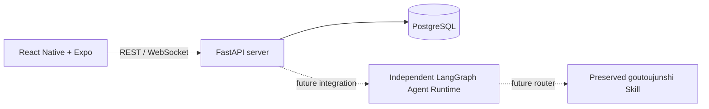

# Architecture direction

Phase 0 fixes the system boundaries. Phase 2A implements the FastAPI HTTP
foundation; Phase 2B adds PostgreSQL persistence; Phase 2C adds the internal
LLM Provider boundary; Phase 2D verifies their composition. Phase 3A defines
Agent state, input/output and dependency contracts. Phase 3B adds a standalone
minimal LangGraph execution path. Phase 3C replaces its fixtures with safety,
scenario and FIU semantic nodes. Relationship reasoning, RAG and memory
implementation belong to later phases.

- `apps/mobile` is the React Native and Expo client. It never calls an LLM API
  directly and does not contain model keys, prompts or the Skill corpus.
- `apps/server` exposes `/health`, `/ready` and `/api/v1/status` through FastAPI.
  Its Pydantic Settings and error/logging foundation run without a database
  or LLM key. PostgreSQL is contacted only for readiness or data operations.
- The minimal Agent Runtime uses LangGraph and is callable without FastAPI or
  any external Agent Harness such as Codex or Claude Code.
- `knowledge/goutoujunshi` preserves the upstream Skill. Its content is not
  modified as part of app development.
- Mobile and server are separate deployments. They communicate through REST
  and WebSocket; PostgreSQL belongs to the server side.

Further behavior requirements are recorded in `docs/SKILL_CONTRACT.md` and
future phase decisions in `docs/adr/`.

## Implemented Phase 2A boundary

`app/main.py` builds an HTTP-only application. `app/api/v1/router.py` owns the
version prefix; `/health` stays outside it for process liveness. Settings
read environment variables or an ignored root `.env`, and secret fields are
masked. The only public status field from settings is `APP_ENV`. Request
validation, HTTP and unexpected errors share a minimal JSON shape. Logging
does not include request data or exception text. The root uv project and
lockfile own server dependencies; backend pytest and Ruff are active while
Agent and Mobile gates remain deferred. See
[ADR 0005](adr/0005-fastapi-foundation.md).

## Implemented Phase 2B boundary

The persistence path is API dependency → service/repository → SQLAlchemy Session
→ PostgreSQL. `app/db/session.py` creates an engine only when needed;
`app/api/dependencies.py` handles HTTP transaction commit, rollback and close.
`app/services` contains a narrow conversation persistence service. `/ready`
probes the database, while `/health` only proves the process is alive. The six
tables, ownership keys, delete rules, UTC timestamp policy and disposable
database test strategy are documented in
[ADR 0006](adr/0006-postgresql-foundation.md) and
[DATABASE.md](DATABASE.md). No CRUD transport API or Agent execution exists.

## Implemented Phase 2C boundary

Future application code uses `app.llm.LLMProvider` through one factory. The
protocol defines `chat`, `stream` and `structured_output`, with normalized
typed values and project-owned errors. `MockLLMProvider` is deterministic and
keyless. `OpenAICompatibleProvider` uses the same Chat Completions format with
configurable URL/key/model and an injectable HTTPX client. It discards hidden
reasoning fields; caller-supplied Pydantic schemas validate structured output.
No model is called at app startup, and `/health` and database `/ready` retain
their existing meanings. There is no LLM or Agent HTTP endpoint. See
[LLM_PROVIDER.md](LLM_PROVIDER.md) and [ADR 0007](adr/0007-llm-provider-boundary.md).

## Verified Phase 2 composition

FastAPI owns HTTP transport, error responses and application lifespan.
`Settings` is the application configuration entry point. `Database(settings)`
holds a lazy engine; `Database.session()` yields a SQLAlchemy session for a
repository or service, and the caller owns its transaction. FastAPI's `get_db`
dependency handles request commit/rollback. The application lifespan disposes
the database pool at shutdown, even when `/ready` encountered a connection
failure. The HTTP adapter lives in `app/api/dependencies.py`; persistence code
imports neither FastAPI Request nor the LLM layer.

`create_llm_provider(settings)` returns the `LLMProvider` protocol. Its Mock is
keyless; the compatible adapter normalizes external model transport. Neither
provider depends on FastAPI Request or a database Session. A default HTTPX
client is closed after each operation; an injected client remains caller-owned.
The server does not construct an LLM provider at startup. `/health` is process
liveness; `/ready` checks PostgreSQL only.

Future Phase 3 code can receive an `LLMProvider` and scoped services as
explicit Python dependencies. The Agent itself need not receive `Settings` or
a database session, import `app.main`, create an engine, read raw environment
variables, or create a vendor client. This describes an injection boundary;
the executing Agent has only the Phase 3C semantic entry nodes.
`TEST_DATABASE_URL` belongs only to the isolated test harness, and `POSTGRES_*`
belongs only to Compose. See [ADR 0008](adr/0008-backend-composition-lifecycle.md).

## Phase 3A contract boundary

`app.agent.AgentInput` is created by a caller after authentication and
ownership checks. `initial_state` creates an internal total TypedDict; the
public `AgentResult` and `AgentFailure` are separate JSON-safe Pydantic values.
FIU uses three distinct typed lists. The Agent state carries neither provider
objects nor secrets, and memory candidates are proposals only. The four run
statuses match the existing PostgreSQL `AgentRun` check constraint, so no
migration is needed. `RuntimeDependencies` injects the Phase 2C `LLMProvider`
and optional owner-scoped `ProfileReader`. See [Agent contracts](AGENT_RUNTIME.md)
and [ADR 0009](adr/0009-agent-contract-boundary.md). This section records
the Phase 3A contract baseline; semantic nodes are described below.

## Phase 3B standalone execution boundary

`AgentRuntime` compiles `StateGraph(AgentState)` once per instance. A synthetic
safety gate uses a conditional edge to bypass ordinary analysis, which calls
only the injected `LLMProvider.structured_output`. Node read and write scopes
are enforced by runtime wrappers. A Python demo uses `MockLLMProvider` without
FastAPI, PostgreSQL, network or API key. The runtime returns a versioned
`AgentResult` or a safe `AgentFailure`, each correlated by a unique run ID.
It has no DB side effect, checkpoint or transport integration. See
[Agent runtime](AGENT_RUNTIME.md) and
[ADR 0010](adr/0010-minimal-langgraph-runtime.md).

## Phase 3C semantic entry boundary

The synthetic safety flag, scenario stub and minimal analysis node have been
removed. `safety_check` obtains a typed `SafetyResult` from the injected
`LLMProvider`; the graph routes high risk to safety finalization before any
ordinary node. Other input receives typed `ScenarioResult` and
`FactExtractionResult` from independent nodes. System prompts are separate,
source-backed files; user text and recent speaker-labeled messages are supplied
as untrusted context. A 24-case Golden subset has deterministic structural
comparison and oracle-derived Mock replay. This verifies graph wiring and
evaluation behavior, not live model accuracy. No Knowledge Router, relationship
advice, memory persistence or new HTTP endpoint exists. See
[ADR 0011](adr/0011-semantic-entry-nodes.md).
