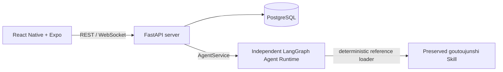

# Architecture direction

Phase 0 fixes the system boundaries. Phase 2A implements the FastAPI HTTP
foundation; Phase 2B adds PostgreSQL persistence; Phase 2C adds the internal
LLM Provider boundary; Phase 2D verifies their composition. Phase 3A defines
Agent state, input/output and dependency contracts. Phase 3B adds a standalone
minimal LangGraph execution path. Phase 3C replaces its fixtures with safety,
scenario and FIU semantic nodes. Phase 3D adds deterministic knowledge routing
and bounded loading of the frozen references. Phase 3E adds structured
relationship analysis that consumes typed FIU and loaded excerpts. Phase 3F
adds action planning and response generation. Phase 3G adds scoped, consented
long-term memory. RAG remains deferred.
Phase 3H closes the memory undo contract and exposes typed, transport-independent
runtime progress events. The overall Phase 3 Agent Runtime is complete after
its standalone E2E and regression gates; network transport was deferred at
that point. Phase 4B now supplies synchronous REST transport.

- `apps/mobile` is the React Native and Expo client. It never calls an LLM API
  directly and does not contain model keys, prompts or the Skill corpus.
- `apps/server` exposes `/health`, `/ready`, `/api/v1/status` and one signed
  Agent run REST endpoint through FastAPI.
  Its Pydantic Settings and error/logging foundation run without a database
  or LLM key. PostgreSQL is contacted only for readiness or data operations.
- The minimal Agent Runtime uses LangGraph and is callable without FastAPI or
  any external Agent Harness such as Codex or Claude Code.
- `knowledge/goutoujunshi` preserves the upstream Skill. Its content is not
  modified as part of app development.
- Mobile and server are separate deployments. They communicate through REST
  and WebSocket; PostgreSQL belongs to the server side.

Further behavior requirements are recorded in `docs/SKILL_CONTRACT.md` and
future phase decisions in `docs/adr/`.

## Implemented Phase 2A boundary

`app/main.py` builds an HTTP-only application. `app/api/v1/router.py` owns the
version prefix; `/health` stays outside it for process liveness. Settings
read environment variables or an ignored root `.env`, and secret fields are
masked. The only public status field from settings is `APP_ENV`. Request
validation, HTTP and unexpected errors share a minimal JSON shape. Logging
does not include request data or exception text. The root uv project and
lockfile own server dependencies; backend pytest and Ruff are active while
Agent and Mobile gates remain deferred. See
[ADR 0005](adr/0005-fastapi-foundation.md).

## Implemented Phase 2B boundary

The persistence path is API dependency → service/repository → SQLAlchemy Session
→ PostgreSQL. `app/db/session.py` creates an engine only when needed;
`app/api/dependencies.py` handles HTTP transaction commit, rollback and close.
`app/services` contains a narrow conversation persistence service. `/ready`
probes the database, while `/health` only proves the process is alive. The six
tables, ownership keys, delete rules, UTC timestamp policy and disposable
database test strategy are documented in
[ADR 0006](adr/0006-postgresql-foundation.md) and
[DATABASE.md](DATABASE.md). No CRUD transport API or Agent execution exists.

## Implemented Phase 2C boundary

Future application code uses `app.llm.LLMProvider` through one factory. The
protocol defines `chat`, `stream` and `structured_output`, with normalized
typed values and project-owned errors. `MockLLMProvider` is deterministic and
keyless. `OpenAICompatibleProvider` uses the same Chat Completions format with
configurable URL/key/model and an injectable HTTPX client. It discards hidden
reasoning fields; caller-supplied Pydantic schemas validate structured output.
No model is called at app startup, and `/health` and database `/ready` retain
their existing meanings. There is no LLM or Agent HTTP endpoint. See
[LLM_PROVIDER.md](LLM_PROVIDER.md) and [ADR 0007](adr/0007-llm-provider-boundary.md).

## Verified Phase 2 composition

FastAPI owns HTTP transport, error responses and application lifespan.
`Settings` is the application configuration entry point. `Database(settings)`
holds a lazy engine; `Database.session()` yields a SQLAlchemy session for a
repository or service, and the caller owns its transaction. FastAPI's `get_db`
dependency handles request commit/rollback. The application lifespan disposes
the database pool at shutdown, even when `/ready` encountered a connection
failure. The HTTP adapter lives in `app/api/dependencies.py`; persistence code
imports neither FastAPI Request nor the LLM layer.

`create_llm_provider(settings)` returns the `LLMProvider` protocol. Its Mock is
keyless; the compatible adapter normalizes external model transport. Neither
provider depends on FastAPI Request or a database Session. A default HTTPX
client is closed after each operation; an injected client remains caller-owned.
The server does not construct an LLM provider at startup. `/health` is process
liveness; `/ready` checks PostgreSQL only.

Future Phase 3 code can receive an `LLMProvider` and scoped services as
explicit Python dependencies. The Agent itself need not receive `Settings` or
a database session, import `app.main`, create an engine, read raw environment
variables, or create a vendor client. This describes an injection boundary;
the executing Agent has Phase 3C semantic entry nodes plus the Phase 3D
deterministic knowledge router, bounded reference loader and Phase 3E
relationship analysis node.
`TEST_DATABASE_URL` belongs only to the isolated test harness, and `POSTGRES_*`
belongs only to Compose. See [ADR 0008](adr/0008-backend-composition-lifecycle.md).

## Phase 3A contract boundary

`app.agent.AgentInput` is created by a caller after authentication and
ownership checks. `initial_state` creates an internal total TypedDict; the
public `AgentResult` and `AgentFailure` are separate JSON-safe Pydantic values.
FIU uses three distinct typed lists. The Agent state carries neither provider
objects nor secrets, and memory candidates are proposals only. The four run
statuses match the existing PostgreSQL `AgentRun` check constraint, so no
migration is needed. `RuntimeDependencies` injects the Phase 2C `LLMProvider`
and optional owner-scoped `ProfileReader`. See [Agent contracts](AGENT_RUNTIME.md)
and [ADR 0009](adr/0009-agent-contract-boundary.md). This section records
the Phase 3A contract baseline; semantic nodes are described below.

## Phase 3B standalone execution boundary

`AgentRuntime` compiles `StateGraph(AgentState)` once per instance. A synthetic
safety gate uses a conditional edge to bypass ordinary analysis, which calls
only the injected `LLMProvider.structured_output`. Node read and write scopes
are enforced by runtime wrappers. A Python demo uses `MockLLMProvider` without
FastAPI, PostgreSQL, network or API key. The runtime returns a versioned
`AgentResult` or a safe `AgentFailure`, each correlated by a unique run ID.
It has no DB side effect, checkpoint or transport integration. See
[Agent runtime](AGENT_RUNTIME.md) and
[ADR 0010](adr/0010-minimal-langgraph-runtime.md).

## Phase 3C semantic entry boundary

The synthetic safety flag, scenario stub and minimal analysis node have been
removed. `safety_check` obtains a typed `SafetyResult` from the injected
`LLMProvider`; the graph routes high risk to safety finalization before any
ordinary node. Other input receives typed `ScenarioResult` and
`FactExtractionResult` from independent nodes. System prompts are separate,
source-backed files; user text and recent speaker-labeled messages are supplied
as untrusted context. A 24-case Golden subset has deterministic structural
comparison and oracle-derived Mock replay. This verifies graph wiring and
evaluation behavior, not live model accuracy. Relationship advice, memory
persistence and a new HTTP endpoint are still absent. See
[ADR 0011](adr/0011-semantic-entry-nodes.md).

## Phase 3D knowledge boundary

The ordinary graph loads knowledge after FIU; the high risk graph branches
straight from safety checking into the same router and loader. The router uses
scenario and route with narrow topic cues to choose a stable alias; it cannot
ask an LLM or form a path from user text. The registry resolves aliases only
through `evals/reference_map.json`, within the frozen tree and manifest. The
loader verifies the frozen hash and loads at most three typed references under
per-document and total character budgets. The public result exposes aliases,
not document text. See [Knowledge routing](KNOWLEDGE_ROUTING.md) and
[ADR 0012](adr/0012-deterministic-knowledge-loading.md).

## Phase 3E analysis boundary

Only ordinary and boundary paths enter `relationship_analysis` after reference
loading. The high-risk path continues directly to `safety_finalize`. The node
receives typed FIU, scenario/route, optional profiles and the actual bounded
reference excerpts as separate JSON data. `LLMProvider.structured_output`
returns `AnalysisResult`; a second project-owned validator checks every FIU
and reference ID, observed/tentative roles, boundary recognition and obvious
action or certainty language. It writes only `analysis_result`. The public
result exposes structured analysis but no loaded source text; at Phase 3E,
`action` and memory candidates remained empty. These checks establish provenance structure,
not full semantic entailment or live-model quality. See
[Relationship analysis](RELATIONSHIP_ANALYSIS.md) and
[ADR 0013](adr/0013-grounded-analysis-contract.md).

## Phase 3F action and response boundary

Phase 3F extends the ordinary/boundary path after relationship analysis with
`action_planner → response_generator`. Each calls the injected provider for a
strict structured value, writes one state field, and runs project-owned
validation. Action provenance points to analysis points; response validation
checks the contact policy and actionable text against the plan. The high-risk
path still exits through `safety_finalize` after knowledge loading. See
[Action and response](ACTION_RESPONSE.md) and
[ADR 0014](adr/0014-action-response-boundary.md).

## Phase 3G memory boundary

`load_memory` runs after normalization and before safety checking. It uses the
injected `MemoryService` to retrieve at most eight consented, unpaused records
for the current user and relationship. User-level memories can be global;
person and relationship records are confined to the matching relationship.
Analysis sees historical memory in a separate data field with provenance and
time, never as current FIU. The high-risk path ends without a memory write.

After an ordinary/boundary response, a typed candidate extractor reads only
current user message and F facts. The independent persistence node enforces
source, owner, scope, content and consent gates through `MemoryService` and
returns a receipt. `MemoryStore` has an in-memory implementation for the
standalone graph and a SQLAlchemy adapter using isolated sessions. Memory
errors do not discard a completed response. See [Memory](MEMORY.md) and
[ADR 0015](adr/0015-consent-gated-memory.md).

## Phase 3H streaming and final standalone boundary

`AgentRuntime.run(input)` returns one `AgentResult` or `AgentFailure`.
`AgentRuntime.stream(input)` iterates typed events from the same compiled
LangGraph, with one execution and one run ID. The graph's internal node updates
map to stable product statuses; only validated final text, public result,
generic failures and bounded memory receipts are emitted. Async-generator
close/cancellation closes the underlying graph iterator. The memory undo audit
adds an owner-scoped, 20-operation history for saved records. See
[Streaming runtime](STREAMING_RUNTIME.md), [ADR 0016](adr/0016-memory-undo.md)
and [ADR 0017](adr/0017-runtime-streaming.md).

## Phase 4A application boundary

`AuthenticatedActor → AgentService → owner-scoped Conversation/Message/AgentRun
repositories → AgentRuntime` is the new application path. The service commits
user input plus a running run before runtime execution, then commits only a
validated assistant answer plus completion. A runtime failure leaves user input
and a failed run. It constructs a bounded owner-scoped history before inserting
the current message. Persistent and runtime run IDs are identical. See
[Agent Service](AGENT_SERVICE.md) and [ADR 0018](adr/0018-agent-service-orchestration.md).

## Phase 4B REST and authentication boundary

FastAPI's Agent route receives a signed Bearer JWT through a transport
dependency. A separate verifier checks signature, UUID subject, expiration,
issuer, audience and fixed HS256 algorithm before issuing `AuthenticatedActor`.
The route validates a bounded message, calls `AgentService.execute()` and maps
its typed result/error into the established HTTP envelope. A lazy per-app
service reuses one compiled LangGraph; startup makes no model or database call.
The service remains responsible for ownership, history, persistence and memory
scope. See [Authentication](AUTHENTICATION.md), [Agent API](AGENT_API.md) and
[ADR 0019](adr/0019-rest-authentication-boundary.md).

Phase 4C–4D will add network streaming, disconnect policy and persistent
idempotent retries. No Phase 4 transport belongs inside the Phase 3 runtime.
