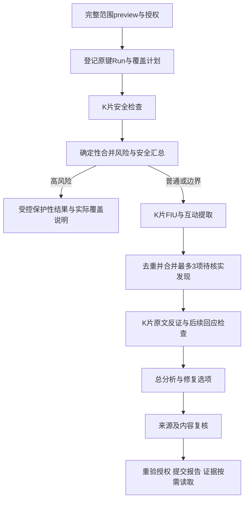

# ICA 长聊天处理：外部参考项目适配审查

2026-10-30；设计建议版本 `ica-long-range-v3`。本轮为源码阅读、方案比较与匿名合成结构实验，
**未实现 ICA、未调用付费模型、未执行完整历史回归**。本仓库基线 `18f9bfa`，正式 Marker 仍9/9H，
Phase11 QUALITY FAIL、11R Memory P0修复和真实用户试用前的角色错位P1门槛均保留。
不修改旧规划、原始评测或历史证据。本文提出对
[MVP v2](IMPORTED_CHAT_ANALYSIS_MVP.md) 的技术增补，待 ICA-A 授权时采纳。

## 1. 结论与最小选择

推荐复用本仓库的导入、canonical Dataset、PostgreSQL、权限/删除围栏和LangGraph执行框架，
新增**ChatLab JSONL标准适配器、3/7天范围快照、分片覆盖台账、受限只读查询及分批证据分析**。
Weport兼容标准的导出优先走同一适配器；不另引入桌面应用、Node解析服务、Go CLI或第二套数据库。

长聊天应采用“完整范围准入 → SQL有界遍历 → 时间session辅助分片 → 有限重叠 → 跨片回应/反证检查”。
200条/48KiB改为拟定**单个模型核心片段**上限，不再作为整次范围上限；超过整次预算须明确拒绝，
不暗中退化为最近200条。只读取全部原文也不等于识别了所有情绪或冲突，报告必须说明候选提取的选择性。

四个项目的可移植重点不同：Weport的连续阅读与范围说明；ChatLab的交换格式、流式解析和工具查询；
WeChat-daily的事件主线与证据附录；wechat-analyzer的session边界、统计分母和结构引用验证。
任何一个都不能替代本仓库Owner/Person权限、授权撤销、报告删除或关系洞察专项质量验收。

### 1.1 Weport：采用交换格式与连续阅读思路，不搬入桌面运行时

固定commit `a4d74c9bee895d7356fc1ed79afc5350767f0b9f`；
[LICENSE](https://github.com/Panther114/Weport/blob/a4d74c9bee895d7356fc1ed79afc5350767f0b9f/LICENSE)
是**CC BY-NC-SA 4.0**，不是MIT。
[NOTICE.md](https://github.com/Panther114/Weport/blob/a4d74c9bee895d7356fc1ed79afc5350767f0b9f/NOTICE.md)
说明其大量继承WeFlow，原作者cc/hicccc77及贡献者、Weport修改作者Panther114及贡献者均需保留署名；
组合改编项目适用该许可，第三方材料另有许可。本App不据此假设可复制其代码用于商业发行；
本次推荐独立实现格式互操作和查询合同，不复制导出器、Prompt、桌面/native组件。

- [export/types.ts](https://github.com/Panther114/Weport/blob/a4d74c9bee895d7356fc1ed79afc5350767f0b9f/electron/services/export/types.ts)
  区分`chatlab`、`chatlab-jsonl`、原生`json`等格式；不能仅凭扩展名混为一种。
  [ChatLabFormatter.ts](https://github.com/Panther114/Weport/blob/a4d74c9bee895d7356fc1ed79afc5350767f0b9f/electron/services/export/formatters/ChatLabFormatter.ts#L326)
  输出sender/accountName、秒级timestamp、type/content及可选platformMessageId/replyToMessageId；
  [JSONL写出入口](https://github.com/Panther114/Weport/blob/a4d74c9bee895d7356fc1ed79afc5350767f0b9f/electron/services/export/formatters/ChatLabFormatter.ts#L509)
  是一行header、若干member、若干message，与ChatLab JSONL可共用适配器。
  但该实现先收集allMessages/chatLabMessages，再组装lines.join写出，**并非有界流式导出**。
- [ExportContext.getExportMeta](https://github.com/Panther114/Weport/blob/a4d74c9bee895d7356fc1ed79afc5350767f0b9f/electron/services/export/core/ExportContext.ts#L6005)
  当前写version=0.0.2、generator=WeFlow，私聊meta未写ownerId/sourceSessionId。
  因此不能要求generator必须为Weport，也不能由其推断self或导出会话授权。
  嵌套chatRecords、媒体转写/链接等是导出派生内容，不自动升级为独立原始消息。
- [exportDateRange.ts](https://github.com/Panther114/Weport/blob/a4d74c9bee895d7356fc1ed79afc5350767f0b9f/src/utils/exportDateRange.ts)
  把本地日期/时间转秒级epoch；结束秒包含在内，纯结束日期扩展到当日23:59:59，并拒绝无效日期和不存在的DST时刻。
  Formatter将dateRange传给collectMessages。可借鉴显式范围预览，App仍采用IANA时区和UTC半开窗；
  不能把上游inclusive end直接传入本App的exclusive end，导出窗口也不能证明更大分析窗完整。
- [weportAiService.read_session_messages](https://github.com/Panther114/Weport/blob/a4d74c9bee895d7356fc1ed79afc5350767f0b9f/electron/services/weportAiService.ts#L1925)
  默认400条、上限500、默认从新到旧，返回nextOffset/hasMore、来源链接和Coverage；Prompt要求连续分页阅读，
  不拿关键词命中替代历史。借鉴连续读取与失败不等于无消息的表达；300–500是该工具页限，不能照搬为模型预算。
  [coverageState.ts](https://github.com/Panther114/Weport/blob/a4d74c9bee895d7356fc1ed79afc5350767f0b9f/src/components/weportAi/coverageState.ts)
  取最后一次工具结果，最新失败保持unknown；这不是累积全范围覆盖台账。
  单页completeWindow仅在offset=0且无hasMore时为真，ICA另建精确core并集验证，采用稳定keyset。
- [ai/evidence.ts](https://github.com/Panther114/Weport/blob/a4d74c9bee895d7356fc1ed79afc5350767f0b9f/electron/services/ai/evidence.ts)
  将account/session、物理db/table/localId和内容hash组成引用；
  [registerEvidence / resolveEvidence](https://github.com/Panther114/Weport/blob/a4d74c9bee895d7356fc1ed79afc5350767f0b9f/electron/services/weportAiService.ts#L845)
  保存引用后重新读取确切来源、检查当前账号和内容hash。值得借鉴“身份+内容指纹+再次核验”，
  但物理数据库路径不进入本App模型或证据链接，改用canonical message UUID与grant。
  该服务还含长期记忆及工作区写操作，不接入ICA只读工具或默认Memory。

### 1.2 ChatLab：JSONL和查询协议适配，保留本仓库幂等语义

固定commit `bf8d5ac77443512b9973ff3a236f258424202bbc`；根
[LICENSE](https://github.com/ChatLab/ChatLab/blob/bf8d5ac77443512b9973ff3a236f258424202bbc/LICENSE)
为**AGPL-3.0**。本次检查未发现parser目录单独许可，
[parser/package.json](https://github.com/ChatLab/ChatLab/blob/bf8d5ac77443512b9973ff3a236f258424202bbc/packages/parser/package.json)
为private工作区包且未声明更宽松license，不能把parser当MIT独立库。
AGPL并非禁止商业使用；直接复用/修改涉及其分发和网络源码义务，应单独决策。
首版不引入Node依赖，按格式合同独立实现小型Python适配器。

- 必读的[chatlab-format.md](https://github.com/ChatLab/ChatLab/blob/bf8d5ac77443512b9973ff3a236f258424202bbc/docs/cn/standard/chatlab-format.md)
  是v0.0.2，规定JSON和JSONL、秒级时间、稳定sender、可选原消息/回复ID、null正文和header/member/message结构。
  规范的“恒定内存/百万条”说明不是本App的容量证明；members、长单条和行错误仍须独立设限。
- 指定的[formats/chatlab.ts](https://github.com/ChatLab/ChatLab/blob/bf8d5ac77443512b9973ff3a236f258424202bbc/packages/parser/src/formats/chatlab.ts#L88)
  处理普通JSON，用stream-json读取，但第217/235行把批次累计进messageBatch，直到流结束才逐批yield。
  所以“使用流式tokenizer”不等于端到端有界内存。
  真正对应本次适配的是[formats/chatlab-jsonl.ts](https://github.com/ChatLab/ChatLab/blob/bf8d5ac77443512b9973ff3a236f258424202bbc/packages/parser/src/formats/chatlab-jsonl.ts#L130)：
  readline逐行、默认5000条flush并splice清空消息数组。它仍保留成员集合；parseLine会跳过坏JSON，
  parser有缺header/成员时推断fallback。ICA不照搬这种宽容失败方式：坏行、未知版本与角色信息缺失必须显式处理。
- [import-idempotency.ts](https://github.com/ChatLab/ChatLab/blob/bf8d5ac77443512b9973ff3a236f258424202bbc/packages/node-runtime/src/services/import-idempotency.ts)
  是默认1小时、进程内Map的请求key/bodyHash pending/success/conflict缓存，重启或多worker不能靠它保证持久幂等。
  本仓库继续使用PostgreSQL原键/事务和canonical transcript合同。
- [message-deduplicator.ts](https://github.com/ChatLab/ChatLab/blob/bf8d5ac77443512b9973ff3a236f258424202bbc/packages/node-runtime/src/import/message-deduplicator.ts#L89)
  优先platform ID，fallback包含时间、sender、正文、类型和回复目标；有按格式启用的重复occurrence保留模式，
  不会简单把两个不同稳定ID的同文消息合并。
  [incremental-importer.ts](https://github.com/ChatLab/ChatLab/blob/bf8d5ac77443512b9973ff3a236f258424202bbc/packages/node-runtime/src/import/incremental-importer.ts)
  再与已有库消息匹配。可以借测试思路，但不移植这套增量合并语义，也不把跨批事件去重做成导入消息去重。
- [commands-messages.ts](https://github.com/ChatLab/ChatLab/blob/bf8d5ac77443512b9973ff3a236f258424202bbc/apps/cli/src/query/commands-messages.ts#L142)
  的list/search/between/context专用查询返回范围、totalHits、hasMore与绑定查询fingerprint的cursor；
  当前CLI分页底层仍用offset，隐私黑名单过滤进入查询。可借响应协议，但需换为本App的Owner/grant校验与keyset。
  [message-query-functions.ts::fetchMessageContext](https://github.com/ChatLab/ChatLab/blob/bf8d5ac77443512b9973ff3a236f258424202bbc/packages/core/src/query/message-query-functions.ts#L136)
  以(ts,id)选前后文，search context另可按segment取邻居；它依赖所选本地聊天库，函数本身没有本App授权时间围栏。
  [get-message-context.ts](https://github.com/ChatLab/ChatLab/blob/bf8d5ac77443512b9973ff3a236f258424202bbc/packages/tools/src/definitions/get-message-context.ts)
  按总消息限额缩小每个锚点的context，适合借鉴有界工具结果。
- [messages-output.ts](https://github.com/ChatLab/ChatLab/blob/bf8d5ac77443512b9973ff3a236f258424202bbc/apps/cli/src/query/messages-output.ts#L179)
  输出本地消息ID/时间/说话人并做隐私预处理、长度/Token控制；显示ID不等于本App canonical UUID或来源授权。
  指定的[skills/chatlab-analyze/SKILL.md](https://github.com/ChatLab/ChatLab/blob/bf8d5ac77443512b9973ff3a236f258424202bbc/skills/chatlab-analyze/SKILL.md)
  使用manifest→专用查询→context/统计，要求保留引用、区分事实与解释、披露部分覆盖；范围合并引用仅供显示。
  但其“回答足够即停”适用于问答，不能替代ICA完整范围分析；允许的只读SQL fallback也不移植。
  本轮把这个SKILL当审查对象读取，没有执行其CLI或把它作为本App系统指令。

以上是固定源码的静态审查，不声称运行过四个外部应用。许可证判断限定于所引文件，
本轮无第三方代码进入产品；若后续直接复用代码，优先考虑两项MIT项目的小型算法/校验模块，仍须适配与定向验证。

### 1.3 WeChat-daily：事件主线可借鉴，范围LIMIT不证明完整

固定commit `cdb7fc261e0160a2778466e48a9c9ce71a3687e8`；
[LICENSE](https://github.com/Sutera-Diffusus/WeChat-daily/blob/cdb7fc261e0160a2778466e48a9c9ce71a3687e8/LICENSE)
为MIT，©2026 Sutera-Diffusus。复制实质代码须保留许可与署名；本轮只移植设计建议。

- [store.py的messages / sync_runs](https://github.com/Sutera-Diffusus/WeChat-daily/blob/cdb7fc261e0160a2778466e48a9c9ce71a3687e8/src/wechat_bridge/store.py#L66)
  使用SQLite归档与同步运行记录，messages以(adapter_name,message_id)去重；
  [service.py历史同步](https://github.com/Sutera-Diffusus/WeChat-daily/blob/cdb7fc261e0160a2778466e48a9c9ce71a3687e8/src/wechat_bridge/service.py#L275)
  按范围向adapter补取历史。近7天是对已有/补齐档案的查询，不是只保存7天或自动证明七天来源完整。
  本App已经有上传/ImportJob/PostgreSQL档案，不引入其采集器、SQLite或跨聊天自动补取机制。
- [web.py::_date_range / _load_message_window](https://github.com/Sutera-Diffusus/WeChat-daily/blob/cdb7fc261e0160a2778466e48a9c9ce71a3687e8/src/wechat_bridge/web.py#L1021)
  实现近7个本地自然日和UTC半开日期窗口；
  [store.py::messages_between](https://github.com/Sutera-Diffusus/WeChat-daily/blob/cdb7fc261e0160a2778466e48a9c9ce71a3687e8/src/wechat_bridge/store.py#L842)
  有稳定时间/id排序与LIMIT，但fetchall返回受限列表；可借其日期语义，不能当有界keyset流式扫描。
  它不证明导出完整或所有七日消息都已分析。
- [analysis.py::_event_briefs](https://github.com/Sutera-Diffusus/WeChat-daily/blob/cdb7fc261e0160a2778466e48a9c9ce71a3687e8/src/wechat_bridge/analysis.py#L2810)
  以共享anchor/domain兼容性和有限跨度聚类，避免A似B、B似C就把A/B/C全部传递合并。
  [事件证据](https://github.com/Sutera-Diffusus/WeChat-daily/blob/cdb7fc261e0160a2778466e48a9c9ce71a3687e8/src/wechat_bridge/analysis.py#L3060)
  保存message_id、时间、说话人和quote；适合借鉴event lineage与merge_basis。
  其规则confidence不应搬成关系结论概率，跨聊天聚类也不能移植为跨Person读取。
- [web/app.js::eventCardHtml](https://github.com/Sutera-Diffusus/WeChat-daily/blob/cdb7fc261e0160a2778466e48a9c9ce71a3687e8/src/wechat_bridge/web/app.js#L1128)
  将主线与证据附录分开，可反馈错误合并/缺少上下文；
  [openMessage](https://github.com/Sutera-Diffusus/WeChat-daily/blob/cdb7fc261e0160a2778466e48a9c9ce71a3687e8/src/wechat_bridge/web/app.js#L1613)
  只定位已加载feed，不重新鉴权。App必须换成每次检查grant/来源状态的服务器证据接口。
- [ai.py的日报Prompt](https://github.com/Sutera-Diffusus/WeChat-daily/blob/cdb7fc261e0160a2778466e48a9c9ce71a3687e8/src/wechat_bridge/ai.py#L520)
  要求引用与不确定性，属于生成要求；
  [web.py来源校验](https://github.com/Sutera-Diffusus/WeChat-daily/blob/cdb7fc261e0160a2778466e48a9c9ce71a3687e8/src/wechat_bridge/web.py#L4800)
  另有实际引用过滤/层级和启发式支持检查。不能将它当成语义蕴含证明；本App遇伪造引用须拒绝发布，
  不悄悄过滤非法引用后保留结论。

### 1.4 wechat-analyzer：统计/引用校验有用，抽样和人格输出不移植

固定commit `b19ecc2b7fc7472f0a2f44ce2c400a14e550af39`；
[LICENSE](https://github.com/superShen0916/wechat-analyzer/blob/b19ecc2b7fc7472f0a2f44ce2c400a14e550af39/LICENSE)
为MIT，©2026 Peng Shen。Go CLI本身不加入Python Runtime，必要算法按本App合同独立实现。

- [internal/stats/analyzer.go::buildSessions](https://github.com/superShen0916/wechat-analyzer/blob/b19ecc2b7fc7472f0a2f44ce2c400a14e550af39/internal/stats/analyzer.go#L248)
  按严格大于gap（默认30min）分session，稳定排序；不是语义episode。
  [analyzer_test.go](https://github.com/superShen0916/wechat-analyzer/blob/b19ecc2b7fc7472f0a2f44ce2c400a14e550af39/internal/stats/analyzer_test.go#L55)
  有恰30min与30min+1s对照，本轮仅读未运行。
- [统计分母](https://github.com/superShen0916/wechat-analyzer/blob/b19ecc2b7fc7472f0a2f44ce2c400a14e550af39/internal/stats/analyzer.go#L151)
  区分活跃日和calendar_days，但后者取首末消息跨度，非用户选中的完整七天。
  [analyzeRelationships](https://github.com/superShen0916/wechat-analyzer/blob/b19ecc2b7fc7472f0a2f44ce2c400a14e550af39/internal/stats/analyzer.go#L221)
  的响应间隔只是session内说话轮次的时间差，不是已读后延迟或语义回复，不能据此判断冷漠。
- [cmd/main.go::previewEvidence](https://github.com/superShen0916/wechat-analyzer/blob/b19ecc2b7fc7472f0a2f44ce2c400a14e550af39/cmd/main.go#L673)
  可在Provider之前展示外发证据，适合借鉴范围预览；
  [internal/ai/evidence.go::PrepareEvidence](https://github.com/superShen0916/wechat-analyzer/blob/b19ecc2b7fc7472f0a2f44ce2c400a14e550af39/internal/ai/evidence.go#L109)
  实际做文本筛选、替换与确定性等距采样。披露候选/入选/截断有价值，等距采样会拆掉表达/回应和反证，
  不采用为本App的完整范围模式。
- 同文件的`m0001`是抽样后别名，未带回原LocalID/MsgSvrID；
  [client.go::parseEvidenceResponse](https://github.com/superShen0916/wechat-analyzer/blob/b19ecc2b7fc7472f0a2f44ce2c400a14e550af39/internal/ai/client.go#L287)
  和[validator](https://github.com/superShen0916/wechat-analyzer/blob/b19ecc2b7fc7472f0a2f44ce2c400a14e550af39/internal/ai/client.go#L398)
  验严格JSON、枚举、非空/不重复/属于bundle的引用。可借鉴结构门禁，仍需本App的canonical UUID/span桥。
  禁止心理诊断主要靠Prompt；personality/archetype/非空结论结构不移植，保留FIU与零发现。

## 2. 本仓库已有能力与实际改动位置

- [RelationshipMessage/ImportJob](../apps/server/app/db/models/import_jobs.py) 已有Owner、
  Relationship、canonical Job、消息UUID、source_index、说话人/Person、UTC/来源时区、fingerprint、行号。
  Dataset就是canonical imported ChatImportJob，无需新建Dataset或另一套消息存储。
- [导入合同](../apps/server/app/chat_import/contracts.py) 已定义流式source、parser protocol与on_message。
  [ImportMergeService](../apps/server/app/services/import_merge.py) 每500条写PostgreSQL事务暂存表，
  二次解析校验后一次原子提升；同Owner/Relationship/transcript幂等，重复正文occurrence不丢弃。
  [现有幂等合同](IMPORTED_MESSAGES.md) 明确跨文件部分重叠去重尚未实现。
- 实际需要修改的格式入口有三个：
  [API source_format allowlist](../apps/server/app/api/v1/chat_imports.py)、
  [register_uploaded](../apps/server/app/services/import_workflow.py)、
  merge二次解析。后两者目前直接实例化WeChatMarkdownParser；只新增parser文件不能完成适配。
- 现有`page_relationship_messages`按整个Relationship分页（上限200），不是Dataset范围快照。
  新增受限Dataset/date过滤与keyset iterator，复用仓库查询方式；先测执行计划，需要时只加PostgreSQL复合索引。
- [AgentInput/FIU](../apps/server/app/agent/contracts.py) 的F/I/U/A是运行内ID；
  [普通context](../apps/server/app/agent/prompts/common.py) 只含最近8条。
  当前没有ImportedChatContext、全范围覆盖或原始消息证据映射，不能把导入原文塞进普通会话冒充接入。
- [LLMProvider](../apps/server/app/llm/provider.py)、Mock、节点状态读写矩阵、REST/SSE、原键幂等和writer围栏可复用。
  [EvalBudget](../apps/server/app/llm/eval_budget.py) 是评测预算；普通factory未自动注入完整run预算。
- Android已有文件选择/导入/历史/对象切换；native picker虽可选任意文件，私有缓存当前后缀固定`.md`。
  格式适配需更新显式选择/检测、adapter、OpenAPI/client及文案，不能依赖缓存扩展名检测。
  正式报告/授权页面仍未实现，本轮不启动Android开发。

真正新增的是：格式兼容层、source外部ID/回复关系的可选来源元数据、精确范围快照、覆盖台账、
有预算的分片与跨片验证；不是重做上传、清洗框架、canonical幂等、Owner模型或整个Agent。

## 3. 新增 Weport / ChatLab 导入适配器的边界

可保留canonical Dataset与Owner/Person合同，采用一个严格版本化`chatlab_jsonl_v0_0_2` parser，
另设Weport生成器兼容profile。必须用固定上游导出的匿名fixture验证其实际字段，不能把所有`.jsonl`
都视为ChatLab格式。普通JSON与JSONL是两种容器；首版优先JSONL，普通JSON及Weport其他原生格式不自动承诺支持。

解析结果继续是`ImportedMessage → ImportJob显式绑定 → 二次解析 → 原子merge`。
parser注册表按受支持format/version选择，注册和finalize用同一版本，旧Markdown指纹算法不改。
导入batch500沿用现有数据库写入优化；它与模型的片段200条、SQL读取页数和LLM Token上限分别配置。

字段映射要求：

- 平台sender ID作为稳定外部说话人键，昵称仅供展示，不能靠昵称相同合并人；meta.ownerId不是本App登录Owner。
  self/person映射仍由签名用户明确确认，群聊不能因删除多余成员而假装双人。
- 秒级Unix时间按格式版本严格解析成aware UTC，不能默认毫秒或猜单位；用户显式IANA时区用于展示/本地范围。
  `original_timestamp`现有String(19)只容纳规范化本地秒时间；原epoch/更高精度字段如需保留，
  使用可选来源元数据，不能塞入19字符列或静默损失精度。
- source_index按消息occurrence递增，JSONL物理行号另记；metadata/member行不伪装成消息。
  message UUID由服务端生成。platformMessageId/replyToMessageId保留为可选source键，
  唯一性限定同Dataset/平台会话，重复冲突/缺失/悬空明确标记；绝不将其当全局鉴权ID。
- 正文保守规范化，null/非文本成为明确占位/unknown，保留类型；不下载avatar、附件URL或读取其指向的本地文件。
  不解析附件里的指令。原始导出全文仍按现有artifact生命周期清理。
- 需要时给现有消息增加受限、nullable来源字段或1:1来源扩展，保留当前Owner复合外键与删除依赖。
  这是可选schema演进，**不是声称完全零迁移**；禁止无界任意metadata blob。
- header/version、逐行大小、decoded正文、成员数、消息数、错误记录总量均有上限。
  未知版本/缺header/未知sender/恶意JSON失败关闭；允许跳过的非致命行必须进入导入缺口汇总，不能声称无损。

同文件/同格式重复导入可复用现有幂等；跨Markdown/JSONL同一聊天可能生成不同Dataset，
现有fingerprint包含format/parser版本，不能承诺跨格式合并。部分重叠文件继续不按正文去重。
分析首版只取一个canonical Dataset，因此跨导入去重与跨模型批次的事件合并是不同问题。

## 4. 近3天 / 近7天完整范围与覆盖台账

### 明确时间含义

快捷项定义为用户所选IANA时区的**包含今天的近3/7个自然日，截至prepare时刻**：
`[local_midnight(today-(N-1)), frozen_now)`转UTC；结束半开，今天尚未完整。
不是72/168小时。若之后增加滚动小时选项，另列语义，不混用。
空范围不调用模型；导出只到昨天时显示source最大时间和今日未知，不将缺数据记成零互动。

preview给出canonical Dataset、Person/角色映射、起止UTC/本地时间、精确总数/字节、
每日本人/对方/系统/非文本数量、parser缺口、模型可读文本数、活跃日、source最早/最晚消息和候选K。
分母分别是selected_calendar_days、observed_span_days、active_days；“七天日均”不能除以末日1天。
消息不存在可能是无交流或导出遗漏，系统只保证**该Dataset中已授权范围**覆盖。

### 准备快照与有界读取

短数据库一致性读取中按`(timestamp_utc, source_index, id)`分页遍历单Dataset，计算元数据统计及
流式digest，固定精确message UUID/内容指纹/映射版本和chunk manifest。
使用cursor/yield_per等有界读取，不把全部正文构建成Python列表；跨Provider调用不保持长数据库事务。
canonical已导入消息目前不提供正文编辑，后续每批重验source状态/指纹；删除仍可使整次授权失效。
仅冻结now并不足以证明快照一致。

grant/challenge绑定actor、Dataset/Person/Relationship、message manifest、问题digest、范围/时区、
分片/模型/预算/报告版本与24小时政策；用户确认的是**完整该范围、其总预算和允许外发的片段内容**。
同原键不重复付费；消费challenge、grant、AgentRun/key登记同事务，未知结果只能查原run。

推荐初始准入参数（待ICA-A实验冻结，不是当前实现）：最多10,000条/2MiB规范化正文、K≤32，
还须满足每次payload、所有中间汇总、总费用与run时限。K上限可能先于消息数生效。
超限返回实际计数、原因、可选更短时间窗；**不批准整个7天后只做其中一部分**。

### 覆盖账本

最小`AnalysisScope + ChunkManifest + StageReceipt`归入现有分析run的派生域，存元数据/ID与有限提取结果，
不建立第二份聊天全文；可用PostgreSQL子记录，不要求单个128KiB JSON容纳10k来源映射。
最终报告正文仍有界；旧v2扩展记录128KiB总上限须在采纳此设计时版本化修订。

每片记录：scope/digest、chunk_id、core消息ID/顺序区间、halo ID、原始/序列化字节数、
session/continuation信息、每阶段pending/sent/validated/failed、输入/结果hash、usage、预算与安全结果。
台账不存隐藏推理；无法确认Provider结果时保留unknown，不能自动重发。

核心不变量：core集合互斥且并集=全部授权occurrence；halo重复不计覆盖分母或冲突复发次数。
分别报告 `selected / traversed / safety_validated / extraction_validated / counter_checked` 的unique数量，
文本/非文本数量、halo重复输入量、完成/失败片数、候选提取上限/实际数/全局未入报告数。
任何必需片失败、超限或撤销都不能标记完整范围completed；可显示不可发布的incomplete进度，
不能用剩余片的报告替代原任务成功。安全提前退出也要如实显示尚未处理的范围。

## 5. 分块方案比较与跨批合并

固定条数简单且成本可预测，但在第200条切断表达/回应，长短消息Token波动大。
固定时间窗适合日期覆盖和统计，但午夜/整点会切断连续互动，稀疏与密集时段的成本不均。
按session/episode分块更能保留往返，但30分钟空档只是一项时间规则，不是语义议题边界，
连续高频会话仍可能超过窗口；第二天的道歉也可能回应前一天的冲突。
重叠能保护近邻边界，代价是重复送模和重复候选，无法覆盖任意长的延迟回应。

推荐混合策略：

1. 按固定顺序建立time-session候选，初始gap严格`>30min`才分开；相邻同说话人构成turn，
   尽量在turn/session边界pack核心片段。session仅辅助分片，真正episode由有来源的互动提取定义。
2. 核心片段同时受200条/48KiB正文上限约束；大session切为continuation片，保留父session ID、
   左右开放标记和待核实的回应关系。单条超限须preview拒绝或另授权更大单条profile，不能砍半正文。
3. 每侧最多20条/4KiB halo，只来自该连续授权范围。明确halo被上限裁短；不能保证每个完整turn都装得下。
   两个不连续比较窗分别处理，不把间隔外消息或另一个窗拼成相邻上下文。
4. `chunk_id=hash(scope_digest, policy_version, core_IDs)`；全局E别名绑定稳定message UUID，
   不能每片都重新用E1代表不同消息。halo引用映射回同一message，不另造occurrence。
5. 跨片候选先按表达/回应source anchor集合和同一episode lineage去重，保留合并依据及所有source引用。
   相同文字、相近摘要或共同“难过”关键词不足以合并事件；无法确定时并列为可能相关，不能取传递闭包。
   真正不同日期的重复冲突仍是不同episode，再作为“重复模式”的多项证据。

### 后续回应与全范围反证

每个候选标记open/linked/unknown，而不是窗口结束就判定未回应。
优先解析显式replyToMessageId的同Dataset唯一目标；原始回复ID也只能证明引用关系，不能证明语义修复。
无显式回复时，使用局部context、后续episode与候选摘要提出可能联系，并标注推断。
“嗯/知道了”等短回应可能存在多种归属，不能由时间相邻或关键词自动认定。

全局候选合并得到最多3项待核实发现（三类各≤1项）后，对**所有K片原文**再做一次反证/后续回应检查，
每片每项返回support/refute/later_reply/repair/alternative/insufficient及合法锚点。
全局模型同时看到发现锚点的必要上下文与各片检查结果；长距离联系没有上下文时仍可unknown。
SQL关键词搜索只是补充定位，不是反证扫描完成的证据。
范围外的后来回应不可读取，写“截至授权终点未见/未知”；不将无检出升级为不存在。
若全范围安全与提取完成但没有候选，可跳过反证调用，台账记not_applicable及原因，
不能把counter_checked伪记为N；零发现报告仍须来源/内容复核。3K+8是调用上界，不是必花次数。

总分析要解释反证如何改变/削弱/撤回发现；不能生成一个支持观点的摘要后仅在末尾贴一条不同意见。
消息结构合法性由程序校验，语义支持、遗漏反证和归因继续由冻结合成真值及独立人评验证。

### 消息级来源和报告发布门禁

`Finding → FIU item → EvidenceRef → canonical RelationshipMessage.id`保持可逆来源链。
EvidenceRef含scope/chunk/episode、message UUID、角色映射版本、正文fingerprint及可选span；
span在规范化正文上采用Unicode code point半开索引，明确排除UTF-16下标混用。
模型只返回allowlist内别名/ID和span，quote由服务器切片生成，并与模型引用逐字校验；
来源属于授权范围、说话人/时间一致、span有效且指纹未变才可发布。外部source ID仅用于溯源/回复匹配。
“原话内容”是可观察事实，原话本身关于动机或关系的主张仍可能不真实，不能因引用合法就认定其主张成立。

报告沿用MVP v2结构，新增范围与阶段覆盖摘要、候选选择说明；每项发现包含可观察互动、
推断/未知、支持与反证锚点、后来回应、其他解释、不确定性、可核实的问题和可选择的修复动作。
证据展开只返回授权内相邻上下文及裁切提示，支持零发现/证据不足；不强制凑三项负面结论。
读取证据和报告均重新鉴权；撤销/删除后连同所有缓存副本不可继续回放。

## 6. LangGraph最小只读接口与安全次序

保留独立Runtime、注入有界Reader协议，FastAPI/SQLAlchemy只在服务适配层。
首版由图按manifest确定性调度，避免为每次读取再花一轮模型tool-call；未来让模型选工具须另计请求。
五个方法足够：

- `scope_summary()`：返回当前grant已绑定的范围/计数/警告/预算，不能通过参数替换Owner或Dataset。
- `read_chunk(cursor)`：仅取预先登记的核心片段和halo；返回has_more/next_cursor/字节/IDs。
- `get_messages(ids, spans)`：本scope allowlist内最多20条，校验span/指纹；不接受任意外部UUID直读。
- `get_context(anchor, before, after)`：在同连续窗内每侧≤20条/4KiB；显式标边界/截断，可有界继续读取。
- `search_messages(query, filters, cursor)`：受限词项/时间/角色过滤、参数化SQL、页≤50与字节/总页/超时限制；
  不支持任意SQL、路径、URL、任意正则或跨Dataset搜索。词项转义不能改变谓词。

opaque cursor绑定grant、manifest digest、过滤和排序版本；每次服务调用重新检查当前Owner、
Person、grant、删除/到期及writer状态，不能只在第一轮鉴权。模型看到的speaker/file标题都只是数据。
工具不包含Memory、保存、删除、账户、下载、消息发送能力；统计/台账写入是可信服务职责。

图顺序建议：

所有安全片先完成才开始普通关系提取。先确定性保留最高相关风险与角色冲突，再汇总说明，
汇总模型不能把已验证高风险降成普通；安全失败/矛盾未解不放行普通分析。
保留拒绝范围、历史与当前事件区分、保护性出口/最终校验和独立角色适配P1。
不因长聊天引入自动Memory；明确关闭读、候选、写及consent/pause等控制变化。

## 7. 完整范围预算与汇总容量

明确四种尺度：文件/数据库导入批次；SQL读取页；模型核心片段+halo；整个run。
外部parser的batchSize不代表模型安全窗口，本仓库500条staging也不代表LLM每次应读500条。

设最终分片数为K。拟定硬请求上界是 **3K+8**：
K安全 +1安全汇总 +K提取 +1候选合并 +K反证 +1总分析 +1行动 +1回复 +最多3内容复核。
去重/统计/报告组装使用代码；若新增模型归并层、自动重试、tool-call继续轮，都须显式增加计划，
不能沿用这个上界。高风险提前退出可以少用，失败调用和未知结果仍计费预留。

每片提取拟定最多3候选（允许0）、结构结果≤2KiB；反证每片≤2KiB，保留每项来源和截断/不足标志。
K≤32时每一类汇总≤64KiB，再为schema/知识/问题/锚点上下文预留空间。
prepare按**实际schema、halo和中间结果最坏大小**验证全部阶段可装入，不把24事实×K塞进单次输入。
候选饱和必须上报；结果实际超过合同失败关闭，不能静默丢候选或追加模型树形归并。
SafetyReceipt另限≤1KiB/片；代码先合并风险类型/角色冲突和必要source锚点，
原逐片receipt保留于台账。prepare也验证安全汇总输入与必要上下文上界；
风险信息无法有界完整表达时失败关闭，不裁掉危险信息换取普通放行。
最终选择3项只限制报告篇幅；台账披露未入报告的候选数量，不能称为完整语义识别。

单次最终序列化请求含system/schema注入、转义、知识1–3篇、原文、halo、三项发现及复核上下文，
暂保留128KiB输入/4096输出token上限，并取模型实际窗口与配置更严者。
每请求保守输入预留 `I_j = serialized_bytes_j + 4096`；此为估计，不是假称精确tokenizer。
总量 `T_reserve = Σ(I_j + O_j)`，费用上界
`C_reserve = Σ(I_j × p_input_miss + O_j × p_output) / 1,000,000`。
每片三次读取、halo重复、每次schema/参考和全部8个固定请求都计入，不能只按原文一次估价。

prepare展示按阶段预计/上界Token、请求数、金额和耗时区间；没有测量则耗时标未知。
每次实际发送前以最终payload重新计量和预留，累计与原key/run绑定在PostgreSQL，
跨worker不能重新领取预算；无usage为null，不以失败或撤销退回已外发预留。
同时约束DB页数、累计读取字节、工具次数与run deadline；超限停止并显示实际覆盖。
预算不足在首次Provider前拒绝完整任务；运行中中间结果超限则记录已用费用并失败，不自动缩范围重跑。

2026-10-30核对的[DeepSeek官方中文价格页](https://api-docs.deepseek.com/zh-cn/quick_start/pricing/)
列deepseek-flash高峰未命中输入2元/百万、输出8元/百万，缓存命中0.04元/百万；本预算不假定缓存命中或优惠。
官方[Token说明](https://api-docs.deepseek.com/quick_start/token_usage/)明确字符比率只是近似，实际以usage为准。
这些价格必须带日期/版本，未来真实批次前重验；本轮实际Provider调用数0。

以每次都占满128KiB输入及4096输出的极保守上限计算：K=6对应26请求、3,620,864预留token、
¥7.880704；K=14对应50请求、6,963,200预留token、¥15.1552。它们不是实验实际token或账单，
实际prepare应按逐阶段真实输入与中间结果上限求和，通常明显小于把每次都当满窗。
K=32最多104请求；若全满上界已超用户预算，就直接拒绝，不能用“大上下文模型”作为不设预算的理由。

## 8. 匿名合成小实验

可复核的[探针代码](evidence/ica_external_reference/chunk_probe.py)与
[结果JSON](evidence/ica_external_reference/chunk_probe_result.json)为本轮新增证据，不修改旧eval。
代码不读真实数据、不连DB/网络/模型，固定生成3天900条、7天2100条，
每个自然日4个由>30分钟间隔分离的75条session，加入近邻、片边界、跨夜和远距离回应，
以及同文不同ID、emoji。所有回应关联由fixture给出真值，不是模型识别成果。

比较结果（指标为表达和回应是否同时出现在某个输入片段，非洞察准确率）：

- 3天12组表达/回应：固定200条为8/12；15分钟窗为3/12；session打包为6/12；
  session+每侧20条重叠为11/12。各策略core覆盖900/900、无重无漏。
- 7天28组：上述四种分别20/28、7/28、14/28、27/28；core覆盖2100/2100。
- 重叠带来3天200次、7天520次额外消息出现；对应单遍序列化消息字段从75,364/175,876字节
  增至92,239/219,767字节（未包含完整产品prompt/schema）。
- 表达锚点在重叠窗口出现17/41次，按fixture给定的表达/回应ID可规范成12/28项；
  这里只验证oracle身份规范化，没有实际模型提取或语义事件归并。
  相同正文的两个消息UUID仍保留。显式reply-ID全scope连接能找回12/12、28/28，
  **这是oracle可达性验证**，不证明模型能将无reply-ID的远距离短回应正确归属。
- 远距离回应在有限halo之外，四种分片均存在上下文遗漏；因此仍需要后续回应与全范围反证轮。
  session打包单独不一定优于固定条数，本合成结果不支持“episode天然解决切断”的说法。

探针只比较短文本的结构保留，不测试长单条/字节阈值/DB吞吐/DST/权限、真实语义或Provider延迟。
这些边界列入下一阶段验收，不能把小实验当作生产性能或质量PASS。

执行命令：`uv --cache-dir .cache/uv --no-managed-python run --offline --locked python docs/evidence/ica_external_reference/chunk_probe.py`，
断言通过；同环境Ruff check/format通过。最终源码hash在result JSON中，重放应与其匹配。

## 9. ICA-A / ICA-B任务调整与验收

### ICA-A：格式与完整范围底座，零真实模型调用

在明确授权后先登记v3对v2的差异：整次200条→分片上限；9请求→3K+8；
单个扩展JSON→有界scope/chunk台账；30min时间session与语义episode/24h复发条件分开。
旧Phase11评测和Marker不改；原Phase12仍顺延到ICA最终收尾。

按最小顺序执行：

1. 实现ChatLab JSONL单一适配器/profile注册与两次解析接线；补external消息/回复来源元数据，
   保留现有canonical/角色绑定/500条原子merge。普通JSON解析和其他Weport格式不搭车扩展。
2. 加3/7自然日scope preview、流式统计/manifest/keyset，绑定当前Owner/Person、问题/模型/预算。
   实现context/source校验、分片计划、覆盖不变量与确定性成本预留，不启动分析。
3. 新grant/台账及来源扩展一落库就接撤销、TTL、Dataset/Person/Relationship/Owner删除及restore。
   保留Memory原P0 signed HTTP/SQL canary，并验证全部新路径Memory控制/记录不变。
4. OpenAPI/client/transport allowlist与格式展示更新，签名PostgreSQL合成demo；
   下一阶段执行/报告API先冻结DTO，不提供假成功占位。

A验收：版本化匿名Weport/ChatLab导出fixture正反例；同文件重复返回canonical；
外Owner/Person、昵称冲突、重复/悬空source ID、未知版本、坏行/UTF-8、恶意metadata、
秒/毫秒混用、null/媒体、同文重复、乱序/同秒、JSONL换行/超长均有明确结果。
3/7窗起止/今天未完整/DST/空窗/导出缺天正确；900/2100及10k源keyset无漏无重；
超总数/字节/K/预算在模型前拒绝，零付费调用；完整manifest/halo/相邻context不越授权边界。
streaming峰值内存与页大小相关而非全文量，给真实测量；索引需求用EXPLAIN证实。
签名DB/删除与restore检查未运行则NOT RUN，不能最终验收。仅定向测试，完成A即停。

### ICA-B：分批洞察、后续回应与反证闭环

按新图接全片安全→提取→候选合并→全片反证→总分析/建议/回复；
加严格消息/span/source归属校验、跨片event lineage、coverage完成门禁与原键预算恢复。
新增operation需独立总deadline/逐阶段进度合同：现Mobile Agent transport总超时60秒，
服务端断流标client_disconnected，不能直接套到50次请求的任务并宣称可用。
首版可继续前台流式且断线即失败/只读查原键，明确告知不能自动续付费；
若需要后台完成或安全断点恢复，须另作有预算/授权/writer证明的有限设计，不在此暗加队列。
最大K、慢Mock、断网/重启和LangGraph逐片循环步数限制必须定向实测，防止达到默认step限制才截断。
报告/全部派生中间结果/通用Conversation副本同阶段接删除、到期、撤销、writer和恢复，
任何通用history/Run replay均不能绕过grant与TTL。24小时临时报告政策保留，不默认长期保存。

B验收新增独立版本化长范围合成集：早期危险位于最近200条之外、边界情绪/下一片回应、
跨天道歉、后半段明确修复、相同表达两次真实复发、无reply-ID歧义、源范围外回应、
halo重计、注入、“系统”发言、反证仅在末片、空候选、候选饱和、某片超时/schema/review失败。
普通发现路径必须证明每条core原文安全/提取/反证三阶段覆盖；零候选/安全出口单独验证适用阶段和覆盖说明。
还须证明风险不被汇总降级、漏片不completed、
事件去重不丢真实复发、来源100%合法、反证能撤回结论、无Memory副作用。

source有效率、语义引用准确率、模式precision/Recall@1、反证检出、无依据负面判断、
用户价值/自主权与隐私沿独立产品评测，不改通用旧样本。
Mock只证明接线/预算/覆盖和故障处理；真实Provider与人工洞察质量需另授权冻结批次、预算和新holdout。
本轮不执行付费；P1角色错位仍须真人试用前关闭。

## 10. 交付边界与停止点

本轮新增本报告及两份匿名实验附件；第三方源码仅在忽略的`.cache/ica-external/`作为阅读副本，
未执行其应用/脚本、未安装其依赖、未复制第三方实现到产品代码。
开始时已有人工评分、评审UI和11R人评报告等未提交工作全部保留。
当前数据库/Android/真实Provider/历史完整回归均未验证；上轮记录的5项knowledge Mock失败未在本轮修复。

无证据表明PostgreSQL范围查询、keyset、source ID与分批处理不能满足此MVP，
因此不增加RAG/pgvector；未来只有在明确的查询/质量/性能实验失败后才另行论证。
交付后停止，等待ICA-A开发授权。
