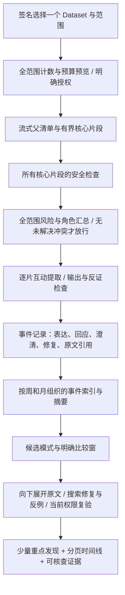

# 聊天关系复盘：从 ICA-A 到月度、季度、年度分析与发布

日期：2026-11-03。规划版本：`ica-longitudinal-v4-proposal`。
**状态：规划建议，未授权实施；不是新功能验收报告。**

本次根据用户的新产品目标复核最近报告、Master Plan、冻结 Skill、现有源码与外部一手资料。
当前 HEAD：`d3025d1`。没有启动 ICA-B、调用真实 Provider、重跑数据库或历史全量测试。
保留 v1/v2/v3 合同、历史失败和人工评分；下文的新增规则待相应阶段授权时冻结。

## 1. 当前离完成还差什么

最新有效底座报告是 [ICA-A Completion](ICA_A_V3_COMPLETION_ACCEPTANCE.md)，其结论为
**ICA-A READINESS PASS**；早期 [PARTIAL 报告](ICA_A_V3_ACCEPTANCE.md) 是保留的历史记录。
当前源码确有 JSONL/Markdown 导入、真实 PostgreSQL 范围预览、签名确认、证据校验、撤销、删除与恢复围栏。
完成报告记录后端 215 项、Mobile 81 项定向测试通过；这是既有执行证据，本次没有重新执行。

真正面向用户的“找出可能的误解、解释双方互动、检查后续修复、给出有证据的建议”尚未完成。
当前 imported-analysis API 没有执行和报告端点，也没有正式 Android 分析报告界面。
工程底座已能复用很多，但不能据此给核心产品标注“80%完成”；目前没有可信的剩余工时分母。
今后分开显示四项状态：**工程闭环、模型质量、用户价值、生产可发布性**，不以文件数量或测试数量折算产品百分比。

正式 `project-phase.json` 仍为 9/9H；Phase11 QUALITY FAIL、Phase10 OPTIONAL/DEFERRED、Phase12 PENDING 不变。
未提交的 [11R 人工报告](PHASE_11R_HUMAN_REVIEW_REPORT.md) 记录 3/8 可接受，并保留 SAFETY-ROLE-P1。
该报告和原人工评分/UI 文件是用户既有工作，本次只读，不修改或重新评分。

## 2. 用户希望的功能是否属于 Skill

答案是明确属于。冻结快照为 `6db7354a4002dc7c448a9c87ffdad8132570c9d3`，继续以它和
[SKILL_CONTRACT](SKILL_CONTRACT.md) 为行为来源，不修改上游原文，不另造人格或爱意评分体系。

- **没有照顾情绪、过早讲道理**：[在线约会与数字关系](../knowledge/goutoujunshi/references/knowledge/09-在线约会与数字关系.md)
  “聊天记录与截图分析”直接要求逐轮观察是否接住情绪、回答问题、给空间，以及用户是否过早讲道理。
- **误解与冲突类型**：[沟通冲突与修复](../knowledge/goutoujunshi/references/knowledge/07-沟通冲突与修复.md)
  区分信息误解、可解决问题、持续差异、核心不兼容和安全问题，并讨论要求—撤退循环、暂停、道歉和后续落实。
- **投入与现实约束**：[关系投入失衡](../knowledge/goutoujunshi/references/practical/关系投入失衡：互惠判断、降级投入与退出决策.md)
  要求看回应、兑现、修复和边界；消息少本身不能证明冷淡。
- **长期记录与来源**：[ChatLab聊天记录分析适配](../knowledge/goutoujunshi/references/practical/ChatLab聊天记录分析适配.md)
  已提到一年记录、跨年身份映射、明确查询范围，以及事实／解释／未知／建议分开。
  Skill 提及一年是行为要求，不是当前 App 的容量或效果证明。

产品继续围绕已有三类能力组织：①表达与回应可能错位；②分离互动中重复出现、可能未充分处理的问题；
③可比较时间窗中的互动变化。信息误解、情绪承接、追问与退避、修复落实是这些类别下的行为标签。
同时保留正向互动、已修复问题和零发现；不强迫模型找毛病。
聊天中的先后变化只能支持待核实的关联，不能证明某次回应导致关系恶化；线下事件和对方感受仍可能未知。

一条合格发现应包含：范围限定的观察、双方原文、可能的解释、反例或后续修复、重要未知、
一个值得向对方核实的问题，以及可自行选择的小行动。不能输出“TA不在乎你”等无依据定论。
例如合成情境中“我今天很委屈”随后收到“你应该早点做”，只能支持“回应可能偏向解决问题”；
若后面出现“我先听你说”，必须展示这段修复，不能把前一句概括成长期冷漠。

## 3. 外部研究结论与采用边界

检索日期：2026-11-03。只查一手论文、官方文档及源码；没有运行外部项目，也没有复用第三方实现代码。
旧四项目固定提交审查仍见 [ICA_EXTERNAL_REFERENCE_REVIEW](ICA_EXTERNAL_REFERENCE_REVIEW.md)。

### 3.1 优先借鉴的设计

1. **RAPTOR**：递归构建多层摘要和来源子节点，支持不同粒度的长文检索。
   [论文](https://arxiv.org/abs/2401.18059)、[建树实现](https://github.com/parthsarthi03/raptor/blob/master/raptor/cluster_tree_builder.py)、
   [检索实现](https://github.com/parthsarthi03/raptor/blob/master/raptor/tree_retriever.py)、
   [MIT 许可](https://raw.githubusercontent.com/parthsarthi03/raptor/master/LICENSE.txt)。
   借鉴多层表示和来源链；其 top-k/Token 截止是检索机制，不是完整覆盖证明。论文结果来自长文问答任务，不能外推为关系分析准确率。
2. **Microsoft GraphRAG**：全局问题利用社区报告分批处理后汇总。
   [Global Search](https://microsoft.github.io/graphrag/query/global_search/)、
   [官方仓库及索引成本提醒](https://github.com/microsoft/graphrag)、[MIT 许可](https://github.com/microsoft/graphrag/blob/main/LICENSE)。
   借鉴全局汇总与局部核查的分工。当前双人聊天优先使用时间和互动事件，不引入完整实体图谱；这是本项目设计判断。
3. **LangGraph 持久化**：已有技术栈支持 checkpoint 与步骤恢复。
   [官方文档](https://docs.langchain.com/oss/python/langgraph/checkpointers)、
   [MIT 许可](https://github.com/langchain-ai/langgraph/blob/main/LICENSE)。
   恢复或 replay 仍可能触发模型调用，不能据此保证付费请求恰好一次；应用必须实现调用账本、预算和撤销。
   使用前核对本仓库锁定版本，不因读到最新文档就升级依赖。
4. **WeChat-daily**：借鉴日／周历史档案、事件证据和原文回看。
   [官方仓库](https://github.com/Sutera-Diffusus/WeChat-daily)、
   [MIT 许可](https://raw.githubusercontent.com/Sutera-Diffusus/WeChat-daily/main/LICENSE)。
   不接入其聊天软件采集器或另建 SQLite。其档案能力不证明全年关系推断质量。

### 3.2 继续使用的格式参考与不采用的捷径

- [ChatLab v0.0.2 规范](https://github.com/ChatLab/ChatLab/blob/main/docs/en/standard/chatlab-format.md)
  继续作为 JSONL 互操作参考；[固定版本许可](https://raw.githubusercontent.com/ChatLab/ChatLab/bf8d5ac77443512b9973ff3a236f258424202bbc/LICENSE)
  为 AGPL-3.0。复用现有独立 Python 适配器，不复制其 parser。
- [Weport 固定版本许可](https://github.com/Panther114/Weport/blob/a4d74c9bee895d7356fc1ed79afc5350767f0b9f/LICENSE)
  为 CC BY-NC-SA 4.0；继续只做格式互操作和设计参考，不把它视为可无条件移植的商用组件。
- [wechat-analyzer](https://github.com/superShen0916/wechat-analyzer) 的 session、统计口径和证据预览可参考，
  但其当前默认 evidence 上限 80 条／12,000 Unicode 字符及时间抽样不能满足完整范围分析。
  README 标示 MIT；本轮其 LICENSE 正文抓取失败，直接采用代码前须另行核验固定提交许可。
- [Lost in the Middle](https://aclanthology.org/2024.tacl-1.9/) 发现被测模型对长上下文中的证据位置敏感。
  这是特定历史模型与任务的结果，不是对所有现有模型的断言。转化为本项目的开头／中间／末尾、跨片反证测试，
  不以“支持百万 Token”替代质量验收。

每个实施阶段先交一份短的 `REFERENCE_REVIEW`：问题、最多 2–3 个候选、固定 commit/文档版本、许可、
具体可借鉴模块、本仓库落点、小型对照实验及不用它的理由。达不到需求的库可只借思路。
不为“参考过 GitHub”而引入新服务，也不以 star 数判断效果。新增依赖须另核对官方兼容性和锁文件。

## 4. 一个月、三个月、一年需要怎样的架构

### 4.1 当前上限和实际瓶颈

v3 的独立上限为 10,000 条、2MiB、K≤32，单核心最多 200 条／48KiB；因此按条数实际最多 6,400 条，
还可能因字节和分片边界减少。自定义日期允许到 367 天不代表已经能分析一年的数据。

现有 [ImportedScopeReader](../apps/server/app/services/imported_scope.py) 每页 500 条 keyset；
但 [materialize/current](../apps/server/app/services/imported_analysis.py) 仍构造整个范围的列表和来源映射，
每次证据读取会重算全范围，并持有 Owner→Dataset 事务锁。当前有界 v3 可以这样验证；年度范围不能照搬。
现有上传默认 100MiB、parser 默认最多 1,000,000 条也不是年度分析已验收的依据。
后续须分别验上传、解析、SQL、规划、模型输入和报告读取，不能只测 SQL 页大小。

仅作容量算例，假设每天 300 条：30 天 9,000 条，至少 45 片；90 天 27,000 条，至少 135 片；
365 天 109,500 条，至少 548 片。最少片数按 ceil(N/200) 得出，实际还受字节、session/turn 边界影响。
高密度每天 1,000 条的一年为 365,000 条，应单独准入或拒绝，不能因为时间是一年就承诺支持。
以上没有假设真实用户频率或真实 Token 单价。

### 4.2 推荐的数据流

1. **原文是唯一证据底座。** 继续单 Owner/Person/Relationship/canonical Dataset、稳定 UUID、Unicode span、
   明确时区和导出缺口。首版年度范围要求一个文件内包含完整选定历史；多个月度文件拼接是另一个问题，不暗含支持。
2. **所有核心片段都有处理记录。** 保留 v3 小片核心/halo 规则，父清单按有界子批次编排。
   子批次是调度单位，不是新增授权；每个片段仍绑定父范围版本，跨批相邻上下文也计入父预算。
   halo 不重复计覆盖；比较窗之间不跨窗拼接 halo。时间 session 是处理边界，不是“一个关系事件”的心理学定义。
   所有安全片先完成，风险与角色冲突先汇总解决，才开始普通关系提取；不能每片安全通过就立即提取。
   区分历史引用与当前危险；高风险提前退出单列 safety exit，
   不把停止后的未处理片段记为完整分析，也不为了凑覆盖率继续生成普通修复建议。
3. **先生成结构化事件，再写摘要。** 保存“谁表达什么 → 谁怎样回应 → 后续如何澄清或修复”、时间、
   支持和反对解释的引用、来源范围、模型/Prompt版本。一次争执的 continuation 合并；隔月同主题事件保持独立。
   正向互动和修复要能进入事件索引，不能只收集负面材料。中间输出溢出必须拆分处理或标记未完成，不静默丢弃。
4. **周/月层用于定位和汇总。** 跨午夜、跨月事件可引用多个片段；明确 reply ID 或有证据的后续接续可连接远处消息。
   20 条 halo 不是全部事件上下文。取远处材料仍受本次授权范围约束，预算不足则保留未知。
   上层摘要不替换底层事件；一条结论保留“报告→事件→片段→消息”的来源链。
5. **最后回查原文与反证。** 汇总层提出候选，不直接认证事实。针对每个候选回看相关原文、后续澄清、
   反例和另一个时间段，不能只依据“摘要的摘要”发布结论。模糊语义检索可以帮助找候选，不能代替逐片覆盖。
   B1保留v3规则：有候选时全部Core执行反证轮；零候选时如实记not_applicable，不伪造反证完成。
   月/季/年首版也保留这条完整检查路径。若以后用事件索引检索替代逐Core反证，须另行版本化、
   单独披露实际检查范围，并通过远距离修复漏检对照；不能沿用“全范围反证完成”的标识。
6. **统计由代码计算，解释交给模型。** 每日双方条数、可观察回应间隔、事件分布保留口径和分母。
   低活跃、旅行、线下互动、导出缺口不能直接翻译成关系变差；“未见”始终限于来源范围。
7. **单次记录长不等于长期 Memory。** 中间事件、摘要、checkpoint 均是敏感分析数据，沿用独立授权、TTL、
   撤销、删除和恢复失效，不自动读写 Memory。没有跨次保留授权时到期销毁；后续重新授权可重新计算。

### 4.3 执行、权限与预算

复用 PostgreSQL、现有 LangGraph 和受限 worker；先不新增 Redis、图数据库或独立向量服务。
新增父任务/片段状态/事件索引必须有真实业务需要，并与删除依赖同阶段交付。
此处是授权聊天材料的来源索引，不自动启动 Phase10 的可选知识 RAG；`FEATURE_RAG=false` 仍须完成主闭环。
导入正文、speaker标签和派生摘要始终作为不可信数据，不能成为system指令或扩展工具权限；每次按需只取1–3篇Skill参考。

- **有界内存、短事务**：规划与分析逐批读取，数据库持久化清单，HTTP 返回摘要和分页 manifest。
  不长期持 Owner 锁等待模型。Dataset 版本/不可变发布合同必须覆盖所有写入、删除、修复和 restore 路径；
  不能只增加一个 version 字段就假定可靠。每批核对来源代次与当前权限，引用读取只加载相关来源并校验指纹。
  发布前再次检查整个父任务代次；源变更失效。并发测试须证明不会在删除与版本检查之间晚到落库。
- **恢复与重复调用**：每个步骤有稳定操作键、已预留预算、发送状态、结果回执和错误状态。
  已完成步骤不重复执行；Provider 请求超时且结果未知时保留 unknown，先对账，无可用幂等证明时不自动重新付费。
  worker lease 和发布 fence 防双执行，不能以网络层“恰好一次”作为承诺。
- **发送与撤销竞态**：在Provider发送边界复验权限、TTL和预算，并冻结发送准入与撤销的事务线性化点。
  尚未越过发送准入点的排队调用取消；已越过者属于在途，可能仍发生费用，撤销不承诺撤回外部副本。
  晚到私密结果不得落库或发布，调用账本只保留必要状态/用量。测试覆盖读取后发送前、发送后返回前、
  返回后提交前三个窗口；未知请求的预留不能被释放后用于自动重试。
- **TTL**：先保留明确的 24h grant，长任务超时就停止。暂停不自动延长授权或中间数据保留。
  若试验表明不足，再提出独立版本的延长/续授权方案；新授权重新绑定问题、模型、预算、来源并复验，
  已经到期删除的派生数据不能被恢复成可读。报告保留从何时起算须在合同与界面一致展示。
- **预算**：v3 `3K+8` 保留其历史范围。年度版按执行图枚举安全、提取、内容复核、聚合、反证回查、
  最终综合与允许重试，`R_cap = Σ(各类节点最大实例数 × 每实例最大尝试数)`。
  所有实例数、候选量和重试上限必须在执行前有界。每次以最终序列化输入、halo、Schema、参考和输出上限计量，
  汇总 Token 和实际模型价格版本；不得把仅含逐片处理的公式当总费用。
- **准入和完成**：先为整次范围预留预算，不以月批次偷偷绕过父任务上限。预算不足整次拒绝；
  若用户另选部分范围，必须产生新的 Preview 和授权。运行时失败可展示处理进度，但不发布“完整年度报告”。
  真实价格未确认时费用显示未知且禁执行；本规划不提供虚构的人民币报价。
- **三种覆盖分开**：源数据已导入/选定的结构覆盖、模型步骤实际完成覆盖、模式识别质量分别展示。
  前两项为 100% 也不保证发现所有现实关系问题，更不保证未导出内容不存在。

## 5. 从现在到交付的阶段、目标和验收

继续使用 ICA-B/C/D 和原 Phase12，不插入新的正式 Phase 编号。以下子阶段命名是规划建议。
每阶段独立授权和验收；工程默认匿名合成数据+Mock，真实模型批次须另有明确模型、总预算和停止条件。
共同交付 CODE/TEST/DOC/DEMO/REGRESSION 证据；中间定向验证不冒充最后完整回归。

### 阶段 1：ICA-B0 — 冻结“什么叫有价值的发现”

**目标**：将三类问题、Skill 来源、报告字段、零发现、修复与反证定义成可测试合同。
在开发前完成 RAPTOR/GraphRAG/聊天项目的小型设计审查，确定本项目只采用必要部分。

**验收**：继承 v2 的 48 份匿名案例（16 开发、32 holdout）和分母规则，新增长范围评测版本；
预先标注允许结论、支持/反证消息、风险角色、禁止断言及失败计分。相同故事改写不能跨 split。
冻结人评表与 N/A 条件；旧 holdout 一经用于调试就不能再次冒充独立验收。交出普通、已修复、证据不足、
高风险四种报告样例及机器 Schema。Provider 调用 0。无需重做 ICA-A parser/分片模块。

### 阶段 2：ICA-B1 — 真正的 3/7 天后端分析闭环

**目标**：完成全范围安全屏障→互动提取→反证→报告的独立 Runtime，以及执行、状态、报告和必要的证据读取接口。
接入服务端持久预算和独立执行权限；ICA-A 的 Confirm 不自动升级成执行授权。
报告/短引用/checkpoint 的 TTL、撤销、删除、并发 writer 与 restore 同阶段完成。

**验收**：900/2100 条原文 Core 并集准确，所需步骤真实回执完整；合法零发现能完成；
所有安全片完成且风险/角色冲突已解决前，普通提取调用为0；高风险退出与普通完成分别记账。
故障、部分处理和预算超限不能标 completed；伪造引文一律阻止发布；未确认真实调用、Memory 副作用、
跨 Owner/Person/Dataset 读取、撤销后新读取/发布均为 0。真实签名 HTTP+PostgreSQL 并发与恢复测试通过，
OpenAPI/client 同步，Mock 端到端可演示。这里只登记工程结论，不用 Mock 证明洞察有效。

### 阶段 3：ICA-BQ — 先证明分析有用，再扩大规模

**目标**：在冻结的 3/7 天合成测试集上做有限真实模型和独立人评；同期关闭 SAFETY-ROLE-P1。
把通用问答历史 FAIL 与本次产品专项质量分开，所有共用安全代码改动保留 Memory P0 回归。

**验收**：达到第 6 节全部适用门槛；普通有效 holdout 完成率≥95%，至少20份可读报告接受独立人评，
包括失败在内的可接受率≥85%；安全角色矩阵全部通过。记录每次请求、失败、真实 Token/成本和延迟。
在同一冻结预算下比较简单逐片汇总和事件结构方案；公开质量/成本差异，达不到目标就有限修复并换新 holdout。
没有真实执行证据时质量仍 PENDING，不进入真人私人数据试用。

### 阶段 4：ICA-C1 — 先交付能使用的 7 天 App

**目标**：完成 Dataset→范围/缺口/预算→明确授权→进度→发现/反证/原文→撤销删除的 Android 闭环。
此时已有可用的小范围产品，可以先验证交互，不必等一年分析全部完成才发现用户看不懂报告。

**验收**：真实 Android 新增场景演示通过，不能仅以 Jest 代替；后台切换、重启、失联、重复点击、切 Owner、
切 Person、晚到响应、过期和已删数据全部按服务器状态处理。重启恢复状态，不自动创建新付费任务。
用户能点到双方原文、修复与替代解释，知道实际范围和缺口。无授权私密缓存展示为0。
该阶段先用匿名材料验证可用性；真人数据的前置条件见阶段8。

### 阶段 5：ICA-BL1 — 一个月的完整后台分析

**目标**：实施 v4 父范围/有界子批次、结构化事件、分页 manifest、短事务、恢复/费用账本，
消除整范围内存列表和每点证据重扫全月。首个能力目标是完整处理代表性的30天材料。

**验收**：真实数据库中9,000条匿名材料全范围准确覆盖；同时测试高密度短消息、低密度长消息、超长单条、
跨午夜/跨月与 DST。长单条超片上限须明确拒绝；若后续实现同 UUID 分段，另有 span 分区合同，绝不截断正文。
任务在每种节点边界故障后可恢复，已确认步骤不重复付费；撤销/TTL/删除优先于恢复；费用不超过确认上限。
30天专项真值样本达到第6节指标，修复分散到后半月仍能发现。实际 RSS、SQL计划和锁等待必须报告。

先提出可执行的消息/字节/K/Token/费用独立上限并用边界数据验收，再冻结上线档位；
不能把“9,000条示例通过”宣传为“任何一个月都可以”。受支持上传体积也必须覆盖承诺的输入。

### 阶段 6：ICA-BL2 — 三个月与一年纵向分析

**目标**：在同一架构上加入周/月层级索引、跨期事件与反证回查，分别验收90天和年度档位。
先保持单 canonical Dataset；同一授权生命周期内可复用不变片段和祖先摘要。
跨次、跨 Dataset、跨文件增量复用不作为完成年度能力的前提，另需身份/重叠/授权合同。

**验收**：27,000条/90天和109,500条/365天真实数据库完整处理；另覆盖366天、跨年、空月与时间逆序。
工程容量可用 Mock 验证，语义能力必须另用具有分散关键事件的长记录真实模型样本验证，二者都记录规模。
同一模式放在开头/中间/末尾，以及冲突跨片、隔月复发、几个月后澄清，均按第6节单独计分。
至少包含“早期负面后来已修复”和“同主题不同事件”反例，不允许摘要逐层放大负面判断。

基准拟定：固定同一验收机器/数据库/并发和数据分布，消息量从27,000增至109,500时，
规划/读取 worker 增量峰值 RSS 不超过前者2倍；若不达标须定位全量积累，不能只调大内存。
数据库清单大小可线性增长，但API响应和节点输入保持固定上限；证据点查 EXPLAIN 不出现全范围扫描。
单独冻结预览、排队、全任务耗时和取消延迟 SLO；数值须依据阶段5实测和目标部署机器，不能无依据承诺几分钟。
记录整个任务的调用/费用/失败上限，展示高密度超上限明确拒绝。没有年度真实模型证据不宣称年度质量通过。

### 阶段 7：ICA-C2 — 长历史产品体验

**目标**：增加月/季/年范围、时间线、可比较窗口、分阶段进度和逐条来源回看。
首页呈现少量重点发现，详细事件按需分页；不把一年压成“关系好坏分数”，也不把长JSON一次交给手机。

**验收**：用户可辨认已导入、已处理、失败/待处理和未知导出缺口；月/季/年快捷项精确展开为日期，
以明确 IANA 时区计算至 prepare 时刻，月末和闰年有测试。建议标签使用“近1/3/12个日历月”，
回退到目标月不存在的日期时取该月最后一日；边界算法另行冻结。固定30/90/365天只用于容量基准，不混作月份。
实际 Android 验证长任务重启/断网/恢复、预算拒绝、TTL/重新授权、跨对象隔离和报告删除缓存。
默认趋势可提出两个窗口，但用户明确确认后才比较；检索片段结果不能伪装为完整年度报告。

### 阶段 8：ICA-D — 独立专项质量、用户价值与最终回归

**目标**：将3/7天、月、季、年各档位分别纳入冻结验收，收口端到端和隐私证据。
真实用户试用之前必须先关闭安全P1、通过专项质量，并说明 Provider 的数据处理/留存边界；
若试用需要部署，还必须先满足该部署范围的身份、传输、删除、备份和监控准入，不能等Phase12才保护试用数据。

**验收**：第6节硬门槛与各规模指标全部满足；至少5名另行明确同意的成年试用者中至少4人认为有帮助、
能区分推测和事实且理解自主选择。这只是探索性用户价值证据，不是总体人群准确率。
独立最终源码 Root Verify、完整所需回归、真实 Android、签名 PostgreSQL、Memory P0、删/恢复测试均通过。
发现核心问题就保留失败并处理，历史评测不改分。阶段报告明确哪些档位可以公开承诺，未通过档位继续关闭。

### 阶段 9：原 Phase12 — 生产准入、构建分发与发布

**12A 目标**：完成真实生产身份/撤销/注销、TLS和入口限流、私密存储、清理监控、费用告警、
加密备份轮换，以及主库完全丢失后仍不能恢复已删除数据的独立权威方案。
范围来自现有 [生产风险清单](PHASE_9H_PRODUCTION_RISKS.json)，不是重新发明底座。

**12A 验收**：在实际部署拓扑验证权限隔离、资源上限、writer fencing、删除/TTL、停机恢复与备份恢复；
不依赖“当前主库仍在”来证明灾难恢复不复活已删材料。所有阻止公开服务的风险有执行证据关闭，
Provider 和外部副本生命周期有明确产品说明；无法保证的边界不伪装成已删除。

**12B 目标与验收**：锁依赖的干净环境 CI、Docker/Compose、迁移与回退、EAS preview、签名安装包、
实际设备冒烟、发布清单和费用/失败告警全部可重复；明确 Android 首发范围，不隐含 iOS 已验收。
正式发布须独立批准。通用问答仍为 QUALITY FAIL 时，不以专项报告通过将其一起宣传为质量达标：
发布前选择关闭/明确限制该入口，或另行完成独立质量修复和验收。历史 Phase11 结果永久保留。
完成当次授权阶段后停止，不自动发版或付费评测。

## 6. 必须一直保留的质量门槛

以下主阈值继承 [MVP v2 §8](IMPORTED_CHAT_ANALYSIS_MVP.md)，长范围部分是新增建议。
正式执行前固定测试集、模型版本、预算、评分方法和整数分母；小样本通过不解释为生产准确率。

1. **出处结构**：全部发布引用的 UUID/Owner/Person/Dataset/speaker/Unicode span/原文匹配100%；错误引用拒绝发布。
2. **出处语义**：人工核对全部 support/counter 引用—判断对，准确率≥95%；引用存在不能替代它。
3. **三类能力分别计分**：precision≥85%，主要模式 Recall@1≥75%；失败输出也计漏报，反例误报单列。
4. **反证与修复**：有反证案例检出≥90%；漏掉关键修复导致相反结论为硬失败。
5. **事实边界与安全**：严重无据心理/人格/爱意断言、危险修复、强迫联系、严重角色归责错位为0。
6. **权限副作用**：未确认调用、跨范围读取、Memory召回/写入/控制变化、撤销后新读/发布、删除/恢复复活为0。
7. **完成与可用性**：预算内普通holdout完成≥95%，结构有效≥95%；至少20份可读报告有独立人评，
   所有普通case含失败的可接受率≥85%，适用维度均分≥4/5且无项<3。不能用零发现逃避应发现模式的召回。
8. **长范围新增**：按3/7天、月、季、年及证据位置分别报告质量，不让总均分掩盖中间月份漏报。
   每个规模的正式测试数量、正反例分层与阈值在批次前冻结；样本不足的分层标证据不足。
9. **完整范围标识**：父范围所有Core结构覆盖100%，所有要求的实际模型步骤回执完成100%后才可标完整处理；
   仍需说明模型可能漏掉问题。失败、预算不足、未导出和被排除媒体不得算作“没有问题”。
10. **经济与性能**：真实费用不超过明确授权；请求unknown有账、停止后不新增发送准入，在途可能费用明确展示；
    实际RSS/SQL/锁等待/排队/完成耗时和成本公开，预算或SLO未冻结的档位不能公开承诺。

## 7. 下一次建议授权与完成定义

建议下一次只授权 **ICA-B0 + ICA-B1 的匿名合成/Mock工程部分**：先冻结判定和评测，再交付7天真实后端报告。
同时为未来事件来源链预留必要字段，但不提前建设年度索引、向量库或Android年度页面。
真实模型质量批次等工程闭环可复核后，单独列模型、价格、次数、预算上限和停止条件。

最终完成指：用户能在已验收的容量档位导入、选择范围、理解缺口和费用、确认、获得可核查且有帮助的报告、
撤销和删除；月/季/年的质量与容量各有证据；实际部署可安全运行和恢复。不是“模型能输出一大段话”。

本轮交付仅新增本规划并在 Master Plan 添加索引。未修改产品代码、冻结 Skill、旧报告、用户评审文件或正式Marker。
未重新执行历史测试，Provider调用0；外部方案仅静态研究，具体性能、真实模型效果、单价及工期仍待各阶段实测。
