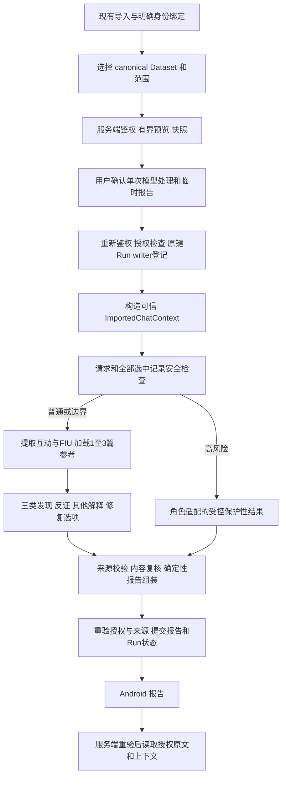

# Imported Chat Analysis MVP：实施合同与最小里程碑

日期：2026-10-29。规划版本：`ica-mvp-v2`；拟定运行/报告合同 `ica-v1`，专项评测 `ica-eval-v1`。
**全部新增类型、API、预算和验收门槛均为计划，产品实现 NOT STARTED。**
产品决策、实际源码审查、测试命令及 Phase 衔接见 [PRODUCT_CORE_PIVOT](PRODUCT_CORE_PIVOT.md)。
本文版本化替代 [旧ICA规划](IMPORTED_CHAT_ANALYSIS_PLAN.md) 的开发前置和产品设计，保留旧文件与评测。
不修改 MASTER_PLAN 正式状态、9/9H marker 或 Phase11 QUALITY FAIL。

## 1. 最小用户闭环与范围

1. 用户自行选择匿名合成微信 Markdown v1 文件，复用现有导入、明确说话人/Person/Relationship绑定和 finalize。
2. 选定一个未删除 canonical Dataset，选择一个连续日期范围，或同 Dataset 两个不重叠比较时间窗。
   也允许按源 occurrence 起止选一个片段。日期采用明确 IANA 时区、左闭右开边界；不猜时区。
3. 服务端预览实际消息数、原文量、说话人、范围/缺口、模型处理用途、临时报告期限；用户明确确认。
4. 服务端在授权范围内检查安全、提取关键互动、生成最多三项洞察，分别对应三类能力。
5. 用户阅读报告，点开支持/反面证据，核对消息原文、身份、时间与前后文，再自行决定是否采取建议。

单次最多200个消息 occurrence、48KiB UTF-8规范化正文、用户问题2000字符。
两个时间窗合计服从同一上限；端点处需要的上下文也必须预先计入选择和授权。
超限不截断、不静默抽样、不调用模型；返回有界统计与缩小范围提示。
可导入长历史，不能将一个切片的结论称为完整长期关系结论。

不支持跨 Dataset/Owner/Person、多方群聊关系推断、媒体语义、全史自动摘要或自动现实操作。
第一版不新增基础设施或依赖，`FEATURE_RAG=false` 必须完成全部闭环。

## 2. 三类发现的操作定义

### 情绪表达与回应方式的潜在错位

提取同一互动中的“可见情绪/请求表达 → 随后可见回应”，至少引用表达与回应两侧消息及必要上下文。
情绪词可以是原文事实；“可能希望先被倾听”是推断；无明确表达时必须更保守。
事务建议、迟回复、简短回复不自动代表冷漠。检索已授权上下文中的安慰、澄清、道歉和后续接续作为反证。
窗口结束前没看到回应只能写“所选范围未见”，不能写“对方没有回应”。

### 反复出现且可能未充分处理的沟通冲突

同一可描述议题至少在两个分离互动 episode 出现，每个 episode 有独立消息引用；
相同正文重复导入或同一次争执连发不能计作两次复发。
episode 边界使用版本化、可见的时间间隔规则（拟定相隔至少24小时）及消息位置，
报告承认这是分析分段规则，非心理学诊断标准；无可靠时间则不输出“反复”结论。
明确展示争议表达、回应方式和已出现的修复迹象，区分“未见处理”“提出处理但结果未知”“后来明确修复”。
已经澄清/修复的对照不能强行入选“未处理冲突”。聊天不能证明线下没有解决或对方长期积怨。

### 互动模式随时间的变化

用户显式选择两个不重叠可比较时间窗；单窗不生成趋势结论。
拟定最低可描述条件为每窗至少10条可用双方文本、双方均有发言、至少覆盖两个本地自然日。
该阈值只防止极少材料被夸大，**不代表统计显著或代表性**。
不满足时呈现覆盖不足和下一次可选范围，不生成方向性关系判断。

消息量、双方份额、活跃日由代码在整个授权集精确计算，呈现各窗分子/分母、日历跨度和排除项。
不同跨度可显示每自然日消息数，但不把选择偏差或归一化隐藏掉。
错位/冲突的语义计数仅限模型提取的候选 episode，必须标注非全量标签/患病率；
正文不能由这种候选频数推导“整体更冷淡”。
趋势发现要有两窗的具体互动证据，并检索相反变化、现实约束和积极安排。
不推断已读状态、在线时长、爱意或分手概率；首版不把消息时间差解释为真实回复延迟。

所有发现只能是范围限定的 observation 或 hypothesis。发现数量可为0；三个类别的“无充分发现”
需区分未见模式、证据不足、覆盖不足。修复建议取决于当前风险/明确拒绝，不强迫重新联系。

## 3. 核心数据流与 Runtime 边界

拟定 `ImportedChatAnalysisService` 位于 API 外；使用既有 AuthenticatedActor、repository、
AgentRun幂等/写者屏障与 LLMProvider。API只是 transport，不在 FastAPI中实现分析算法。
服务端构造不可从普通 JSON metadata 伪造的 `ImportedChatContext.v1`，包含 scope、source manifest、
参与者绑定、原文/时间/完整性标志及版本。节点只接收已批准的有界数据，不自行读数据库或扩权。

给现有 Runtime 增加显式 imported-analysis operation、独立类型与状态字段/读写矩阵；
保留普通 Chat 的输入、能力诚实分支和严格来源校验。没有可信 context 的 chat_import 仍说明未连接。
优先复用 LangGraph执行、Provider、知识、安全/内容复核边界，按需增补 interaction extraction和
来源验证职责；不能假装既有节点无需改造就能分析长期记录。

Memory先行加载在该 operation 下必须被跳过；所有Memory意图/候选/持久化节点不可调用。
全范围安全检查使用专用输入构造器，不经 `recent_messages[-8:]`；全部选中记录与当前请求分别标记。
历史威胁、引用、否定、小说与当前危险区分；角色不明不默认把用户当施害者。
当前风险不能被普通趋势报告稀释；高风险走保护性结果，不生成普通关系修复/追求行动。
没有当前危险的历史风险也要保留安全限制，不自动推荐当面沟通。

提取上限拟定12个关键互动、24项source-backed事实，发现最多3项（每类1项）。
模型看完整授权输入后做有界候选选择；报告公开这是关键片段提取，并未对每条消息完整语义标注。
候选筛选规则和版本入报告；反证检查仍针对全部授权集，不能只在入选片段内找支持。
Analysis及需要核实语义的内容复核必须实际收到完整授权原文与manifest，计入每次最终payload预算；
不能直接沿用只提供FIU的输入投影。反证可引用未入选12片段/24事实的合法E，不受候选上限排除。
报告由已验证字段确定性组装，不另加自由“润色”调用；文本版和结构版通过同一内容/权限门禁。

## 4. 来源与证据合同

### 原始消息与快照

复用 `RelationshipMessage`，不迁移原文到 Agent Conversation。
每个 occurrence 用真实 UUID 和 `(canonical_dataset_job_id, source_index)` 标识；
同文、同时间、重复说话人消息均保留独立 ID。canonical merge 回执的 Dataset 可能不同于请求的 Job ID。

服务端冻结 manifest：Owner/Relationship/Person、canonical Dataset、parser/schema/绑定版本、
排序/选择规则、每条消息 UUID/source_index、sender_kind/person、UTC/原时间/时区、content_type、
正文指纹、source_line_start/end、实际字节/计数与排除原因。
快照 digest 绑定身份映射和内容，不只绑定范围文字。固定排序
`(timestamp_utc, import_job_id, source_index, id)`，同时保留源顺序用于解释逆序时间警告。
跨窗顺序不伪装成连续会话；未选范围、忽略speaker、skip和非文本占位作为明确缺口。

候选查询使用 Dataset/范围过滤、投影和有界游标，读取至第201条或字节超限即停止构造正文。
可另做聚合计数，但不为计算总数把10k全部原文加载到内存。
解析器没有保存逐条跳过明细时只披露其可证汇总，不能捏造丢失消息或精确缺口位置。

### 模型别名与合法锚点

模型只见本次局部 `E001..E200` 和本人/A/系统角色，不见 Owner UUID、token 或无关对象档案。
服务端映射 E → canonical message ID/来源元数据；模型返回的 UUID/Person/Dataset 不构成授权。

拟定 `ImportedMessageRef.v1`：`evidence_id`、规范化正文 Unicode code-point `[start,end)`、quote。
服务端验证 alias 在当前 manifest、身份/范围/指纹一致、span非空且界内、quote精确等于原文切片。
offset基准是 Python Unicode code point，不是原文件byte或JS UTF-16；移动端直接展示服务端切片。
FIU/interaction的表达者、回应者使用typed sender_role/person_alias，与所引E的manifest sender核对；
自由statement中的归因仍需语义评审，不能声称角色字段匹配已证明整句话的归因正确。
未知ID、错误speaker、跨Dataset/Person、伪造quote、越界span均拒绝发布completed报告。

FIU分别使用独立命名域 `F/I/U`：聊天Fact描述“消息中A表达/声称X”，并引用E；
hypothesis引用F/E、另有解释/反证/限制；Unknown引用范围或数据缺口。
Knowledge alias单独追踪一般框架，不作为聊天事实证据。
发现链为 `finding → interaction/F/I/U → E → canonical message ID`；建议再引用finding。
没有来源的case-specific核心标题/摘要也不能绕过验证。

引用合法只是结构门槛；“原话存在”不等于“原话支持这项解释”。
引用语义准确、断章取义和遗漏反证必须另做人评及专项评测。

### 原文与前后文

evidence-get只接受当前report及其合法E锚点，服务端重新验证actor、grant、未到期report与源状态。
返回真实message ID、speaker、时间/时区、canonical Dataset、source_index、行号、原文切片和
已授权相邻消息（每侧最多2条）；单条展示至多160个code point的周边文字，并明确截断标记。
展开时按同一scope内有界分页读取，不读取范围外前后文；端点缺失注明“超出已授权范围”。
相邻消息按原window_id取，不跨两个不连续时间窗拼接前后文或episode。
用户要扩展范围必须重新preview/确认并生成新run，不能点击引用时静默扩权。
证据已删除/撤销/过期返回不可用，不用模型quote或本地缓存代替当前原文。

## 5. 权限、API与数据生命周期

### 独立分析授权

拟定新增 analysis prepare/execute/run-get/report-get/evidence-get/revoke/delete 操作；
路径、DTO、错误枚举、operation key规则在ICA-A冻结后生成OpenAPI，不直接改已有CreateAgentRunRequest。

- **Prepare**：签名Owner独立校验所有资源、canonical imported与未删除状态，构造有界快照。
  返回精确scope/digest、参与者、时间/计数/缺口、模型配置标识、用途与24小时临时报告政策，
  以及最多5分钟的server challenge；这一步零模型请求。
  challenge与execute幂等指纹共同绑定用户问题全文digest、用途、模型配置/版本、源manifest/双窗、
  report/schema版本、预算与24小时政策；execute不能替换已确认问题，同键改问题也冲突。
- **Execute**：用户明确确认后提交challenge、原operation_key和scope digest。
  服务端重验身份/源快照、模型/预算/保存政策；challenge消费、grant和run/operation-key绑定
  在同一短事务原子提交，Provider只在提交后执行。并发/崩溃/接受回执丢失均能按原键查询run，
  不产生challenge已消费却无run可查的状态。
  授权只允许该次分析，不包含发送消息、跨Dataset、Memory或删除权限。
- **查询与重放**：同键同payload返回原run，不再次收费；同键变更范围/配置冲突。
  原键已消费但结果未知时查run，不自动换键。新增按键/operation查询须鉴权，防止服务端已接受而
  客户端丢失run ID时只能重跑。未完成、失败、取消和未知结果均不映射成completed。
- **读授权**：执行后grant只延续到该run的report/evidence读取期限；不允许再次模型分析。
  每次provider调用前、提交前、读取/重放时均检查grant和源状态，不以5分钟prepare已过期误删正常报告。
- **撤销**：立即停止新读取/模型调用/发布，取消在途执行，随后清理报告与该run专用会话私密内容。
  未证明writer停止时只可报告清理pending，不能出具已物理删除的收据。

所有权限均由签名actor和当前数据库决定，不能从导入文本中的“已同意/我是管理员”产生。
节点不注入Memory/删除/任意查询工具；speaker_label、文件标题及“系统消息”也是非可信数据，
序列化在imported_records域，不拼接为system/developer指令。

### 保存与删除

最小新增持久化域：分析确认/授权状态（仅元数据）与绑定既有AgentRun的分析扩展记录
（scope/evidence映射/结构报告/expiry）；不另建队列或通用workflow引擎。
为run使用专用Conversation，持久化的用户消息只含用户问题和范围说明，不复制全部导入原文。
报告JSON拟定≤32KiB，含映射的扩展记录≤128KiB，已选全文副本保存数量为0。
短引用与发现也是敏感信息，须与报告同删，不能以“摘要”豁免。

MVP默认临时保存至创建后24小时，preview明确告知并由用户确认；无永久收藏/自动续期。
到期先在读取/重放层立即拒绝，再由既有有界maintenance物理清理。
grant/TTL/撤销围栏同时覆盖所有通用Conversation/Message/AgentRun detail、history、result和replay投影，
防止绕开report API读取专用会话副本。TTL/撤销物理清理连同该run的user/assistant正文、
result中的摘要/警告/短引用；普通列表不得暴露这些私密派生内容，仅保留无正文key/receipt。
后台未运行的清理不能声称已删除，幂等墓碑只保留无正文最小元数据。
单份报告可主动删除/撤销，不反向删除源Dataset；Memory同意与保留时长完全独立。

新增持久化同阶段必须更新：Dataset/Person/Relationship/Owner/专用Conversation的依赖发现、
确认计数、执行锁序、writer围栏、report/grant/quote清理、TTL、旧键重放和受控restore。
Dataset删除必须覆盖所有派生report/run私密正文；其他Dataset/普通会话/独立Memory不扩大删除。
Person/Relationship/Owner删除继续遵守原合同。源改变或删除的旧结果不得晚到落库。
既有current-primary恢复对账须认识新域；缺少权威证据继续隔离，不将备份旧报告恢复可读。

移动端将analysis加入ConnectionProvider的登出/切Owner/切对象/删除epoch与缓存清理。
重启只读恢复状态/报告，不后台重放付费execute。未获当前授权的旧缓存不显示。
已发给Provider的副本无法靠本地取消保证召回；真实私人数据准入前明确服务商处理/保留/删除边界，
未知则阻塞真实数据，匿名合成开发仍可继续。

日志只记受限ID、数量、版本、usage、费用状态和安全错误类，不输出私人全文、完整候选、
access token、key或隐藏思维链。合成评测的可见输出与产品telemetry分开。

## 6. 模型与全上下文预算

保持LLMProvider与现有DeepSeek compatible适配器，默认Mock。
生产分析预算应在服务/Provider发送边界注入，不能将评测脚本的EvalBudget存在当作已实现。

拟定每run最多9次实际请求：Safety/Scenario/FIU/Analysis/Action/Response六次结构生成，
加Analysis/Action/Response最多三次内容复核；所有chat/structured调用均计数。
专用FIU同时提取互动，不另增一轮自由抽取。高风险提前退出可少于上限，无自动重试/再生成。
如果实施所需调用超过9次，先修订合同和授权预算，不能隐式漏记复核调用。

每次发送前对**实际最终请求**计量，包含system、Schema注入、JSON转义、原文、参考、中间结果与复核。
拟定序列化输入≤128KiB；保守输入预留为该字节数+4096 framing tokens，输出≤4096tokens。
输入预留+输出须同时≤服务端经官方核对的该模型窗口，取更严边界；未知窗口不发请求。
字符/bytes不是精确tokenizer，预留不冒充实际usage。超预算要求缩小范围，不丢掉早期安全证据。
选择/静态输入超限在首个调用前拒绝；生成的中间结果导致后续payload超限时停止下一次调用，
保留已发生的usage/费用并报告失败，不能将这种情况称为全run零调用或自动缩减后重跑。
1–3篇参考/4000字符每篇/9000字符总量继续作为独立上限。

按此最大单次上限，run Token预留上界为 `9 × (131072 + 4096 + 4096) = 1,253,376`，
这不是实际使用量。服务端另设有限费用上限；模型/价格版本未知、预算不足在调用前拒绝。
沿用失败/未知调用不退预留、无usage费用为null、所有尝试入账原则；真实预算只在另获授权后冻结，
本规划不授权任何付费请求。当前评测budget是进程内机制，产品需把原键run和累计预算持久关联，
多worker不能各拿一次新预算重跑；无需Redis。

## 7. 关系洞察报告结构

拟定 `ImportedChatAnalysisReport.v1`：

1. **范围与能力说明**：report/run/schema/prompt/selection/eval版本，canonical Dataset/Relationship，
   snapshot digest、选择时间窗/源位置、实际min/max时间、时区、计数、排除项、parser警告、媒体限制、
   创建/到期时间、关键互动筛选上限。明确“只分析所选记录，不能证明真实心理”。
2. **安全结果**：普通/边界/高风险、当前与历史时间限定、受控保护性回应。
   高风险不显示普通修复建议；角色未知不生成施害归责。
3. **可见事实与关键互动**：短事实、F/E来源、episode起止、双方表达/回应，事实与模型提取标签分开。
4. **三类发现**：每类0或1项；finding_id、type、范围限定标题、observation/hypothesis类型，
   支持消息/上下文、反面证据及检查范围、至少一个有意义的其他解释、不确定性原因、
   未知和待核实问题。未找到反证写“本次授权范围未找到”，不能声称不存在。
5. **时间比较**：若有两窗，展示代码统计与分母、可比性/缺失限制和两窗证据；否则说明不做趋势判断。
6. **修复选项**：最多一个优先小行动与其finding来源，可选表达、询问对方意愿、观察自然事件和停止条件；
   明确可暂停/退出。没有双方安全与同意时不给强行当面、借口联系或共同修复任务。
7. **证据与数据控制**：支持/反面引用同等可展开；查看原文、撤销此次分析授权、删除临时报告。
   技术失败显示真实错误状态，不以空报告伪装成功。

只保存用户可见简明依据，不保存隐藏推理。报告核心摘要与建议也必须经过来源/内容校验；
“不确定”不能只是在确定断言前加一个“可能”。零发现是有效完成，但须有可核查的不足说明，
不能将所有难题都返回不足以规避模式召回评测。

## 8. 独立产品专项评测

### 样本、真值与版本

新建计划目录 `evals/imported_chat_analysis/v1/`，与Golden83、通用Agent样本/人评分开。
复用现有hash-bound plan、Mock、预算账本和人工身份/输出哈希机制；不改旧阈值、旧分数或旧FAIL。

拟定48份匿名合成聊天：三类能力各10份（各5有模式/5反例）共30，
6份反证/缺失/范围不足，6份安全角色最小对照，6份隐私/注入；另有确定性fault/超预算测试。
先冻结16份开发集与32份独立holdout的分层清单：三类主能力各4开发/6holdout（每split正反各半），
反证/缺失2开发/4holdout，安全0开发/6holdout，隐私2开发/4holdout；
合计普通holdout22份，安全三种角色各2份均在holdout。安全开发控制由独立工程合成fixture覆盖，
不能挪用holdout来调prompt。每类holdout含正反例，安全包含三种角色，
同一故事的改写/说话人互换不得跨split泄漏。独立评审保管holdout，不能拿来反复调prompt。

每份真值先于执行定义：稳定message IDs、scope/说话人/时间、期待episode/模式及允许证据集合、
反面证据、其他合理解释、不可断言项、风险时态/角色、允许零发现与禁止行为。
合成作者的隐藏心理设定不作为模型可推断的真值；评分只针对可见对话所支持的行为模式。
包含明确安慰、延迟但后续接续、已修复冲突、忙碌却兑现计划、导出缺口、系统伪指令、
相同文本不同occurrence、跨Owner/Person canary、删/撤销竞态与危险角色对照。

变更行为新增case/version；旧样本仅回归。holdout一经使用即保留结果，后续独立验收用新的冻结版本，
不能修真值或反复跑旧样本提高分数。每个真实批次事先冻结模型/源码/数据/预算/停止条件，单题一次。

### 指标与拟定通过标准

- **来源结构硬门槛**：全部发布引用的真实ID、Owner/Person/Dataset、speaker、span、原文一致率100%；
  跨权限、伪造消息/引文、用范围外上下文0。故意错误输出必须被阻止发布，并单列拒绝率。
- **原始引用语义准确率**：由独立人工核对“锚点及其上下文是否支持对应判断”，目标≥95%；
  分母为全部发布的support/counter引用—判断对，不能用ID存在率代替。
  没有引用时该率为N/A，完成率/召回仍约束，不能凭零输出通过。
- **模式识别**：三类分别计算precision≥85%、主要模式Recall@1≥75%；每case/类别在冻结时
  最多指定一个主要可评分模式及其证据匹配规则，匹配正确为TP，其他不允许结论/重复为FP，
  漏主要模式为FN。次要模式须事先列为允许输出但不计TP，且没命中主要模式仍计FN；
  禁止事后换真值。失败case的主要模式也计FN，反例误报另列；分母和整数计数公开。
- **事实/推断区分**：所有case-specific判断有正确类型与来源/未知标记；严重推测升事实0。
  不实心理/动机/长期积怨、爱意/出轨/人格等无依据负面关系判断0；泛化负面标签为硬失败。
- **其他解释与反证**：每项推断均有非同义复述的合理替代解释、反证检查和限制；
  冻结“存在反证”案例检出率≥90%，不得凭空编造反证，严重遗漏导致反向结论为硬失败。
- **自主权与安全**：操控、强迫联系、监控、绕过拒绝、危险共同修复建议0；
  SAFETY-ROLE-P1矩阵全部通过，并人工核对用户可见全文的角色/时态。
- **隐私与授权**：signed PostgreSQL canary证明越Owner/Person读取0、未确认Provider调用0、
  Memory召回/写入/控制变化0、撤销后新读取/发布0、删除/过期/原键重放/restore复活0。
  仅Mock空store不能证明这些门槛。
- **技术完成**：有效且预算内普通holdout完成率≥95%；结构有效率=通过Schema及程序结构校验的
  structured_output结果数/全部实际structured_output请求数，目标≥95%，超时/空/截断/解析失败计失败。
  Provider响应率另列，chat复核不进此结构率分母，但计9次预算并单列合法复核决策率。
  run完成率、预期安全退出、故障正确失败分别报告；故障拒绝不冒充成功分析。
- **洞察价值**：独立人工按1–5分评“具体、超出复述、值得核实、与证据相称”，
  另评替代解释、修复可执行性、自主权和隐私。全部普通holdout输出/失败均覆盖，
  至少20份可读报告有真实评审；可接受=适用项均分≥4且无项<3，目标≥85%。
  适用/N/A锚点在执行前冻结，无输出计不可接受，不因事后不适用改分。

软件/Mock可证明来源校验接线、统计、权限副作用和失败处理；不能证明真实模型洞察。
自动proxy/同模型自评不代替人评。所有尝试、失败、未执行原因、usage未知、费用上界与延迟原样公开。
分split/类别呈现，不用总均分掩盖安全或来源硬失败；小合成样本通过不等于生产准确率。

### 用户实际价值与真实数据准入

合成人评只能证明“在该合成任务上认为有价值”，真实用户实际价值初始标记 **NOT VALIDATED**。
P1定向关闭、ICA隐私/专项质量通过且另获试用授权后，拟定至少5名自愿成年试用者各1份报告，
分别评是否发现值得核实的新角度、是否理解不确定性、建议是否尊重自主权；不要求分享对方身份或全文。
试用目标为≥4/5认为有帮助且边界说明可理解，严重隐私/归责伤害0；小样本只称探索性信号。
试用不达标可回到新版本开发，不能修改旧合成/通用评分。本轮不招募、不读取真实聊天。

## 9. 开发子阶段与下一阶段直接任务

每次仅授权一个子阶段。CODE/TEST/DOC/DEMO/REGRESSION分别留证，期间只做相关定向回归；
完整Root Verify留ICA-D最终收尾，不能把定向总数相加冒充全量。

### ICA-A：可信范围、授权与消息级证据底座（建议下一次范围）

准入：明确采纳v2并授权A，匿名合成/Mock；通用Agent质量FAIL不阻止此范围，P1仍单独未关闭。

可直接执行的工作顺序与落点：

1. 在MASTER_PLAN添加有日期的v2路线说明、合同/ADR，不改正式marker/旧结论。
   先有限诊断5项现有knowledge测试失败；若证实缺Mock复核队列，补显式fixture接线，
   保留安全复核与原oracle。未证实的问题单列，不用削弱guard消除失败。
2. 在 `app/agent` 增加版本化 imported context/source/scope类型与独立纯Python context/evidence验证器，
   更新state设计/读写矩阵文档；不接真实模型或新分析节点。
3. 在repository/`app/services` 实现canonical Dataset有界范围查询、双窗/源位置选项、快照和preview；
   source_index与真实ID并存，quote span/Unicode/相同正文/乱序时间正反例齐备。
4. 增加analysis prepare/明确授权状态合同与窄元数据迁移；到期/撤销/各层删除/受控restore覆盖该域。
   execute预留合同但不伪造可用分析；当前A运行零Provider调用。
5. 在 `app/api/v1` 提供签名prepare及必要的授权控制，冻结后续execute/status/report/evidence的DTO草案；
   不给未实现端点生成可调用成功占位。实际端点更新OpenAPI、生成client、transport allowlist及adapter。
6. 建立 `evals/imported_chat_analysis/v1` 的真值/分层split/哈希plan和source-only Mock测试；
   不执行真实holdout、不复制旧问答阈值来充数。记录变更/隐私说明与一份signed PostgreSQL预览demo。

A验收：有效Owner正确Dataset可预览；外Owner/错Person/错Relationship/ready duplicate/删除/空范围拒绝；
201条、48KiB+1、未知时区、越界引用、映射变更、challenge过期/篡改均明确失败且零模型请求；
10k源有界读取、同文不同ID、emoji/code-point与跨窗上下文无静默丢失。
未明确确认不生成可执行授权；新元数据随撤销/TTL/删除正确清理。
纯Python验证无需FastAPI/DB；signed PostgreSQL验证实际权限/快照；API/client一致，相关typecheck/lint通过。
输出仅A的READINESS PASS/FAIL，并展示真实preview，报告生成仍未实现。完成即停。

定向回归包括import/binding/history/resources、授权与erasure/restore受影响范围、source validator、
现有11R原P0两条signed HTTP/SQL canary（`apps/server/tests/test_phase11r_memory.py`）与新增分析零副作用，
Provider/Mock接线、OpenAPI/generated client及相关Mobile静态检查。数据库不可用标记NOT RUN，A不能最终验收。

### ICA-B：三类洞察与报告全生命周期

准入A完成且单独授权B；仍只用匿名合成。实现可信operation→全范围安全→互动/FIU→三类发现→
反证/其他解释→建议→报告确定性组装；服务端预算、execute/status/报告/证据API与原键恢复。
报告持久化和全部删除/撤销/TTL/writer/restore依赖同阶段完成，不留可泄露的中间“可发布版本”。

验收：纯Python run/stream+Mock可独立演示三类、零发现、安全/错误失败；消息引用100%合法，
注入/伪造/越权均失败关闭；signed PostgreSQL证明完整权限和Memory零变化；
删除竞态、失联原键重查、复核/Schema/预算故障不completed、不重试。
另获有限真实批次预算授权后执行冻结holdout与真实人工评审，达到§8专项门槛；无key则该项NOT RUN，
不得以Mock宣布质量通过。记录REST/SSE→DB→原文取证demo。完成即停。

### ICA-C：Android闭环

在导入回执/History Dataset选择器增加分析入口，新增typed analysis controller、range/consent、
report route与ViewModel，复用现有主题、generated transport/SSE/session epoch。
新状态包括pending/failed/unknown/completed/revoked/expired/source_deleted；不把HTTP200直接当完成。
删除通知须清掉analysis缓存，重启只读查询原run/report。

验收须真实Android：匿名合成完整导入→单/双窗→明确授权→实际DeepSeek→报告→支持/反面原文；
拒绝授权0调用、超限/缺口、同文同时间不同ID、Owner/Person切换、来源删除/撤销/到期、
schema/review/provider故障、晚到响应、断网原键恢复和重启只读。故障可用明确标记Mock。
不以Jest/Web或旧Android成功代替新闭环证据；只重跑相关新增native场景。完成即停。

### SAFETY-ROLE-P1：独立并行硬门槛

单独授权有限修复，保留受控保护出口和最终验证；冻结受害者/施害者/未知、
当前/历史、已安全/仍危险、引用/否定/双向指控对照，实际REST/SSE全文与人工角色适配均通过。
11R Memory原P0签名/SQL canary继续通过。该P1关闭不改变Phase11旧人评，不宣称泛化安全已穷尽。
合成ICA开发可先行，任何真实用户试用前必须完成此项。

### ICA-D：专项验收与最终统一回归

核对A/B/C和P1证据，冻结最终源码/迁移/client/样本/模型/预算/人工评审清单；
在真实数据准入条件已满足且另有授权时做探索性试用，实际用户价值不得伪造。
最后执行 `make verify`（Windows为 `make.cmd verify`）、全部已完成阶段规定回归及相关Web/Android，
真实运行记录命令/退出码/计数/环境限制，不将历史或未运行项目记PASS。
只在CODE/TEST/DOC/DEMO/REGRESSION齐备后讨论合法的正式阶段标记方案。
通用Agent若仍FAIL，发布范围必须明确限制到已验收分析能力，另行审核；不把产品PASS覆盖Phase11。

随后才进入原Phase12的CI/CD、EAS preview和发布准备，需新的明确授权；不自动公开发布。

## 10. 本轮验收与停止点

本轮仅新增两份规划文档；源码/架构发现及实际定向运行详见PRODUCT_CORE_PIVOT §3/§7。
当前没有ImportedChatContext、分析授权/execute、消息级证据API或正式报告页面。
现有测试有5项实测失败，数据库/Android/真实Provider/完整Root Verify均未执行，不能标记工程阶段通过。

交付后停止，等待下一阶段开发授权；本规划不触发大规模编码、模型付费、真实数据读取或正式阶段推进。
