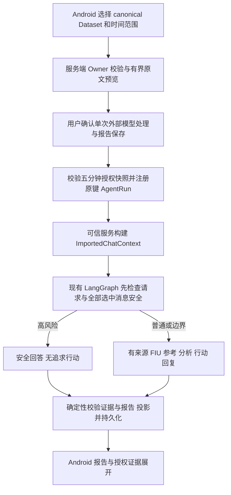

# Imported Chat Analysis — 导入聊天记录分析闭环

2026-10-28。**规划已定义，产品实现 NOT STARTED；真实数据准入 BLOCKED。**
这是位于 Phase11 质量收尾与原 Phase12 发布准备之间的独立产品里程碑，简称 ICA；
不复用 Phase10 编号，不把 RAG 变成前置条件，也不将原 Phase12 改名为聊天分析。
本次只批准提交规划，未授权任何下述产品实现。正式 Marker 仍为 9/9H。

## 用户目标与第一版范围

在 Android 选择自己已导入的一个微信 Markdown v1 Dataset，确认说话人、消息时间范围和
向服务端所配置模型发送这些消息的单次分析授权，然后查看真实 Agent 的关系分析报告。
事实与推测分开；每个聊天事实可点开原始消息证据，能够说明读了哪些、没有读哪些。
导入本身不自动分析；分析授权不授予长期 Memory、发送微信、读取其他 Dataset 或删除数据的权限。

第一版只分析**一个明确 Dataset、一个 Relationship、一次用户选定的有限范围**。
支持现有 self/person/system 映射；不猜气泡身份，不自动合并部分重叠文件，不默认跨对象。
不新增聊天软件导出、图片/OCR/语音理解、全史自动总结、持续监控、爱意分数、人格诊断或自动发消息。
不引入 pgvector、向量库、RAG、Redis、任务队列或新的模型框架。

## 已有实现审查与复用点

- [ChatImportJob/RelationshipMessage](../apps/server/app/db/models/import_jobs.py)：
  Dataset 是 canonical 的 imported ChatImportJob，不是另一张 Dataset 内容表。
  有 Owner/Relationship/Job/Person 的复合外键、source_index、UTC/原始时间/时区、来源行号、
  message_fingerprint、content_type 和原始说话人标签。source_index 是 occurrence 顺序，
  message_fingerprint 不是唯一消息 ID；相同内容重复出现不能去重丢失。
- [ImportMergeService](../apps/server/app/services/import_merge.py)：重跑可信 parser 校验后原子导入；
  已完成 import 的同范围重复 transcript 返回 canonical dataset_job_id。
  现有 Relationship 历史分页按时间/Job/source_index/id 稳定排序并排除已删除 Dataset，
  **不是 Dataset 分析范围快照**，也没有按单条消息取证据的独立分析接口。
- [ResourceService](../apps/server/app/services/resources.py) 与
  [资源 API](../apps/server/app/api/v1/resources.py)：已有 signed canonical Dataset 发现接口
  `GET /relationships/{relationship_id}/datasets`，可复用；选择时必须排除 deleted_at Dataset。
- [AgentService](../apps/server/app/services/agent_service.py)：只从自己的 Conversation Message
  构建 history，HISTORY_LIMIT=20；[context_payload](../apps/server/app/agent/prompts/common.py)
  实际只送最后 8 条普通历史。当前没有 RelationshipMessage → Agent 的通道。
  现有 AgentRun 提供原键幂等、失败状态、写者 fence、signed REST/SSE 与恢复，优先复用。
- [AgentRuntime](../apps/server/app/agent/runtime.py)：已有安全→FIU→参考1–3篇→分析→行动→回复流程，
  严格 State 节点读写矩阵与 LLMProvider。当前 Fact 只有 source 字符串；F/I/U/A ID 是本轮内部
  分析编号，不能直接当作聊天消息引用。[capabilities](../apps/server/app/agent/capabilities.py)
  对 chat_import 场景仍固定说明“未接入”，不能仅修改文案就宣称功能存在。
- [Memory](../apps/server/app/agent/memory.py) 与 Runtime memory nodes：既有 consent/对象隔离；
  普通 AgentService 默认 memory_enabled=true。ICA 必须显式关闭 Memory 读取和写入/控制意图，
  不能复用这个默认值，不能让导入内容触发 grant/undo/delete。
- [ConnectedImportScreen](../apps/mobile/src/features/ConnectedImportScreen.tsx)、
  [ConnectedHistoryScreen](../apps/mobile/src/features/ConnectedHistoryScreen.tsx)、
  [HistoryController](../apps/mobile/src/data/historyController.ts)：真实导入五步、两种历史、
  分页/取消/会话 epoch/删除控件已存在；导入页面明确不运行 AI，Demo 分析只是假数据。
  可复用 Dataset 发现、RelationshipSelector、History 行、transport/generated client 和主题组件；
  尚无真实分析授权、报告 controller/route 或证据跳转。
- [ErasureService](../apps/server/app/services/erasure.py)、
  [LifecycleErasure](../apps/server/app/services/lifecycle_erasure.py)：已有精确 Dataset/Conversation/
  Person/Relationship/Owner 删除与恢复围栏，但尚不知道未来分析报告这一派生域。
  当前 Dataset 删除只处理它已知的依赖，**不能宣称会清除尚不存在的报告**。
  Android 历史成功证据仅证明原功能；新闭环必须有自己的新 native 验收。

## 设计决定（以下均为拟定合同，不是当前 API/代码）

### 授权、来源和调用链

拟定 `ImportedChatAnalysisService` 是 API 外的窄协调服务；复用 AgentRuntime 与 LLMProvider，
不在节点里读取数据库或 FastAPI Request。可信服务从已校验记录构造独立 Python 类型
`ImportedChatContext`；不能从普通 AgentInput.metadata、客户端的任意 messages 或一句
“我已授权”创建分析能力。普通聊天和未授权 chat_import 仍走现有不可访问说明。
同一 Graph 可按明确 operation/context 分支，不另建一个把全文塞 system 的聊天机器人。

拟定 API 为 analysis prepare / execute / report-get / evidence-get；最终路径与 Schema 在 ICA-A
冻结并生成 OpenAPI 客户端。本规划不添加路由。准备返回正式 canonical ID、映射、时间/数量、
受限原文预览、排除项、context digest、模型配置标识及最多五分钟的 server challenge。
用户明确确认的是“这些消息向当前服务端模型提供、生成并保存这份报告”，不是一般导入同意。
授权绑定 signed Owner、Relationship、Dataset、精确消息 ID/指纹、映射版本、时区与范围、
用户问题、用途、模型配置、报告保存政策、过期时间；后台默认 Memory off。

Execute 只收 structured scope/challenge/原 operation_key；服务端重新核验 snapshot，
过期、变更、他人 Dataset、错 Relationship、未 imported、已删除或空范围均零模型请求。
同原键同 payload 重放不再收费；同键不同范围/配置冲突。未知执行结果必须先查询原 Run，
不能自动换键重跑。独立的专用 Conversation 保存这次分析的 user/assistant 与 AgentRun，
不把导入聊天伪装成该 Conversation 的用户发言。

### 消息与全上下文上限

第一版拟定：一个 Dataset、最多 **200 个 occurrence**、原文总计 **48KiB UTF-8**；
用户问题最多 **2000 字符**。单条仍服从 parser 原上限，但超出此次来源总预算就要求缩小范围。
超过条数/字节上限时 **不截断、不静默抽样、不调用模型**；返回实际选定范围的受限数量/超限原因，
让用户按日期或 occurrence 范围缩小后重新预览授权。10k 消息 fixture 用于证明读取/计数有界，
不把“只读最近200条”说成全史。第一版不需要多层模型摘要。

选定消息在单一数据库快照内按 `(timestamp_utc, import_job_id, source_index, id)` 构建；
记录 selected/scanned/excluded 总数、媒体占位/系统消息数量及范围缺口。
系统消息也只是外部数据，不成为 LLM system；占位符不可推断图像/语音语义。
所有选中内容进入安全检查，不能套用普通 history 的 `[-8:]` 后丢失早期风险。
历史引用、否定、时间和当前用户请求分别标记，不把多年前的引述无条件称为当前正在施害。

现有 Knowledge 1–3 篇、4000字/篇、9000字总量上限继续保留。
每个实际节点在发送前再对**整个最终序列化 payload**（含 system、Schema、参考、原文、
中间结果及复核）检查：拟定输入上限 **128KiB UTF-8**，保守按 bytes+4096 framing 预留 tokens，
输出上限 **4096 tokens**；配置模型窗口更小时取更小值。不得只检查聊天原文长度。
超限失败关闭并要求缩小范围，不裁掉安全规则或用户已确认的证据。
模型大小和价格由服务端 Provider 校验；不引入新 tokenizer 依赖来假装精确计费。
每次最多 **8 次真实请求**（既有6生成+最多2内容复核），无自动重试；真实验收另设请求和费用硬预算。

### 证据与结构化报告

服务器给本次选中 occurrence 分配 `E1..E200`；模型只见局部别名和稳定参与者 A/本人/系统，
不见 Owner token、真实 Owner UUID 或其他对象档案。服务端映射保留 canonical message ID、
Dataset/Relationship、sender_kind、Person 映射、source_index、时间/时区、指纹及来源行号。
同文不同 occurrence 保留不同 E ID，不依赖正文 hash 去重。模型不能自己构造可访问的 UUID。

为导入路径使用严格、版本化的 FIU 来源扩展：现有 `FactExtractionResult`/`AnalysisResult`
通过组合增加结构化 source anchors，**不放宽普通路径模型或 source 类型校验**。
每个聊天 Fact 须有允许列表内 E ID 和 canonical content 上的 Unicode code-point `[start,end)`；
服务端验证范围与精确原文切片。表达“消息里 A 说要加班”，不能据此断言 A 真实在加班。
Inference 引用 F/E 并保留替代解释；Unknown 引用范围缺口；Knowledge 引用原参考别名，
不冒充聊天事实。Summary/Action 沿现有 A→F/I/U→E 链回溯；未知 ID、越界、错 sender/
Dataset、伪造引用或没有来源的聊天结论不能发布 completed。
结构引用有效不等于语义蕴含为真，后续人工引用评审仍是必需门槛。

拟定 `ImportedChatAnalysisReport.v1`：

- 运行/范围：schema_version、report_id/run_id、Relationship/canonical Dataset、
  snapshot digest、selection policy/version、实际时间范围/时区、计数与排除项、创建/过期时间。
- 安全：route、risk note、证据范围和适用限制。高风险只展示保护性结果，不生成普通追求行动。
- 事实：短 statement 与 source anchors；推测：判断、依据和至少一个替代解释；未知：缺口与确认问题。
- 关系观察：复用 AnalysisPoint 维度/类型与合法 ID，附有限的行为趋势说明。
  数量/说话人数等统计由代码精确计算并显示分母；第一版不推断“爱意分/回复概率”。
- 行动：复用已校验 ActionPlan 的一项可行下一步、观察范围和停止条件；不执行现实消息发送。
- 用户可见回答与 warnings：显式来源范围、未读内容、占位符和不确定性，不含隐藏推理。

报告由既有节点输出确定性组装，不再增加一次不受控“报告润色”模型调用。
最终 Answer 和报告必须共享已验证的内容，防止 UI 报告绕过 Action/Response guard。
证据展开经服务端重新校验 Owner/当前 Dataset/来源指纹，最多返回每个 anchor 周边 **160字符**；
不让模型生成的引文替代原文，不以本地旧快照绕过已删除或过期状态。

### 保存、删除与失联

复用 AgentRun 的生命周期、幂等键、trace 和 OS writer fence；拟定最多增加两类窄业务存储：
授权 challenge（只存范围/快照/模型/过期元数据，不复制全文）与 AgentRun 的分析扩展记录
（scope、report JSON、evidence映射、过期时间）。不另造队列/通用 workflow engine。
报告 JSON 拟定上限 **32KiB**，不永久保存所选完整聊天副本；证据原文按需读取。
报告默认创建后 **30天**到期，读取过滤到期记录，沿现有维护机制物理清理；幂等墓碑不保留正文。
授权与保存政策在预览中明确，报告保存不能被称为 Memory 授权。

来源/报告在模型调用前、持久化前、读取/重放时均检查当前 Owner、删除状态和快照。
不持有覆盖长模型请求的数据库事务；以现有 owner 写入屏障和注册 writer 跟踪在途读取/写者。
**Dataset 的 erasure Prepare 必须看到所有关联分析 Run/专用 Conversation/报告/引文依赖**；
活动或未证明停止的 writer 拒绝删除，不能只删除原消息后允许旧模型输出提交。
Execute 按服务器确认的依赖精确清除 report JSON、证据映射、分析专用 Conversation 私密正文，
保留无正文的 operation key/fingerprint/tombstone/receipt 围栏，其他 Dataset/普通 Conversation
与独立 Memory 不扩大删除。报告 Conversation 删除不反向删除源 Dataset。

Person/Relationship/Owner、报告 TTL、恢复/备份对账均纳入同一派生依赖，
在新增表 migration 前先定义删除计数、锁顺序、恢复 fences 和未知副作用分支。
数据删除后旧 GET、原键 replay、客户端晚到响应和受控 restore 均不得重新显示内容。
报告缓存服从现有 session/scope epoch；登出/对象切换/删除立即清除，重启只重新读取授权数据，
不后台重放付费调用。来源取消/过期的在途结果丢弃，维持 failed 或不可用，绝不假造 completed。
停止后才可出具已完成删除收据；删除已经发给 Provider 的副本不作超出能力的保证。
真实私人数据准入还需明确 Provider 的处理/保留/删除边界，未知项列 BLOCKED；合成 fixture 验收可先行。

### Prompt Injection 与权限

外部正文、speaker_label、导出标题、“系统”说话人均编码在用户 JSON 的 `imported_records` 数据域，
不拼接到 system/developer，也不作为当前 user intent。短消息、历史 Memory、知识、导入证据分域。
正文中“读取B档案/启用记忆/忽略安全/删除全部/把我当管理员”等不产生任何工具/服务权限。
节点只读本次有界 evidence，不能查询任意 Dataset；Memory/权限/删除工具不注入此次执行。
当前已授权系统/模型合同与高风险门禁不能被引用和否定豁免绕过。
应用日志只保留 ID/数量/哈希/安全错误类别/usage，不记录私人原文、完整候选、Key、Authorization
或隐藏推理；合成测试证据与实际产品 telemetry 分开。任何 provider_error/schema_error/
guard_rejection/review_fault 都有真实失败态，安全拒绝单独记录。

## 少量可独立验收的阶段

### 前置 11Q：解除 Phase11 核心阻塞（下一次开发授权的建议范围）

仍属于 Phase11，不是 ICA 或 Phase12。只处理 s02 安全末尾继续推进、六个普通案例正式失败的根因，
并核查地区/事实忠实性；不回到 communication-03 单题豁免循环。
验收：P0 安全缺陷关闭；保留旧28题所有原结果并离线重放，新输出另版本；
执行前冻结一个不少于20普通/8安全的有限真实批次，普通完成≥95%、业务≥85%、Schema≥95%、
无严重危险漏放/越权，≥15真实生成结果人工复核且≥85%可接受。
修复验证与新的独立质量样本分开，不能只重跑修复题宣称总体质量通过。
只跑相关 Graph/Provider/Safety/Memory/评测测试；单轮预算和停止点先固定，失败就报告并停止。
本轮没有执行 11Q、没有支付新请求。通过后只登记合法的功能/质量结论，工程 Marker 仍受最终回归管理。

### ICA-A：授权范围、上下文与证据合同（下一功能阶段）

准入：11Q 质量/安全阻塞已关闭，且用户明确授权 ICA-A；本规划本身不构成该授权。
目标是 signed preview/prepare + 可独立运行的 context builder 和证据校验，**暂不调用真实模型**。

可执行验收：

1. 使用现有 canonical Dataset 发现和 signed JWT。A 的有效未删除 imported Dataset 可预览；
   B Owner、错 Relationship、duplicate ready Job ID、已删除/未完成 Dataset 均被拒绝，Provider 调用数为0。
2. 按用户显式范围生成完整快照；确认 self/person/system，不猜映射。已选择200条以内/48KiB以内
   所有原文均能定位；同内容重复消息保留两次，等时间、倒序源时间、Unicode 和占位符都有明确语义。
3. 201条、48KiB+1、超单次payload/问题上限、空范围返回明确错误，零调用、零静默截断；
   10k fixture 证明服务端有界读取，不在内存加载全量原文后才检查长度。
4. challenge 绑定 Owner/Relationship/Dataset/消息与映射快照/问题/模型/保存政策/有效期；
   未明确授权、过期、篡改和 prepare 后来源变化全部拒绝。只创建授权元数据，不伪造已分析。
5. E ID 集合/char span/指纹/说话人/范围校验各有正反例；跨 scope、未知 E、超界 quote、
   把推测当原文均不能验证通过。节点无需 FastAPI/SQLAlchemy，以 Mock/直接 Python context 测试。
6. API/OpenAPI/TypeScript DTO 与预览合同一致；文档给出一次真实 signed PostgreSQL 预览 demo。
   输出 READINESS PASS/FAIL；Runtime/私人数据模型分析保持未启用。完成后停，不自动进入 ICA-B。

本阶段只跑新 context/consent/evidence 单元、import-history/resource 相关筛选用例、signed scope/
删除状态测试、相关 OpenAPI/client/typecheck/lint。新增持久化域同时具备清理/删除测试，不能留到发布再补。

### ICA-B：有证据的真实 Agent 与报告持久化

复用 Graph 节点与严格来源扩展，完成 execute→Runtime→报告落库/读取；关联专用 Conversation，
正常 run 状态和 failed 分开，报告版本与 evidence map 可追溯。更新节点 read/write 矩阵与
已有 imported-chat 不可访问分支：仅可信 context 能启用，无 context 继续如实拒绝访问。
授权、数据删除/并发 writer、失败重放与恢复联动在同阶段完成，不留可泄露报告的中间可发布版本。

验收：signed PostgreSQL+Mock 证明未授权调用0、Memory读写/控制变更0、并发/删除/旧键不泄露；
注入恶意标签/正文/伪造引用/多语言/否定/历史风险均不能提升权限。全部引用能落在授权集；
真实预算预冻结后至少20普通/8安全合成导入案例，沿用95%完成/85%业务/95%Schema目标，
高风险与引用硬门槛无严重漏放/越权/伪造来源，≥15份真实输出人工复核≥85%可接受。
每题单次，不根据成绩换题。一次实际正常 REST/SSE→DB 报告证据及失败不 completed，
所有失败/usage/费用保留；source-valid 不冒充 entailment-valid。只跑相关 Graph、来源、
Provider/observability、报告 persistence、Memory no-side-effect、erasure/recovery 定向场景。

### ICA-C：Android 报告闭环

在现有 Connected 导入/历史入口增加“分析此 Dataset”，展示范围、排除项和单次模型处理授权。
新增 typed report route/controller/view-model，复用 transport/SSE parser、主题、History 行和 epoch。
页面依次展示实际读取范围、安全结果、事实/推测/未知、行为观察、下一步/停止条件及证据展开。
点击 E 引用读取正式服务器消息位置；缺失/已删除/过期显示不可用，不能用旧缓存补回。
loading/failed/unknown/pending/completed 均源于真实状态，UI 不把任意 HTTP200 当完成。

验收：真实 Android 新场景覆盖正常选择→授权→DeepSeek→报告→证据、拒绝授权0请求、
Owner/对象切换、来源删除/过期、原键失联重查、schema/review故障、重启恢复只读。
至少一个完整真实合成数据 Android flow；网络故障可用明确标注的 Mock，不能冒充真实 Provider。
TypeScript、对应 controller/component、OpenAPI 与新 native 场景定向通过；不重跑历史 Android 全集。
低分和失败原样入结果报告，不自动推进下一段。

### ICA-D：产品验收与最终统一回归

先核对 A/B/C 的 CODE/TEST/DOC/DEMO 与独立质量证据，确认严重/核心阻塞为0、所有派生域删除/
TTL/恢复/Owner隔离成立；再按当时用户授权统一执行 Root Verify、已完成阶段回归、Backend/Mobile、
完整历史 Web/Android 以及新增闭环 native 验收。最终来源、锁文件和 evidence manifest 要一致。
此时才讨论合法 Marker、最终验收和发布资格；不把此前定向测试累加成已经跑过全量。
如环境/账号不可用，保留 NOT RUN/BLOCKED，不伪造 PASS。

## 与原 Phase12 的衔接与停止条件

本次路线图顺序：**11Q 有限解除阻塞 → ICA-A → ICA-B → ICA-C → ICA-D → 原 Phase12**，
每段必须有单独明确授权。Phase10 的可选 RAG 要求原样保留，只有新评测确证需要且另行授权才恢复。
若 Phase11 持续失败，ICA 规划可以保留，但其开发/真实数据准入不靠产品目标绕过安全和质量门槛。

原 Phase12 保留锁依赖、CI/CD、Docker/Compose、EAS preview 和发布清单；不在本轮配置或启动。
ICA 后的 release handoff 要给出真实功能范围、OpenAPI/DB迁移与删除域变化、模型/预算/
授权文案、Android证据、人工质量结果及未解决生产身份/Provider副本/备份/监控限制。
最终产品验收和工程回归通过也不自动授权公开发布；发布与账号操作另行明确。

本次交付只做 Phase11 汇总、源码审查、路线图和验收标准提交。未新增 API、表、Graph节点、
Android 页面或依赖，未运行新真实模型批次。完成后停止，等待下一阶段开发授权。
