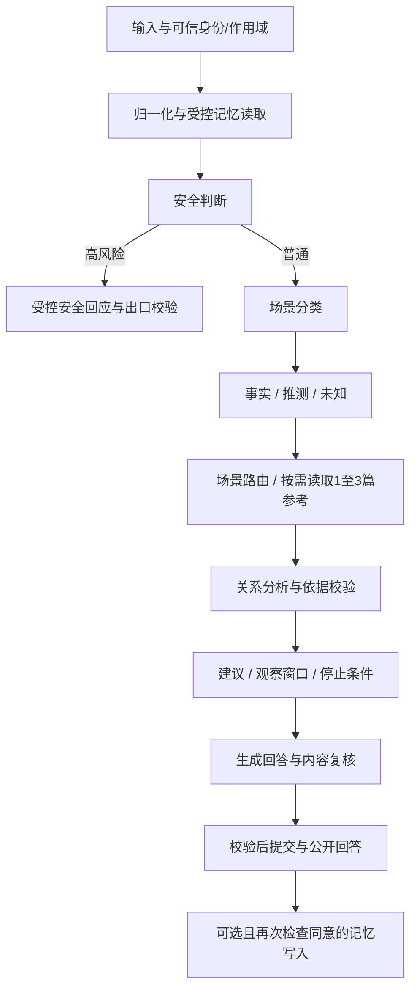
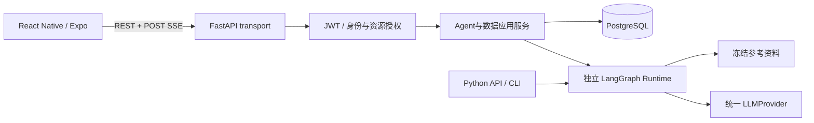

# 狗头军师 App：项目全景介绍

核对日期：2026-11-17。源码基线：`e9216180770a6e878b2247061de8fd7313ec7e81`。本轮只更新介绍与核对材料，不增加产品功能、修改 Agent 行为或推进阶段。

## 1. 项目定位

这是把 `goutoujunshi` 关系沟通与情绪支持 Skill 工程化为独立 AI Agent，再接入手机 App 的项目。用户可以围绕明确的对象和关系整理材料、询问如何回复或行动、复盘沟通，并控制自己的长期记忆和数据。

核心价值是帮助用户区分“看到了什么、可能如何解释、还不知道什么”，并给出可选择、可拒绝、可退出的小行动。项目不以读心、人格定性、爱意打分或保证挽回为目标；危险情境优先处理安全。

上游 Skill 提供行为规范与参考资料。本仓库把要求转写为合同、类型、多个执行节点、数据授权、验证器、API、App 和评测流程。Agent 可由 Python 直接调用，运行不需要 Codex、Claude Code 或其他开发宿主。

**当前定位：已有较完整工程底座和移动端业务接入的开发版本，真实模型质量及生产发布条件仍未通过。** 工程覆盖、模型质量、用户价值和生产可发布性需要分别验收，没有可信依据把它们折算成一个完成百分比。

## 2. 已实现的用户功能

| 功能 | 当前能够完成 | 实际边界 |
| --- | --- | --- |
| 首页与导航 | 首页、对话、关系资料、导入与分析、历史、设置六页面；主题切换、空/错/加载状态 | Demo 与 Connected 明确区分 |
| 对象与关系 | 创建、列出、查看 Person / Relationship / Conversation，绑定并切换业务作用域 | 尚非完整可编辑关系画像或正式账户体系 |
| Agent 对话 | 提问、查看进度、获得服务端已校验回答、读取历史、使用同操作键恢复/重试 | 模型质量未通过，无法保证每次生成成功 |
| 场景处理 | 回复、邀约、暧昧、关系判断、投入失衡、冲突、分手、长期关系、家庭、边界等分类与流程 | 路径可执行不等于所有场景建议已通过真人验收 |
| 聊天导入 | 文件选择、上传预检、说话人映射、对象与关系确认、正式入库 | 支持明确版本格式，不直接采集微信/QQ数据库 |
| 历史查询 | AI 对话与外部关系聊天分开存取、分页、隔离 | 外部聊天不会未经授权混入日常 Agent 上下文 |
| 长期记忆 | 明确同意、检查、暂停/恢复、撤回、受保护撤销、确认删除、有效期 | 当前支持 user / object / relationship 三类，不保存整段私聊或隐藏推理 |
| 数据删除 | Dataset、Conversation、Person、Relationship 的准备/确认/执行/回执 | Owner 全范围清除是私有开发操作，不等于生产账号注销 |

Mobile 主要实现位于 `apps/mobile/src/features`、`src/data`、`src/session`；服务端位于 `apps/server/app/services`、`app/api/v1`。

导入兼容微信 Markdown v1 与 ChatLab JSONL v0.0.2（Weport 导出互操作）。用户必须确认本人和对方，系统不会按气泡左右或猜测锁定身份。导入、去重/合并、正式历史和原始上传文件生命周期各有合同；支持既有格式不代表任意文件都能解析。

## 3. Agent 如何执行一次对话

这是实际 LangGraph 拆节点执行的 Runtime，主要入口为 `apps/server/app/agent/runtime.py`。节点有结构化输入输出、字段权限和类型校验，FastAPI Request / Response 不进入节点。上图是语义主线，具体状态与事件以源码合同为准。

安全判断先于普通关系分析。事实保留来源，推测保持不确定性；生成内容经过来源、联系边界、内容复核等检查。明确拒绝与高风险不能因换措辞而绕过规则。角色适配的受控安全表达已实现，但历史人工评审失败不会因此自动改分。

知识层保留冻结 Skill、references、原许可和哈希清单。按场景确定性选择 1–3 篇参考，并限制内容预算，不把整份 Skill 与全部参考塞进一个 Prompt。当前不依赖向量库、RAG 或外部 Agent 宿主。

`LLMProvider` 统一提供 `chat`、`stream`、`structured_output`。Mock 无密钥执行可控用例，OpenAI-compatible 适配器支持真实模型；历史 DeepSeek 调用用于已授权合成评测。Provider 有 `stream` 接口不代表 App 已有模型 Token 增量显示。

## 4. 后端与数据架构

当前流式传输是 **POST SSE**：过程进度、一次已校验且提交的最终回答、终止状态。最初 WebSocket 方向尚未实现。持久操作键和请求指纹让同请求重放不会再次生成、重复记忆或重复写回答。失败、运行中与结果未知会分别表达，不能把客户端断开直接当作服务端没执行。

PostgreSQL 保存用户/对象/关系、Agent 会话消息、外部关系消息、运行记录、导入 Job / Dataset、Memory、授权及最小操作回执。两类聊天分域，Owner、Person、Relationship 和 Dataset 由服务端鉴权。SQLAlchemy 管理访问，Alembic 管理迁移；模型执行不占用一条贯穿全过程的长事务。

长期记忆在明确同意后启用，并在写入时重新检查。当前默认总量最多 200 条、召回最多 8 条、单条 200 字符，受保留期和类型约束。对话记录和长期记忆是不同数据域，撤回同意、暂停和删除也有不同含义。

删除使用短时确认、精确范围、幂等操作与回执。活动写入、授权撤回、运行恢复和隔离恢复各有围栏。已有维护 CLI、资源准入和受控恢复验证，但生产调度、独立灾备和所有外部副本的删除尚未部署。

## 5. 导入聊天分析 ICA 到了哪一步

ICA（Imported Chat Analysis）希望从明确授权的聊天范围中识别可能的情绪回应错位、重复冲突和两个时间窗的互动变化，同时保留反例、后续修复和未知。它在日常 Agent 对话之外单独授权。

已实现的工程部分：

1. **ICA-A 范围与证据底座**：按 Dataset、对象、时区和日期确定范围；近 3/7 天、自定义及最多双窗；覆盖、分片和缺口；签名 prepare / confirm、短时 challenge、操作幂等、撤回与过期。
2. **ICA-B1 Mock 执行与报告**：独立执行确认；先完成全范围安全检查，再提取互动候选，有候选时检查所有 core 的反证，然后综合报告并独立复核。可返回信息不足，不强迫产生发现。
3. **证据追溯**：消息 UUID、speaker、Unicode 字符范围；`quote-v2` 使用 alias、真实 speaker、精确唯一原文，由服务端解析 canonical span。错人、歧义、越界或当前授权/来源失效会拒绝。
4. **生命周期**：派生执行与报告受撤回、TTL、删除、活动 writer 和隔离恢复约束。ICA 不写长期记忆，也不获得联系对方或发送消息的权限。
5. **评测工具**：独立合成案例、一次性计划、预算准入和账本、版本/来源冻结、可读报告及人工评分包。

**服务端产品执行默认关闭且仅允许 Mock；App 没有范围确认、分析报告、反证及原文回看产品页面。** 客户端生成了相关合同不等于功能已接通。真实 DeepSeek 仅由隔离合成评测工具调用，不代表用户能上传真实聊天后启动真实分析。

v3 约束包含总量 10,000 条、2 MiB、K≤32、每 core≤200 条等独立准入条件；仅按条数已至多约 6,400 条，还可能因字节/分片更少。允许最长 367 天日期窗不代表完整年度聊天容量或质量已通过。历史 900/2,100 条 Mock Demo 只证明工程接线。

参考：[ICA-A完成](ICA_A_V3_COMPLETION_ACCEPTANCE.md)、[ICA-B1](ICA_B1_ACCEPTANCE.md)、[quote-v2修复](ICA_BQ_R1_ACCEPTANCE.md)、[v2真实评测](ICA_BQ_V2_ACCEPTANCE.md)。

## 6. 技术路线及选择理由

| 层 | 当前采用 | 作用 |
| --- | --- | --- |
| Mobile | React Native 0.86.3 / Expo 57.0.30 / React 19.2.3 | 复用客户端代码，同时保留原生平台适配 |
| 类型与导航 | TypeScript 6.0.3 / Expo Router 57.0.28 | 严格类型、六页面路由和作用域控制 |
| API客户端 | OpenAPI / openapi-fetch 0.17.0 | 唯一合同生成 TypeScript，检测漂移 |
| 原生令牌 | Expo SecureStore | 原生安全存储；Web会话仅内存 |
| Backend | Python 3.12–3.14 / FastAPI / Pydantic Settings | 类型校验、配置和独立transport |
| Agent | LangGraph / TypedDict State / Pydantic数据合同 | 可拆节点测试、显式控制流和安全出口 |
| 持久化 | PostgreSQL / SQLAlchemy / Alembic | 事务、资源隔离、操作键、删除和迁移 |
| 模型 | LLMProvider + Mock / OpenAI-compatible | 统一边界、可控离线测试与真实调用观测 |
| Knowledge | 冻结Markdown / 场景路由 / 哈希校验 | 保留规范、限制读取、追溯版本 |
| 测试 | pytest / unittest / Jest / Playwright | 节点、数据服务、合同、UI、Web和回归 |
| 工程管理 | uv / pnpm 11.25.0 / lockfile / Make入口 | 锁定依赖、复现和阶段门禁 |

具体版本以 `pyproject.toml`、`uv.lock`、`apps/mobile/package.json` 和 `pnpm-lock.yaml` 为准。上表描述本仓库的已选技术，不宣称是行业最新版本。本轮无新增依赖或升级。

未提前引入 Redis、Kafka、Kubernetes、微服务或独立向量库。可选 RAG 计划采用 PostgreSQL / pgvector，但 Phase 10 已明确暂缓，现有功能无需 RAG 也可工作。`compose.yaml` 仅提供本地 PostgreSQL，不代表全部服务已生产容器化。

## 7. 质量与验收的真实情况

正式工程标记仍为 **9/9H**。Phase 0–9 的历史工程验收包含 Runtime、签名 API、PostgreSQL、Web 和 Android，是对应当时源码的证据。Phase 11 质量与 ICA 定向验收不能自动推进正式标记。

| 证据 | 已知结果 | 意义 |
| --- | --- | --- |
| Phase11独立真实评测 | 普通完成14/20；原去重人工可接受8/28 | 工程可调用，但质量门槛失败 |
| ICA-BQ-v2 | 普通完成10/22、9/22；64次运行中28完成、34失败、2未运行 | 未达95%完成门槛；引用有效不等于语义正确 |
| ICA-v2人评 | 可读包已导出，正式评分待真人 | 助手不能代填或改为通过 |
| 本次定向核对 | Backend309、Mobile413、TypeScript、OpenAPI52、codegen3通过；独立Mock Demo成功 | 所选范围当前可测试，不能替代完整回归 |
| 本次根验证 | `make.cmd verify` exit1：9H current-source/baseline scope drift | 当前源码尚未获得新的完整根验收 |

主要质量问题包括生成完成率、统计/证据校验失败、内容复核拒绝、场景或角色表达适配及人工接受度。后续应按有限范围修复，再用新独立保留集验收，不修改已知案例或降低门槛制造 PASS。

本次没有真实 Provider 调用，也未重新执行 PostgreSQL/Web/Android 全量链路。命令与日志见[本次核对报告](PROJECT_STATUS_2026-11-17.md)。

## 8. 距离最终产品还差什么

| 方向 | 尚需完成 |
| --- | --- |
| Agent质量 | 关闭完成率和安全沟通问题，完成独立真实模型及人工验收 |
| ICA真实执行 | 在模型/预算/来源/授权约束下验收真实报告，而非只允许Mock |
| ICA手机体验 | 范围与费用确认、覆盖缺口、运行/取消/过期/结果未知、报告和原文反证查看 |
| 长周期能力 | 月/季/年分别验收容量、全范围安全、事件索引、分层汇总、复核、预算和质量 |
| 统一终验 | ICA-D与Phase11收尾；当前源码重过全部已完成阶段回归，历史证据保持原样 |
| 正式身份 | 注册登录、刷新/撤销、账户生命周期；当前开发JWT不能代替 |
| 生产运行 | HTTPS/入口、权限和密钥、监控、维护监督、备份轮换、独立灾备和删除传播 |
| 发布链路 | Phase12 CI/CD、EAS预览、签名构建和发布准备；当前无工作流与EAS配置 |
| 平台验收 | Android历史验收不替代新增功能验收；iOS设备验证和发布证据尚缺 |

移动端还没有离线模型、持久待处理 outbox 和完整跨重启自动对账。是否实现需后续明确产品范围，不能写成已承诺交付。

路线见 [Master Plan](MASTER_PLAN.md)、[ICA长周期规划v4](ICA_LONGITUDINAL_ROADMAP_V4.md)。规划可能早于后续实现，应与最新验收和代码交叉核对。

## 9. 最终希望实现的体验

通过剩余质量、移动体验和发布门槛后，用户应能：

1. 正式登录 App，选择对象、关系和当前目标，获得与材料相符的沟通支持。
2. 导入支持格式的聊天，确认说话人、时间范围、覆盖缺口和预计成本，再单独授权分析。
3. 在已验收容量内获得少量重点发现：哪些回应可能没接住情绪，哪些问题重复，两个时段有什么可观察变化；同时看到修复、反例和信息不足。
4. 从发现返回授权范围内原文，区分事实、解释和未知，并获得可核实的问题、小行动和停止条件。
5. 在分别通过容量与质量验收后，按月、季度或年度复盘；分层摘要可回到事件与原文，不能把摘要当作事实。
6. 决定是否保存长期记忆，随时查看、暂停、撤回和删除，理解删除回执与保留边界。
7. 危险情境优先得到适合角色的安全支持，始终保留决定权。

这是目标体验，不是当前可发布清单。上传 GitHub 完成的是源码托管与说明，不等于服务器部署、App上架或真实质量通过。

## 10. 阅读与来源

建议从 [README](../README.md)、本介绍、[本次状态](PROJECT_STATUS_2026-11-17.md)进入，再读 [MASTER_PLAN](MASTER_PLAN.md)、[ARCHITECTURE](ARCHITECTURE.md)、[SKILL_CONTRACT](SKILL_CONTRACT.md)及对应阶段报告。历史报告保留当时边界，不能把旧的“未开始”直接当作今天现状。

上游 [goutoujunshi](https://github.com/shengjidaguai-china/goutoujunshi) 冻结于 `6db7354a4002dc7c448a9c87ffdad8132570c9d3`；保留[MIT许可和署名](../knowledge/goutoujunshi/LICENSE)，Copyright (c) 2026 powerycy，哈希见 `knowledge/upstream-manifest.json`。本次未修改上游内容。
