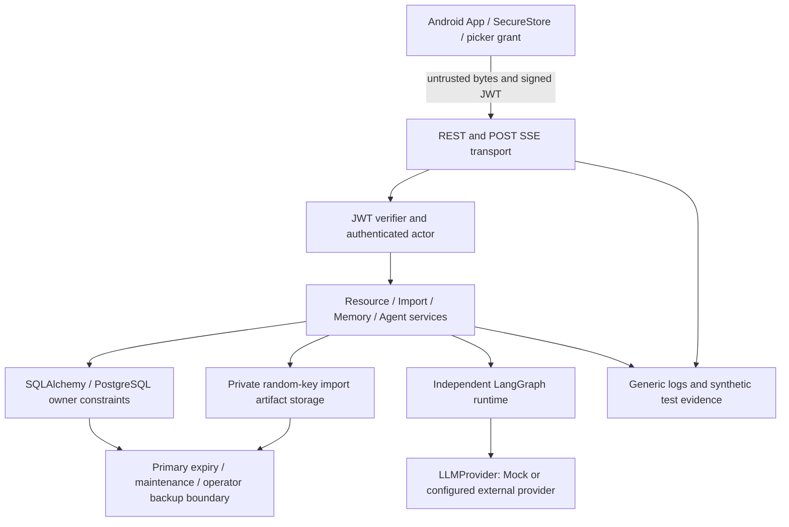

# Security threat model — current Phase9H

## Current9H authority

Current9H adds active identity/write barriers, exact structured deletion snapshots,
minimal durable receipts, OS writer-stop proof and quarantined current-primary
restore checks. Trusted shared private filesystem/DB roles are deployment
assumptions. Missing writer or deletion authority stays fail-closed. Production
identity, public ingress, monitored scheduling, external copies and total-primary-
loss recovery remain separate blockers. Earlier phase-specific capability claims
below are historical; the Current9H supplement defines the current boundary.

## Historical phase-specific contracts

### Security threat model — Phase 9A

Current9G B3/B6/B9 audit: actual SafetyResult node precedes ordinary relationship
analysis and Memory mutations in both signed REST/POST SSE; semantic Mock fixtures
cannot certify real-model risk recognition. Current/history/speaker/Memory JSON
data cannot create LLM system roles or API actors/challenges. Imported Markdown
and RelationshipMessage remain outside Agent payloads. High-risk graph witnesses
skip all ordinary/action/mutation nodes; lower-risk controls continue normally.
See AGENT_UNTRUSTED_INPUT for exact future Provider/RAG/tool authorization gates.
Actual file publication remains charged under its exact OS-fenced reservation;
unrelated/foreign unknown-file exceptions reject. Real global-lock contention
provokes55P03/generic503 before any Person commit; explicit original-UUID retry
after release works. This does not establish prior transient root causes or fix
availability. Thirty-day pending/running/completed-unresolved Runs still block
Conversation erasure. No age reset, new-key bypass or reconciliation tool exists;
AGENT_RUN_RECOVERY specifies design-only writer/effect proof. Exact native
executable-input equality and fresh full service regression are separate gates.
Full account/lifecycle/recovery and public deployment risks remain unfinished.

Current9E supplement B3/B4/B8: signed owner-only canonical Dataset/Conversation
challenges bind target/Relationship/snapshot/counts/expiry. Execute stores durable
receipt and tombstone while physically deleting exact formal messages; no body
matching, cascade enlargement, Memory deletion or client-confirm bypass. Owner and
domain locks fence duplicate/concurrent work; active/unresolved AgentRuns block.
Cross-owner challenges/receipts and stale snapshots fail; original keys replay only
metadata. Deleted Conversation creation/Agent access and deleted Dataset exact-scope
reimport are fenced. Current-primary recovery propagates exact target tombstones,
copies immutable receipts, invalidates challenges and rejects missing/tampered/lagging
authority. Independent journal, production identity/full-account erasure, monitored
scheduler/encrypted copy custody/rotation and live cutover remain absent. R-06/07/08/09
reviewed separately in PHASE_9E_RISK_ASSESSMENT; App erasure is Backend-only. Older
paragraphs remain dated assessments, not current capability or production claims.

Current9D supplement (B5/B8/B9): scheduled local maintenance executes bounded
Memory expiry/challenge cleanup, all-state Job-locked raw-source cleanup and9C
actual-file quota reconciliation with OS-owned multi-process exclusion. Failure,
timeout, file/DB mismatch and actual post-unlink process death are tested without
premature budget release. B3/B7 preserve exact signed-owner challenges/receipts,
original retry keys and fixed metadata-only output. Native synthetic PostgreSQL
dump/restore now demonstrates that an old snapshot contains deleted Memory;
quarantine and authoritative current-primary exact-ID/control/key reconciliation
prevent serving it. B8 still assumes a complete intact current primary and private
operator isolation: no independent production deletion journal/WAL, recovery switch,
encrypted backup rotation or installed monitored scheduler is deployed. Current
R-06/R-09 limits and absent full-data erasure APIs are explicit in
PHASE_9D_RISK_ASSESSMENT and DATA_DELETION_CONTRACT. No real provider/Agent changes.

Current9C supplement updates B2/B5/B9: rate/auth/atomic reservations run before
Multipart receive; one-file/two-field parsing, per-receive idle/total deadlines,
bounded speaker registration, Owner/global actual-file accounting and shared
upload/finalize slots are tested with real signed PostgreSQL and two TCP workers.
OS-owned fences prevent reclaiming a still-writing worker after DB backend loss.
Body/partial/artifact-before-commit crash recovery retains charges and protects
live sources from orphan cleanup. B7 retains fixed safe logs and count-only,
operator-only finite metrics. Historical "no admission" paragraphs describe9A/9B,
not current code. Public ingress/TLS/non-upload body/header/connection limits,
supervision, physical allocation/RSS and monitored retention remain explicit
R-07/R-06 production conditions; R-09 deletion/identity and R-08 future analysis
remain outside this task. No new model/Agent/DTO/knowledge behavior is introduced.

Scope: repository HEAD `08563c3` as the Phase 8 baseline, followed by the 9A
changes. Assessment date: 2026-10-13. This is a development-system engineering
assessment, not production certification. Frozen Skill, Golden Cases, Agent
nodes/prompts and the 36-operation OpenAPI contract remain unchanged.

## Trust boundaries

Attacker classes: unauthenticated HTTP sender; authenticated Owner B attacking
Owner A; authorized owner submitting malformed files or repeated operations;
network observer on development HTTP; future malicious provider/chat content;
privileged operator or compromised host. The last class can bypass filesystem
and database access independently of API authorization. Private storage roots,
OS ACLs and signing-key custody are required assumptions, not API guarantees.

STRIDE labels below mean spoofing, tampering, repudiation, information disclosure,
denial of service and elevation of privilege. Risk IDs refer to the
[risk register](SECURITY_RISK_REGISTER.md); tests refer to actual code, not just plans.

### B1 — Android to HTTP transport (S/T/I)

- Assets: bearer credential, selected transcript, owner/scope UI state.
- Attacker/input: hostile filename/MIME/URI, network interception, stale async result.
- Authority: server-signed JWT; picker grant only authorizes local file access.
- Paths: redirect credential theft; cleartext interception; owner switch while upload finishes.
- Controls: central ApiTransport, HTTPS outside explicit private development hosts,
  `redirect:error`, `credentials:omit`, credential replacement, cancellation/epoch
  guards; native SecureStore; owned cache-copy release; no provider keys in Mobile.
- Risk/evidence: P2 R-07/R-09; Mobile connected/filePicker/session/error tests,
  existing Android 8F matrix and root Mobile boundary scan. No 9A native retest
  or claim of production certificate pinning, encrypted transcript cache or remote wipe.

### B2 — HTTP to authentication (S/D/E)

- Assets: authenticated actor, protected Job creation and credentials.
- Attacker/input: absent/forged/expired JWT, duplicate headers, forged owner fields,
  chunked/false Content-Length upload.
- Authority: fixed HS256 verification of signature/sub/exp/iss/aud; existing User
  is checked by services. Filename or transcript metadata cannot issue an actor.
- Paths: bypass dependency; spool excessive body before authentication.
- Controls: verified dependency before artifact `begin`; receive byte cap plus
  exact file-byte check. Framework form parsing currently precedes dependencies.
- Risk/evidence: current authorization P0 risk controlled; aggregate upload/slow
  clients P2 R-07 only under local development conditions. Auth-before-artifact,
  signed A/B, chunked-limit and actual TCP disconnect tests in `test_upload_security.py`.
  Authentication does not by itself prove object authorization; no production issuer/refresh.

### B3 — authenticated actor to services (T/I/E/R)

- Assets: Jobs, bindings, Person/Relationship scope, Memory and Agent effects.
- Attacker/input: Owner B knows A's UUID; stale revision, injected self/tool/owner text.
- Authority: actor only; owned SQL queries and explicit binding, never speaker name.
- Paths: inspect/edit/ready/finalize/cancel foreign job; attach foreign resources;
  execute old artifact after terminal status.
- Controls: owner-neutral 404, explicit self/person binding, readiness inventory,
  revision fences, locked Job state machine, guarded Memory confirmation/replay.
- Risk/evidence: P0 paths controlled by complete foreign-operation matrix and
  binding-target tests; original Import/Memory/Auth regression retained.
  Wider authorization/deletion audit remains subsequent Phase 9 work (R-09).

### B4 — services to SQLAlchemy/PostgreSQL (T/I/D)

- Assets: atomic Job/artifact metadata and formal imported occurrences.
- Attacker/input: NUL labels/body, date overflow, conflicting dataset and concurrent cancel.
- Authority: owned Job locks, composite owner/resource foreign keys and unique indexes.
- Paths: invalid text reaches DB; SQL errors reveal schema; partial merge;
  cleanup/finalize compete on stale state.
- Controls: NUL fatal parse failure, bounded error samples; generic errors/logs;
  rollback, transaction-local staging, readiness recheck under lock and exact-dataset
  advisory lock. Legitimate duplicate text/time keeps separate occurrence IDs.
- Risk/evidence: R-01/R-02 fixed; upload rollback, trigger-induced merge rollback,
  repeated finalize and cancel/finalize race tests. PostgreSQL tests use disposable
  migrated databases; no production DB availability/timeout or all-system transaction audit claim.

### B5 — import service to private artifact storage (T/I/D)

- Assets: raw transcript bytes, private path, file handles and expiry metadata.
- Attacker/input: traversal/absolute/device/Unicode/long filenames, collision,
  interrupted writes, tampered source, disk/cleanup failure, local symlink.
- Authority: random validated server key; caller filename discarded. Root is trusted config.
- Paths: path injection, overwrite at publication, leaked orphan, stale source reuse.
- Controls: exclusive `.part`, atomic non-overwriting same-filesystem hard link
  publication, no-follow open where available, symlink refusal, hash/size recheck,
  terminal receipt replay without reopening raw data; explicit orphan maintenance.
- Risk/evidence: R-03/R-04 fixed; filename/key matrix, publication race, tamper,
  lifecycle, cleanup failure/retry tests. Real Windows symlink refusal passed in
  the approved host execution against an isolated harmless target; the initial
  sandbox-only run skipped creation because its OS token lacked privilege.
  Root ACL/reparse-point attacks by host writers and scheduling are R-06 deployment prerequisites.

### B6 — imported data to Agent/LLM provider (T/I/E)

- Assets: tool authority, safety order, prompts, Memory consent, provider privacy.
- Attacker/input: instructions in Markdown bodies/labels/provider output.
- Authority: independent Agent caller and explicit owned Conversation; bounded
  server prompts/structured validation; Memory consent and scoped provenance.
- Paths: treat imported text as system message or allow unsolicited external analysis.
- Controls: RelationshipMessage is separate from Message; import composes no Agent,
  provider or Memory workflow. Import never interprets instruction text.
- Risk/evidence: injection-as-data test, original Agent isolation and Phase 6 E2E;
  R-08 is a future integration prerequisite. No imported-chat analysis exists.
  Future owned source selection, explicit authorization, bounded untrusted-data
  envelope and injection evaluation must precede any such integration.

### B7 — application/errors to logs and evidence (I/R)

- Assets: credentials, raw chat/Memory evidence, SQL, filesystem layout.
- Attacker/input: exception text, SQL errors, native subprocess command arguments.
- Authority: application-generated fixed messages; test fixtures are synthetic.
- Paths: Starlette safe 500 re-raised to Uvicorn; TimeoutExpired serializes command/token.
- Controls: response projection, disabled access logs, Uvicorn exception filter;
  count-only cleanup warnings; private subprocess wrapper suppresses chained
  errors, args/stdout/stderr. Mobile allowlists public codes and discards raw errors.
- Risk/evidence: R-01 fixed; real socket SQL and unexpected-error capture, fake-token
  subprocess/redaction tests; read-only 131-file historical screen and provenance review.
  Regex screening cannot establish absence of arbitrary private prose. Production
  collectors/rotation and developer debugger dumps remain R-06/R-09 responsibilities.

### B8 — primary retention to maintenance/backups (I/T/R/D)

- Assets: expiring raw imports, scoped Memory, durable mutation/key fences.
- Attacker/input: missed maintenance, failed deletion, restore of older consent/data.
- Authority: operator-owned maintenance with DB/OS privileges; no public maintenance route.
- Paths: old artifact survives physical cleanup; backup resurrects deleted Memory or replay keys.
- Controls: 72h default artifact expiry prevents new finalize; terminal deletion;
  one-hour orphan grace, generic retry warnings; Memory query-time expiry,
  bounded Memory cleanup and restore-quarantine design.
- Risk/evidence: R-03 fixed diagnostics/failure handling; R-06 unresolved production
  prerequisite. Cancel/expiry/cleanup tests prove local primary behavior only.
  Scheduler, encrypted backup rotation and actual restore replay are NOT DEPLOYED.

### B9 — concurrency/resource boundary (D/T)

- Assets: event loop, bounded Python heap, temporary disk, DB pool and atomic state.
- Attacker/input: legal parallel uploads; chunked oversized file; slow/disconnected client;
  repeated upload or same-owner terminal mutations.
- Authority: per-request file/body/parser limits and PostgreSQL transaction serialization.
- Controls: 64KiB reads, Starlette spool threshold, finite message/line/issue counts,
  linear blank trimming, closed UploadFiles and transaction rollback.
- Risk/evidence: R-05 fixed; real default-100MiB Python-allocation measurement,
  four parallel A/A/B/B uploads, finalized/cancelled race, duplicate/tamper/DB-fault tests.
  No global/per-owner rate limit, storage quota, active-body timeout or upload semaphore
  exists. Per-request bounds are not aggregate DDoS protection; R-07 must be closed
  before untrusted network exposure.

## Source and evidence limits

The [Starlette request documentation](https://starlette.dev/requests/) distinguishes
form field limits from file spooling. The
[OWASP upload guidance](https://cheatsheetseries.owasp.org/cheatsheets/File_Upload_Cheat_Sheet.html)
supports size/content checks and isolated storage. Our implementation uses
content-based strict Markdown parsing and discards filenames entirely; filename
extension allowlists would conflict with the existing API contract.
These sources guide the audit; only repository tests prove this implementation.

See [upload boundary](UPLOAD_SECURITY_BOUNDARY.md), [acceptance](PHASE_9A_ACCEPTANCE.md)
and [handoff](PHASE_9_SECURITY_RELIABILITY_HANDOFF.md) for measured results and remaining work.

## Phase 9B current supplement (2026-10-13)

Current baseline14eb9d4/8-9A. B1/B3 now have an explicit36-operation service/
repository inventory, signed A/B negative matrix and per-event Transport epoch
guard. Import History/Memory opaque cursors bind exact owned navigation scope;
SQL remains independently owner-filtered. B7 application output uses a reviewed
fixed whitelist and strips args/exception/stack/extra fields; Uvicorn access stays
disabled. Runtime/DTO/frozen behavior remains unchanged. Fresh actual Android
smoke of updated dependencies is mandatory9B evidence, not inherited8F/9A PASS.

Tests: test_authorization_security.py, test_privacy_logging.py, Mobile
authPrivacy.test.ts and retained session/controller suites. New generated markers
are runtime-only. Historical131 plus9A21 files have separate automatic credential
screening and limited manual/provenance review in EVIDENCE_PRIVACY_REVIEW_9B.

B9/R-07 remains a production blocker: local project listeners/defaults are
loopback; one-request201MiB transient disk bound multiplies with concurrency.
No global/owner rate, admission/storage quota or active-body deadline exists.
Controlled disk ENOSPC yields generic500/no Job; bounded real pool exhaustion
yields503. These faults do not validate aggregate availability. Before public
exposure require proxy/app admission, quota/deadline controls, monitored storage
and bounded pool/worker alignment plus aggregate stress and fault validation.
R-06/R-08 and production portions of R-09 remain explicit future work.

## Current Phase 9H

B10: OS writer proofs are valid only with the configured trusted private shared root,
exclusive creation, held nonblocking OS locks and protected host ACL/topology.
Missing/moved/tampered fence or legacy row is not proof of death. Lost DB access,
timeout, client cancellation and old age never authorize mutation. Matching durable
run receipts are required before bypassing the terminal run barrier.
B11: exact structured erasure uses active owner barriers and dependency snapshots;
text mentions/other-owner references cannot widen scope. Owner has an explicit signed
operator confirmation and irreversible local identity tombstone; it is distinct from
production provider account closure. External copies/backup independent authority
remain separate production trust boundaries. Raw unlink is monotonic, not SQL-atomic.
